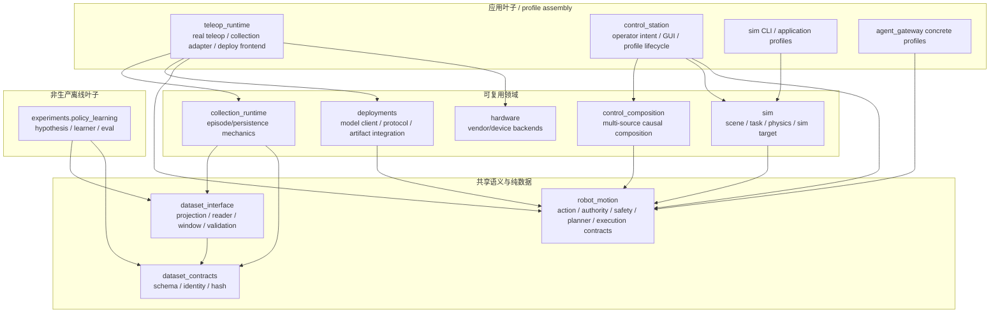
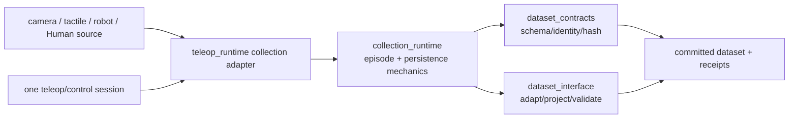
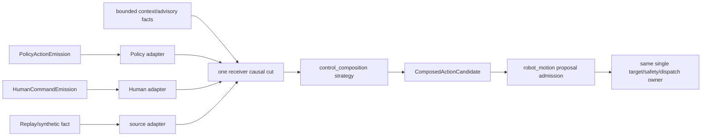
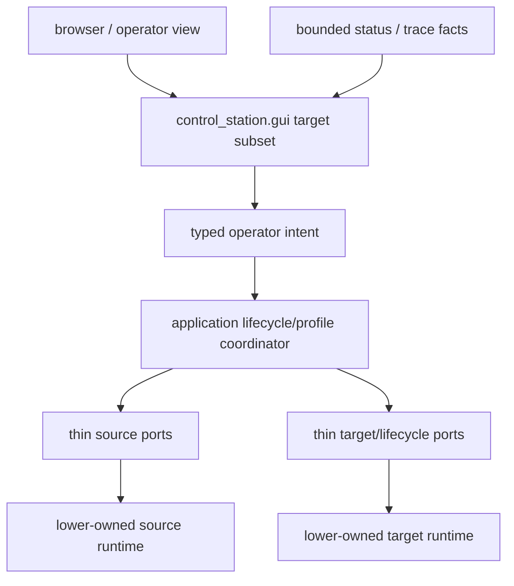
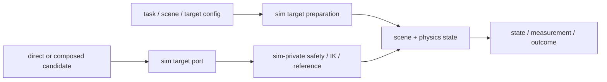
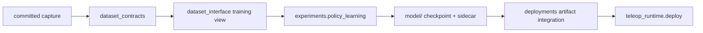
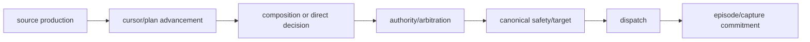
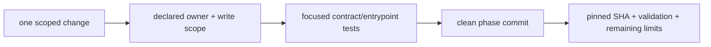

# DexTeleop 当前模块与运行域图示

状态：当前架构导航；最后复核日期为 2026-08-17。

本文面向多人并行开发，画清数采、一般部署、混合遥操/策略部署、模拟环境、离线学习与
应用控制面的可拆分边界。项目仍是一个仓库、一个 Python 3.10 Conda 开发环境，不以拆成
多个 wheel 或可安装产品为目标；“可拆分”指 owner、依赖方向、装配口、验证和发布范围
可以独立说明。

详细运行模式见 [运行域与可拆分边界](runtime_domain_boundaries.md)，长期控制语义见
[控制架构规划](plans/dexteleop_architecture_planning.md)，当前批次见
[计划索引](plans/README.md)。原 2026-07-25 状态表、远端真机收据和里程碑图已归档为
[历史架构视觉台账](reports/architecture_visual_guide_20260725.md)。

本图不新增 contract、authority、验收结论或硬件授权；最终目录规则以
[`AGENTS.md`](../../AGENTS.md) 为准。

## 1. 总体分层



箭头表示允许的依赖/装配方向，不表示每个应用必须加载全部模块。application/profile 可以
组合多个 lower domain；lower domain 不得反向导入应用叶子。

## 2. 五个运行边界与非生产实验叶子

| 边界 | 领域 owner | 应用装配 | 不应吸收 |
|---|---|---|---|
| 数采 | `dataset_contracts`、`dataset_interface`、`collection_runtime` | `teleop_runtime.collection` 与正式 real-teleop GUI 绑定 source/control | policy worker、sim physics、composition authority、第二 episode owner |
| 一般策略部署 | `robot_motion.deploy`、`deployments` | `teleop_runtime.deploy` 绑定 observation、backend 与唯一 dispatch | composition session、sim runtime、dataset writer |
| 混合遥操/策略部署 | `control_composition` | `control_station.composition` 与显式 Sim-HIL/profile 绑定 Human/Policy/Replay 与 target | model worker、source cursor、canonical safety、dispatch、episode commit |
| 模拟环境 | `sim.contracts`、`sim.rm65`、`sim.mujoco` | sim CLI 或 Control Station sim profile | real device 初始化、真机 `teleop_runtime`、训练 loop |
| 离线学习实验 | `experiments.policy_learning` + data interfaces | 非正式 training/eval commands；产出本地 artifact | production dependency、robot authority、safety、dispatch、hardware resource |
| 外部 Agent Skill | `agent_gateway.protocol/runtime/transport` 与 target-neutral `skills` | `agent_gateway.profiles` 绑定 concrete application/executor | 上层 Planner/Task/Memory、canonical safety/IK/dispatch、episode owner |

`control_station` 与 concrete `agent_gateway.profiles` 都是应用叶子。二者可以装配 lower
能力，但不能把自己的状态或 framework 语义下沉到 reusable domain。
`experiments.policy_learning` 不属于运行分层；它只消费数据接口并生成本地实验产物，
production package 不得反向依赖它。

## 3. 数采链



边界：

- `collection_runtime` 不生产设备输入、不控制机器人、不接 operator intent；
- `dataset_contracts` 不拥有 runtime；`dataset_interface` 不成为 episode owner；
- source production、control session、episode commitment 和 durable writer 各有一个 owner；
- formal collection 复用真实控制链，不为 capture 另建 authority/dispatch；
- sealed/committed 数据不原地改写，derived dataset 保留 parent identity。

当前 canonical GUI human teleop/formal collection 入口：

```bash
python -m teleop_runtime.debug.run_vive_rm65_real_teleop --gui
```

`python -m teleop_runtime.collection` 是 headless/compatibility 路径，不是第二套正式 GUI。

## 4. 一般策略部署

```mermaid
flowchart LR
    Obs["deployment observation"] --> Client["deployments client/adapter"]
    Client --> Source["policy source<br/>sync or explicit RTC"]
    Source --> Emit["PolicyActionEmission"]
    Emit --> Prepare["robot_motion deploy preparation"]
    Prepare --> Safety["canonical safety / target / IK / reference"]
    Safety --> Dispatch["one backend dispatch owner"]
    Dispatch --> Receipt["dispatch / measurement / outcome"]
```



默认单源部署不加载 `control_composition`，也不创建第二个 action queue：

```bash
python -m teleop_runtime.deploy
```

模型 transport、artifact codec 与 worker 不拥有机器人安全或 dispatch；backend 不解释模型
checkpoint。RTC 也终止于同一个 `PolicyActionEmission`，详见
[RTC 当前图示](dexteleop_rtc_visual_guide.md)。

## 5. 混合遥操与策略部署



`control_composition` 负责 immutable input admission、TTL、source eligibility、same-cut
selection、replaceable strategy、lineage 和 non-authoritative difference；它不拥有
authority、canonical safety、IK/reference、dispatcher、device/model worker、replay cursor 或
episode lifecycle。

单源直通与多源组合必须显式区分：

| 模式 | `control_composition` | 执行 owner |
|---|---|---|
| 单源 policy / real teleop / replay | 不加载、不创建 | 各自现有 target runtime |
| 被动 trace/shadow/difference | 可观察但不参与 action selection | 原单源 target runtime |
| 两个及以上 source 选择/融合/handoff | profile 显式创建 | 仍是同一个 lower target runtime |

## 6. Control Station 与 GUI



Control Station 拥有 operator intent、rebuildable UI state、profile/lifecycle coordination 和
薄装配；不拥有 reusable composition math、worker/cursor、canonical safety、dispatch 或
dataset writer。

GUI、浏览器开启/关闭、HTTP/server handle、页面资源和 operator interaction 的目标 owner
统一为 `control_station.gui`。现有 `control_station/sim_hil_gui.py` 与
`control_station/web/` 是迁移期兼容路径，不应继续吸收控制算法或 lower resource state。

## 7. 模拟环境



- `sim` 可以依赖 `robot_motion`，不能依赖 `teleop_runtime` 或真实 `hardware`；
- composition 只提交 candidate，不成为 physics/dispatch owner；
- Sim-HIL 的 concrete source/profile binding 位于 Control Station 应用层；
- simulator test harness 属于 `tests/support`，不进入 production package；
- sim evidence 不授权 real motion。

## 8. 数据到学习再到部署



- `experiments.policy_learning` 只拥有非正式 learner、loss、training command 和 offline evaluation；
- production package 不得导入 `experiments`；可复用逻辑必须提升到正式 owner；
- robot action schema 来自 shared contracts，训练代码不重定义 motion/safety；
- `model/` 保存权重、checkpoint、runtime sidecar 和明确 pin 的外部 source boundary，不是
  Python package；
- `model/openpi` 是独立 Git submodule，保留自己的环境与 source-version boundary；
- runtime 通过 `deployments` 验证 artifact/codec，不从 learner 内部直接 import 模型实现；
- Conda 是项目依赖安装口径，模块拆分不要求分别打包发布。

## 9. 单一 owner 与资源关闭



每个阶段可以有不同 owner，但同一 logical resource/stream 的每个阶段只能有一个
authoritative owner。被动 observer、fanout queue 和 UI cache 可以存在，但不得推进 cursor、
重建 authority、覆盖 safety、重复 dispatch 或独立 commit episode。

跨域 adapter 必须回答：

1. 输入由谁推进？
2. 最终 authority/safety/dispatch 由谁拥有？
3. worker、device、server、browser、viewer 和 writer 由谁关闭？

答案出现两个 owner 时，应先修正所有权，而不是增加同步队列、共享布尔量或兼容状态。

## 10. 禁止的反向依赖

```text
robot_motion       -X-> control_composition
control_composition-X-> control_station / sim / hardware / teleop_runtime / deployments
collection_runtime-X-> teleop_runtime / control_station / hardware / sim / GUI
dataset_contracts -X-> runtime / device / GUI / control
dataset_interface -X-> control_station / device-control runtime
sim               -X-> teleop_runtime / real hardware
lower packages    -X-> control_station / concrete agent_gateway profiles
agent_gateway core-X-> upper Planner/Task/Memory or concrete application profile
production code   -X-> tests / legacy / root todos
```

`legacy/` 只能保存已确认归档内容；production 不得导入。root `todos/` 是 Git-ignored 本地
规划状态；共享计划进入 owning `docs/**/plans/`。

## 11. 开发与发布口径



- 多人开发使用独立 worktree 和明确 branch description；
- 每个 coherent phase 验证后提交，不把完成的 tracked 修改留脏；
- 发布说明按“领域内核 + 应用装配 + compatibility surface”列出，不因同仓库同环境而模糊
  依赖边界；
- source-only/docs-only 修改不更新 Conda/lock；只有依赖、Python 版本、package discovery 或
  安装方式变化才修改环境元数据；
- hardware、sim interactive、remote service 与 real motion evidence 分开报告，offline tests
  不替代现场验证。

## 12. 阅读与验证

| 主题 | 当前事实源 |
|---|---|
| 包与 worktree 规则 | [`AGENTS.md`](../../AGENTS.md) |
| 运行域/入口 | [runtime domain boundaries](runtime_domain_boundaries.md) |
| Control Station/GUI | [Control Station current plan](plans/dexteleop_control_station_plan.md) |
| multi-source composition | [`control_composition/README.md`](../../control_composition/README.md) |
| RTC | [RTC current visual](dexteleop_rtc_visual_guide.md) |
| HITL | [HITL current plan](plans/hitl_chunk_relative_migration_plan.md) |
| data | [`dataset_contracts/README.md`](../../dataset_contracts/README.md) 与 [`dataset_interface/README.md`](../../dataset_interface/README.md) |
| historical ledgers | [reports index](reports/README.md) |

最小架构验证：

```bash
python scripts/check_docs_navigation.py
python -m pytest -q tests/test_runtime_domain_boundaries.py
python -m pytest -q tests/test_control_composition_boundaries.py
python -m pytest -q tests/test_control_station_boundaries.py
python -m teleop_runtime.collection --help
python -m teleop_runtime.deploy --help
git diff --check
```
