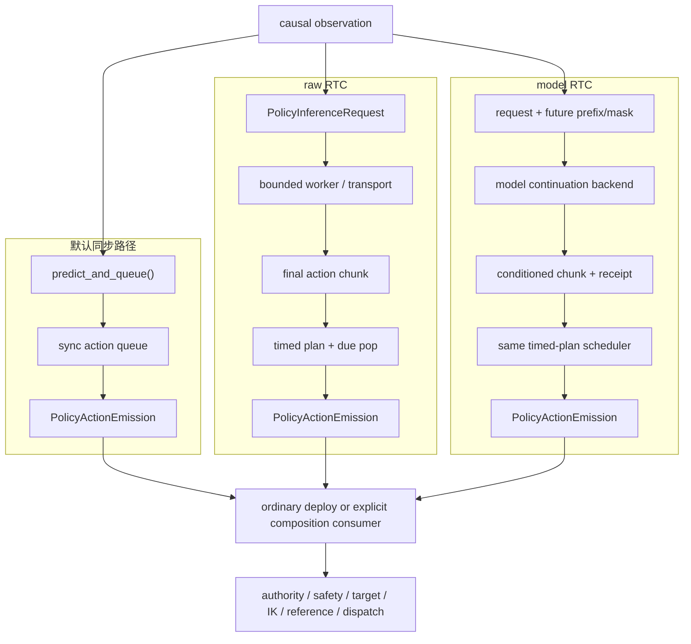
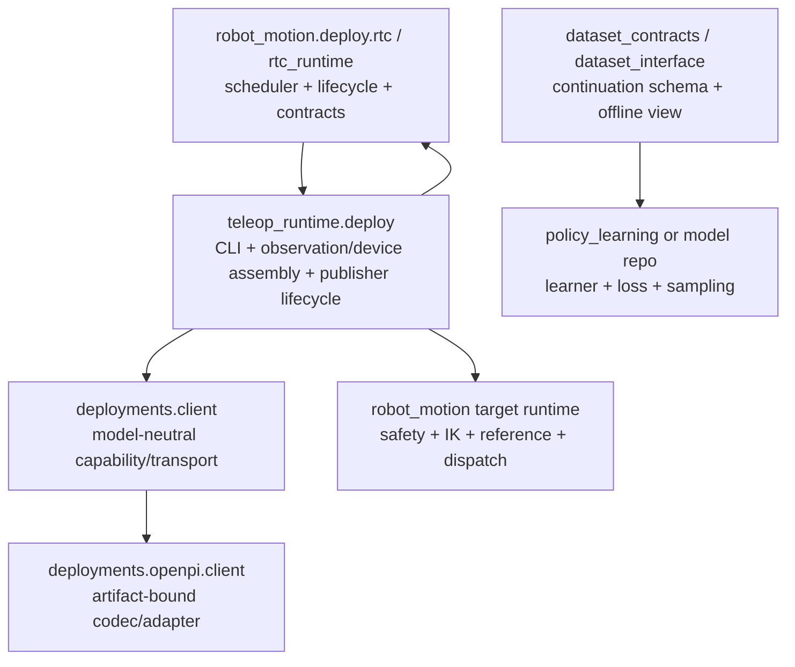
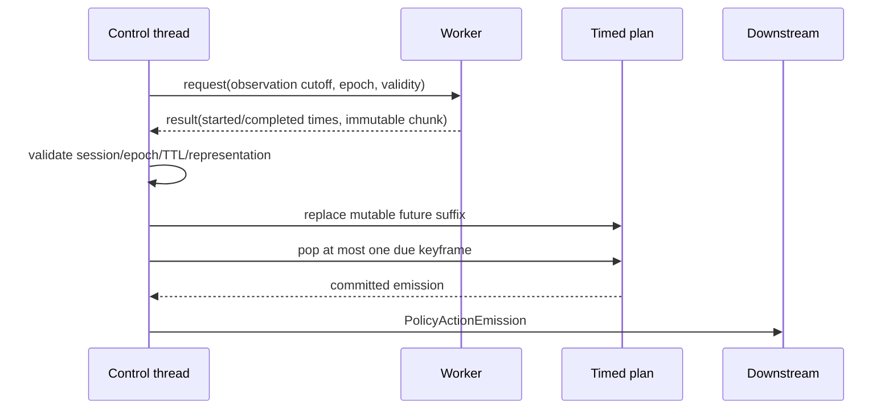
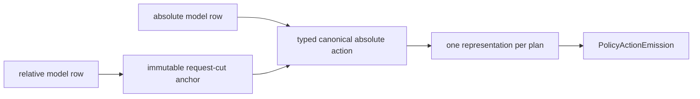
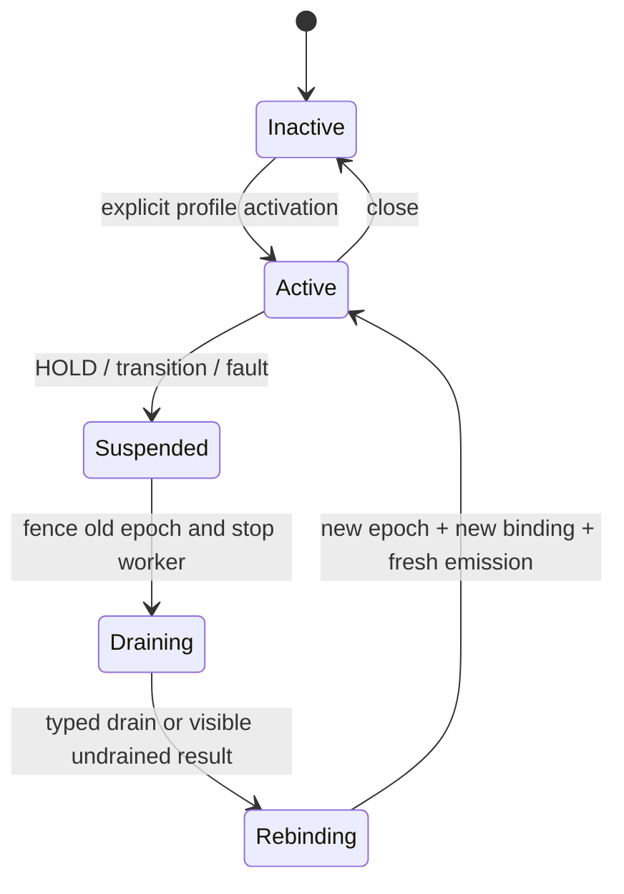
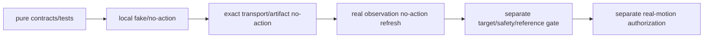
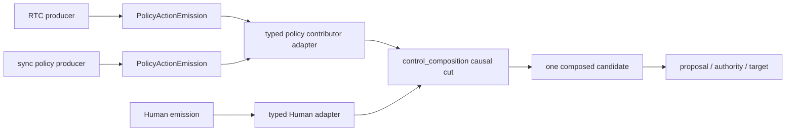

# DexTeleop 实时 Action Chunk（RTC）当前图示

状态：当前架构导航；最后复核日期为 2026-08-17。

本文只把 RTC 当前 owner、同步/raw/model 三条路径、时间线、representation、re-arm 和
authority 边界画成简图。详细 contract 与剩余 gate 见
[RTC 当前落地边界](plans/dexteleop_rtc_landing_plan.md)；原 RTC-1 至 RTC-7、R-R/MRTC
状态表、测试数字、远端收据和完整算法图已归档为
[RTC 历史视觉台账](reports/rtc_visual_guide_20260725.md) 与
[RTC 历史落地台账](reports/rtc_landing_ledger_20260725.md)。

图示不新增 contract、production readiness、设备授权或 motion authority。与代码、测试或
[`AGENTS.md`](../../AGENTS.md) 冲突时，应修正图示。

## 1. 三条路径



```text
raw RTC   = existing observation -> final action chunk
            scheduler=async_timed_plan, continuation=none

model RTC = model consumes versioned future prefix/mask
            scheduler=async_timed_plan, continuation=trained/native
```

默认 CLI 仍是 `--rtc-profile off` 的同步路径。raw RTC 与 model RTC 都是显式、default-off
能力；model continuation 不是 raw RTC 的隐含前置条件。

## 2. RTC 的正式终点

```mermaid
flowchart LR
    Cut["observation cut"] --> Req["request"]
    Req --> Worker["worker / model transport"]
    Worker --> Result["immutable result"]
    Result --> Admit["control-thread validation + merge"]
    Admit --> Pop["at most one due keyframe"]
    Pop --> Commit["emission commit"]
    Commit --> Emission["PolicyActionEmission"]
    Emission --> Consumer["deploy / composition adapter"]
    Consumer --> Target["lower execution owner"]
```



RTC 拥有 request、worker、result、producer-local plan、merge、due-pop、emission commit、
TTL、producer epoch/session 和 producer lifecycle。它不拥有 proposal、Control Station、
canonical safety、IK、reference、target admission、physical HOLD、dispatch 或设备 receipt。

`PolicyActionEmission` commit 只证明 producer action 已固化，不证明下游已接纳或执行。

## 3. Package ownership



边界说明：

- `teleop_runtime.deploy.rtc_frontend` 是 `robot_motion.deploy.rtc_runtime` 的兼容 re-export，
  不拥有第二个 coordinator、worker 或 plan；
- concrete model adapter 不推进 timed-plan cursor，不拥有 worker 或 dispatch；
- `control_composition` 只在 emission 之后通过 typed contributor adapter 消费，不导入 RTC
  worker/plan contract；
- Control Station 可观察或装配 consumer，但不是 RTC core 的依赖或 transport 前提。

## 4. 时间与 admission



必须保留的时间包括 request trigger、inference start/complete、result receive/admit、
observation cutoff、target effective 和 emission。调度使用 local monotonic clock 与显式
clock-domain ID；wall time 只做日志关联。

```text
d_forecast_steps   request-time guidance
d_elapsed_steps    receive time relative to observation cut
s_consumed_steps   actual producer cursor movement
```

三者不能压成一个四舍五入 delay。old request、duplicate、old worker session、epoch mismatch
或过期 keyframe fail closed；missed tick 不 burst catch-up。

## 5. Action representation



- relative row 必须绑定原 request observation cut 的 immutable anchor；
- receive、merge 或 emission 时不能按新 measured pose 重新锚定；
- plan 内不能混装 legacy row 与 typed canonical action，也不能保留两份会漂移的
  relative/absolute 执行副本；
- qpos、continuous gripper 和 discrete token 不参与 SE(3) 重锚定；
- canonicalization receipt 不是 target/safety receipt。

## 6. Lifecycle 与 re-arm



HOLD、FAULT 或 transition 必须先让旧 producer epoch/plan 失效，再处理 worker retirement。
cancel accepted、thread exited 与 execution drained 是不同 receipt；stop timeout 不能冒充
drained。

`RtcPolicyEmissionPublisher` 当前支持 suspend、单 required subscriber ACK、rebind 和 resume。
具体 application 如何等待 quiescence、处理 timeout/restart/late ACK，以及多 required
subscriber 的有序 rotation，仍是独立 gate。

## 7. 当前 profile 与证据范围

当前 deploy CLI 暴露三个 RTC application profile：

```text
rtc_3c_virtual_shadow_15_30_60_120_v1
raw_rtc_final_chunk_15_30_60_120_v1
model_rtc_flow_inpaint_shadow_15_30_60_120_v1
```

它们都必须显式选择，禁用 position lookahead，并拒绝 `--send-actions`。因此：



历史 evidence 只能证明其记录日期、host、artifact 和 profile。它不自动刷新当前 server、
camera、transport、device 或 worker health，也不能跨过 downstream gate。

## 8. RTC 与多来源 composition



ordinary deploy 与 composition consumer 都应消费同一个 committed emission，不读取
`RtcFrontendStep`、worker result 或 timed plan。composition adapter 保留 source lineage，
但不把 model/worker 字段带入 reusable composition core，也不创建第二个 action queue。

## 9. Remaining gates

```text
R-B0  default-off、sync compatibility、legacy import/hash parity
R-B1  application-level cross-rearm binding coordination
R-B2  ordinary deploy/composition consume emission only
R-B3  exact real observation/transport no-action refresh
MRTC  model continuation capability + conditioning receipt parity
D-LA  downstream lookahead/target/safety/reference/dispatch authority
```

No-Go：

- 不以 no-action、shadow、synthetic transport 或旧远端收据授权 motion；
- 不让 RTC 拥有 proposal、target、HOLD physical effect 或 dispatcher；
- 不把 producer overlap 当作 accepted target prefix；
- 不把 corrected preview、emission commit 或 stable descriptor 当作 execution receipt；
- 不让 Control Station、GUI 或 model adapter 反向推进 RTC cursor/epoch；
- 不用 model-RTC 状态改变 raw RTC 或默认同步路径。

## 10. 阅读与验证

推荐顺序：

1. [RTC 当前落地边界](plans/dexteleop_rtc_landing_plan.md)；
2. [Control Core 当前边界](plans/dexteleop_control_core_landing_plan.md)；
3. [`robot_motion/deploy/rtc/README.md`](../../robot_motion/deploy/rtc/README.md)；
4. [历史视觉台账](reports/rtc_visual_guide_20260725.md) 和
   [evidence 索引](evidence/README.md)，仅在需要追溯时阅读。

最小无设备验证：

```bash
python scripts/check_docs_navigation.py
python -m pytest -q tests/test_policy_chunk_plan.py
python -m pytest -q tests/test_rtc_package_architecture.py
python -m pytest -q tests/test_deploy_rtc_frontend_shadow.py
python -m teleop_runtime.deploy --help
git diff --check
```
