# DexTeleop 控制、数据与训练历史闭环图示（更新至 2026-07-25）

> 文档类型：历史视觉台账。本文中的“当前”、CS/RTC/M5 阶段状态、远端真机收据、
> 测试数字和下一 gate 记录原图维护期，不再作为当前 package ownership、entrypoint、
> runtime health 或 motion readiness 事实。现行模块与运行域简图见
> [DexTeleop 当前架构图](../dexteleop_architecture_visual_guide.md)，当前计划与历史报告
> 分别由 [`../plans/`](../plans/README.md) 和本目录索引。本文不授权旧硬件命令、服务或
> 数据流程重跑。

更新日期：2026-07-25

## 文档用途

本文是以下事实文档的可视化索引，不新增 contract、实施授权或验收结论：

- [`dexteleop_architecture_planning.md`](../plans/dexteleop_architecture_planning.md)：长期架构与数据语义；
- [`dexteleop_control_core_landing_plan.md`](../plans/dexteleop_control_core_landing_plan.md)：文件落位、迁移批次、前提和回滚。
- [`dexteleop_rtc_landing_plan.md`](../plans/dexteleop_rtc_landing_plan.md)：异步 action chunk/RTC producer；
- [`dexteleop_rtc_visual_guide.md`](../dexteleop_rtc_visual_guide.md)：RTC 当前实现、顺序兼容、时间对齐与阶段 gate 图；
- [`dexteleop_control_station_plan.md`](../plans/dexteleop_control_station_plan.md)：统一实验台、GUI与source/target迁移。

状态图例：

| 标记 | 含义 |
|---|---|
| ✅ | 当前工作树内已有实现和对应 scoped fixture |
| 🟡 | 已接现有入口，但默认关闭、observe-only 或只在 sim authoritative |
| ⏳ | contract 已规划或部分存在，production 接线/验收未完成 |
| ⛔ | 当前阶段明确禁止启用 |

所有“完成”都受作用域限制；本地测试通过不等于已合并、发布、真机验收或公开数据集可提交。

当前多源组合框架的长期 owner 已修正为 `control_composition/`：

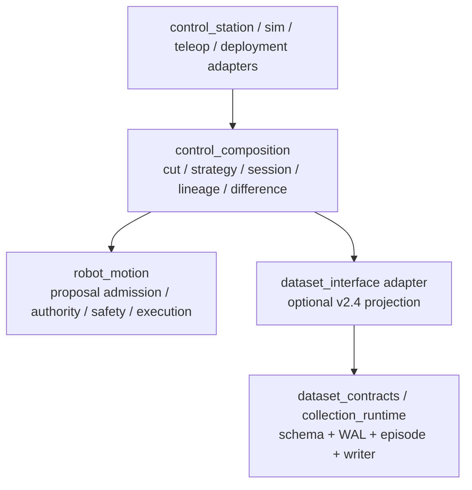

`control_composition`不拥有最终动作许可，也不导入MuJoCo、硬件、遥操设备或模型实现。当前package/ports/
依赖守卫已落地；composition、pose/qpos strategy、observability、domain events、runtime及composition-aware
policy-node协议均已物理迁入，旧RobotMotion实现/API已删除；pure handoff reducer已经物理迁入lifecycle，
composition-session contract/re-arm/registry也已迁入；
Station controller只保留operation/
publication/HOLD适配；旧handoff转发路径已在调用审计后删除。其余逻辑只有通过hash、数值和default-off回归后才物理迁移。

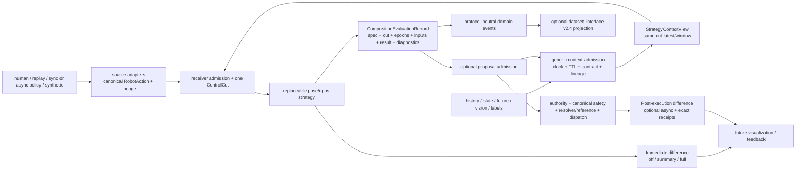

Formal composition的start/re-arm不再依靠Station私有布尔量判定“新输入”：

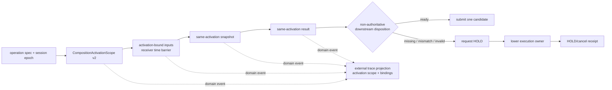

producer、authority和execution epoch仍各自负责原有失效边界；activation identity只解决逻辑session一次
start/re-arm内部的输入归属。未启用formal scope的既有composition继续使用v1 ID/hash。

当前增量门槛：

| 优先级 | 当前事实 | 下一门槛 |
|---|---|---|
| 已落地待稳定 | activation v2覆盖input→snapshot→result；information plan预声明context需求；domain event与dataset projection已分离 | 保持v1 hash/default-off和依赖防火墙，完成回归 |
| P0纯层+sim shadow已落地 | 独立eligibility state/store/snapshot与action共享cut；status epoch、lease、rearm、retention tombstone及外部trace已覆盖 | 保持default-off；后续设备/replay/policy adapter只翻译状态，不改变通用契约或authority |
| P1 | 当前formal re-arm通过composer producer epoch推进阻止旧proposal；activation尚未进入proposal lineage | 仅以additive v3或typed relation贯通，禁止修改proposal v1/v2，不新增execution lease |
| P1/RTC gate | composition不判断model observation/result generation age | 由RTC/deploy adapter和proposal admission校验；composition继续只接absolute RobotAction |
| P1 hardening | semantic time window已落地，窗口内rate/bytes仍无硬上限 | 增加显式quota/rejection，禁止lossy ring overwrite |

多频对齐不是在该包内启动额外loop：input/context以receiver clock声明有效区间，同一cut只选择覆盖
`target_effective_at`且在active epoch内的最新事实；slow source在TTL内复用，fast/late source只进入后续cut。
`CompositionEvaluationRecord`现让调用方一次取得exact spec/cut/epoch/selected lineage/context/result/difference/
diagnostic/domain-event batch；外部adapter可选投影ControlTrace。高频reference、canonical safety和物理下发仍由
RobotMotion拥有。当前长期store pruning/backpressure、动态任意effector拓扑、formal compound hand execution、
真实可视化/触觉适配和多backend/真机验收仍为后续gate。

```text
context现状：formal runtime、synthetic policy node、MuJoCo统一使用CompositionContextRecord/Store/Snapshot
禁止：live backend/model读取、hidden latest cache、composer等待慢模型

information plan：独立于activation和dataset；source acquisition前声明channel/contract/access/max age
资源紧张或source频率不足：先收紧plan；dataset-only媒体绕行composition；shared媒体只传轻量ref

inline strategy：pure/no-I/O，profile声明deadline；初始建议p99 <= min(2 ms, 10% composition period)
slow/model mixer：独立异步producer -> typed time-bound advisory context -> local deterministic strategy

store现状：显式TimeWindowRetentionSpec；snapshot先物化，再推进单调target watermark并prune窗口外full payload
保留：已返回snapshot的immutable record + producer-epoch last-sequence tombstone
待补：窗口内producer rate/blob quota和durable trace backpressure；禁止lossy ring overwrite

拓扑目标：named component set；arm始终pose，机械臂joint DOF只属于downstream resolver capability
end-effector：每个component自声明dimension/names/units/mask；一个arm可以绑定多个末端
当前限制：RobotAction v1的left/right + one hand per side + q6/q16与现有coupled target；不是框架目标限制

difference A：same-cut source -> composed，低资源同步，off/summary/full
difference B：composed -> safe/IK/reference/dispatch/measured，异步且有receipt才称actual，off/summary/full
record core：实际行为与可重放lineage永远持久化
record debug：重型替代项/矩阵/中间量只在debug构建与保存
```

当前远端真机前置状态（2026-07-21）已到有限步只读 SDK state 层：左右 RM65 的 ping 与 TCP 8080 均可达，远端
`dexteleop310` pure M5.8 tests 通过；严格禁用启动写入、streaming 与 force-position 后，两侧各 5 次 state/tool-frame
读取均返回 0，且 5 轮 `arm_err/sys_err` 均为 0。其后一个独立授权的stationary stop-only批次已让左右
`Arm_Slow_Stop`各调用一次并返回0，但尚未验证关节使能/急停物理链、完整stop acknowledgement、worker drain或任何
MOTION调用。
M5.8-b1-real-A 独立 idle-worker drain/stop-only 现场运行已通过：两侧真实worker在无target下运行103/93 tick且
send count为0，三个participant完成epoch 0→1 drain，两次Slow-Stop accepted/SDK=0，10个trace fact全部durable。
它仍是一次性runtime-diagnostic profile，不修改正式deploy默认值或M6候选manifest，也不会把无target、deny-motion
和一次性stop限制继承给后续真实操作。
配置中的 `latest.json` 仍含左臂 TEST-NET 地址，因此后续获授权命令必须显式传入站点 IP，不能把网络可达性画成
motion-authorized。

异步action chunk主路径当前已到RTC-4b-T2b existing OpenPI server synthetic/no-action loopback。这里严格区分：raw-RTC
保持现有 observation→final-chunk model/server 接口，只把客户端 worker 接到 timed plan；model-RTC 才让模型消费
未来 action prefix/mask 并返回 conditioning receipt。可选 model-RTC 支线的 RTC-4b-B1
caller-free model seam也已完成：RTC-1～3c保留timed plan、isolated worker、
single-admission与default-off no-action frontend边界；RTC-4a新增scheduler/continuation分轴、capability/envelope/
conditioning receipt、continuous/discrete输出和model-neutral client seam，并用两个不同local backend验证迁移；RTC-4b-A
再以fake transport/policy验证现有OpenPI artifact、server metadata、exact payload与V22 codec。RTC-4a有42个测试，
RTC-4b-A有28个测试，RTC-1～4b-A聚焦回归130 passed。`run_policy.py`默认仍走同步`predict_and_queue()`；新adapter只声明
`continuation=none`即 raw-RTC；当前仅有显式、default-off、`send_actions=false` 的 OpenPI caller，不代表
model-RTC continuation、real shadow或motion authority。详细流程见
[`dexteleop_rtc_visual_guide.md`](../dexteleop_rtc_visual_guide.md)。
RTC-4b-B按loaded model instance的artifact/model/transform/norm/sampling facts协商，不使用checkpoint/config白名单；
default-off和无RTC envelope请求继续走原`Policy.infer()`/sampler路径。
RTC-4b-T2a现已完成model-neutral transport deadline、fake socket压力矩阵与no-model localhost final-chunk loopback；
T2b随后直接复用现有OpenPI observation→final-chunk model server完成两次synthetic/no-action live request，50×16
final chunk有限且metadata hash跨fresh reconnect一致。它不要求模型侧适配，只声明 raw-RTC 的`continuation=none`；代表性
checkpoint只作证据，不成为启用白名单。下一主路径gate是T2c caller-free synthetic worker→timed-plan shadow；已完成的
B1仍无server caller。

只读 SDK preflight 入口已显式禁用启动期奇异阈值写入、force-position 和 background streaming；现场读取的两侧
qpos 均在 active URDF 范围内，最小余量为左 J3 0.069 rad、右 J3 0.342 rad。也就是说当前状态为
“network evidence ✅ / read-only SDK state ✅ / motion authority ⛔”；左 J3 的有限余量必须进入下一阶段现场检查。

---

## 1. 最终闭环

```mermaid
flowchart LR
    Sensors["异步传感器流<br/>RGBD / tactile / robot state"] --> Hub["Temporal Observation Hub<br/>causal cuts / windows"]
    Human["遥操设备 adapter"] --> Producers
    Hub --> Policy["Policy node(s)<br/>single / slow / fast"]
    Dataset["sealed capture / replay records"] --> Replay["Replay adapter"]
    Policy --> Producers["Context / Composer /<br/>absolute RobotAction proposals"]
    Replay --> Producers
    Producers --> Snapshot["ProposalBuffer<br/>ArbitrationInputSnapshot"]
    Snapshot --> Arbiter["ActionArbiter<br/>authoritative decision <= 60 Hz"]
    Arbiter --> Exec["persistence → shared safety<br/>planner / IK / reference"]
    Exec --> Port["DispatchOwnerToken<br/>single logical dispatch port"]
    Port --> Backend["real or sim embodiment backend"]
    Backend --> Outcome["receipt / measured / outcome"]
    Hub --> Trace["v2.4 native streams + ControlTrace"]
    Producers --> Trace
    Snapshot --> Trace
    Arbiter --> Trace
    Exec --> Trace
    Outcome --> Trace
    Trace --> Dataset
    Dataset --> Views["versioned TrainingView / reward overlay"]
    Views --> Learner["BC / DAgger / RL / fast-slow learning"]
    Learner --> Artifact["versioned policy artifact bundle"]
    Artifact --> Policy
```

闭环的稳定接口是 canonical observation/action/component/frame contract，而不是 VIVE 字段、RM65 SDK、
MuJoCo object 或某个模型 tensor layout。更换遥操设备只替换 source adapter；更换本体只替换 embodiment、
kinematics、safety capability 和 backend binding。不兼容的 DOF/frame/component 必须显式 retarget、重新训练或
fail closed。

### 当前本体通用性不是全绿

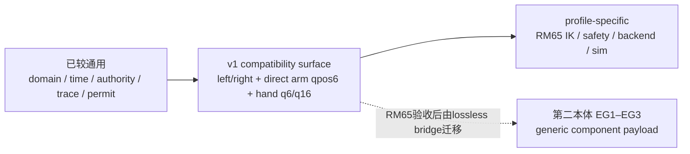

| 变化 | 当前难度 | 准确结论 |
|---|---:|---|
| 同一 RM65 profile 更换 mock/sim/SDK sink | 低至中 | 控制协议可复用，但仍需单位、frame、worker、receipt、stop/permit 验收 |
| 同为左右双6DoF且完全匹配 canonical contract | 中 | 可新增 execution adapter，不等于零成本 backend swap |
| Inspire/DMTAC 等已有 q6/q16 末端 | 中 | 有 compatibility adapter；不同 safety/permit/receipt 仍需独立 profile |
| 单臂或7DoF arm（同pose component语义） | composition低；execution中 | 混合不依赖joint count；仍需target capability、resolver、IK/safety验收 |
| 非left/right、一个arm多末端或第三component | 高/当前carrier不支持 | 需component-keyed carrier与v1无损adapter，不能按shape扩展 |

首个真机候选 `m6_candidate_policy_arm_qpos_v1` 保持不变；本轮只增加依赖/硬编码防火墙，不重构
`RobotAction`、Arbiter payload、安全数值、policy tensor layout 或公开兼容列。当前准确表述是：

> DexTeleop 对 contract-compatible embodiment 可替换，但尚不是任意本体无关框架。

```text
泛化防火墙（scoped 已落地）
  shared action/runtime device-import guard       ✅
  RobotAction v1 hardcode allowlist               ✅
  dataset/postprocess import boundary             ✅
  DM-Tac calibration contract/provider 分离        ✅
  新7DoF resolver/execution profile                  ⏳ target-specific gate
  component-keyed generic payload正向支持            ⏳ EG1–EG3
```

---

### 统一 Control Station 的位置

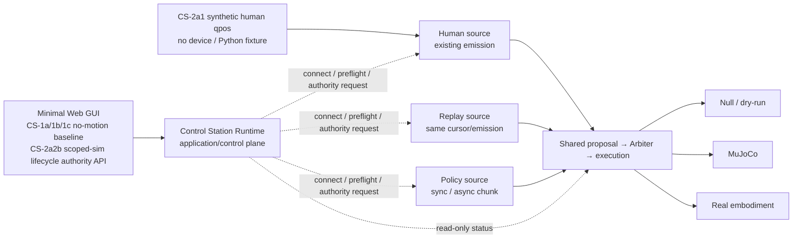

图中的虚线是控制平面，不承载动作数值。GUI不会再次读取tracker/dataset、不会调用policy `predict()`、不会pop
action chunk，也不会创建第二个dispatcher或episode owner。可复用no-motion baseline成熟度是`CS-1c null-target no-I/O coordination complete`；
另有独立`CS-2a2b scoped-sim authority API`，两者均无production入口、无真机授权。CS-1a只读builder和CS-1b typed admission继续保持；CS-1c新增的operation worker只执行
exact-manifest null/fake adapter，容量在intent admission前预留，HTTP线程只入队。UI event ring是可丢弃projection，gap
显式可见但不是ControlTrace。CS-2a1另有一条scoped、无设备的human qpos→现有adapter→MuJoCo authoritative core数据链；
CS-2a1 binding本身不等于Station authority lifecycle；CS-2a2b scoped fixture现已证明typed completion后才开放publication，
release通过同一core进入HOLD/cancellation且不创建第二owner/epoch；source-agnostic原子publication barrier已落地，
测试侧bounded side-effect worker也已验证release-before-enqueue和typed failure closure；现有CS-1c Web exact-type拒绝
该worker，独立scoped-sim builder则要求exact sim manifest/side-effect worker并只开放typed lifecycle/candidate/authority
intent；raw action、real target和production caller均被拒绝。注入式Station trace bridge已将manifest/intent/result/barrier事实接入专用
scheduled-sim formal profile，并与数据面一起完成真实WAL/seal/commit/reader重建；旧profile仍将这些新增事件视为
optional。CS-2a2a已在测试侧用真实WAL/seal/commit/reader
完成scheduled-qpos formal capture，但不是production entrypoint。CS-2b-a又完成qpos-compatible immutable replay
emission→Station barrier→shared MuJoCo authority的scoped链路；它不读dataset、不建cursor/resampler，并保持原emission
identity。CS-2b-b现已增加exact arm-base pose与verified canonical-desk两种独立manifest：pose保持selected/safe，
desk transform只在shared safety后、coupled IK前发生，qpos是独立execution target。legacy executor仍只生成一次immutable
emission；lower-owned fanout把同一对象送到GUI shadow与root Station consumer，单branch drop/error不影响legacy replay。
CS-2b-c又在测试侧用production loader/preflight/GUI worker消费同一个checked trajectory group，并以
`deployable_sim_scheduled_pose_to_qpos_station_v1`完成replay-specific WAL/seal/commit/committed-reader重建；pose→qpos
通过显式resolved execution target闭合，ActualDecisionView仍一行一个Arbiter decision。该结果仍不能标记为production
GUI replay，也无真机副作用；`qpos_target` GUI branch因缺lower-owned immutable emission seam继续fail closed。single-source
human/replay/policy验收边界保持；其上新增的CS-6b1 scoped mixed fixture只复用已验收seam，不代表actual-source或真机mixed已开放。
CS-6b1d现已把replay→synthetic pose-human的source/selected/safe pose与target内resolved-qpos闭合，并增加
`discrete_authority_owner_pose_v1`可替换strategy shadow；该shadow只读取同一cut及已接纳context并做parity，不改变
authority、safety或dispatch，也不代表future/modal/label策略已获得执行权。
CS-6b1f进一步把该pose分支接成一个显式、default-off的sim human-in-the-loop formal capture：
replay先保持authority，passive pose只在typed takeover worker等待post-boundary emission，虚拟readiness完成后同一
emission identity只promotion/admit一次；Station/WAL/episode owner仍沿用已有实现，MuJoCo target内部才解析qpos。
该profile可复用于新的source/target/provider seam，但不开放真实human READY、Web、真机或RTC。

代码依赖方向为单向：

```text
control_station/  ─→ teleop_runtime / deployments / dataset_interface / sim / robot_motion
下层模块          -X→ control_station
```

因此Control Station位于仓库根级，不从属于real frontend；`sim`也无需反向依赖`teleop_runtime`。

```text
CS-0a pure contract                  ✅
CS-0b null/fake composition          ✅
CS-1a read-only local GUI            ✅
CS-1b typed intents, null/no motion  ✅
CS-1c bounded events/coordinator     ✅
CS-2a1 synthetic-human sim data path ✅ scoped
CS-2a2a formal capture fixture       ✅ scoped
CS-2a2b station authority lifecycle  ✅ scoped
         formal lifecycle capture    ✅ scoped
         Web authority binding        ✅ scoped sim only
CS-2b-a qpos replay sim slice         ✅ scoped
CS-2b-b pose/verified desk transform  ✅ scoped
CS-2b-c GUI session + formal capture  ✅ scoped fixture
CS-2c  sync policy sim data plane      ✅ scoped; same PolicyActionEmission
         Station lifecycle              ✅ scoped
         policy-specific formal capture ✅ scoped fixture
CS-2d  RTC virtual policy data plane   ✅ scoped; exact frontend step
         Station lifecycle/capture      ✅ scoped; downstream gate only
CS-3a deploy RTC passive source       ✅ scoped; null target / typed loopback / no authority
CS-3b-a OpenPI RTC source preflight   ✅ scoped; artifact/protocol/binding only
CS-3b-T live transport/observation    ⏳ lower-owned session/health evidence
CS-3b production/real composition     ⏳ startup owner + target preflight
CS-4 bounded real micro-motion       ⛔ separate authorization
CS-5 human/replay/deploy separately  ⛔ separate manifests
CS-6a human→replay direct-qpos handoff ✅ debug/contract fixture only
CS-6b0 safe human takeover protocol   ✅ pure transaction + direct-qpos debug Sim gate
CS-6b1a typed multi-source operation  ✅ pure reducer + late-result fence
CS-6b1b Station operation executor    ✅ direct-qpos debug fixture
CS-6b1c passive human ingress         ✅ representation-neutral scoped seam
CS-6b1d arm-pose mixed Sim            ✅ scoped + replaceable strategy shadow
CS-6b1e passive live pose source      ✅ device-neutral; replay remains authority
CS-6b1f sim pose HIL formal capture    ✅ opt-in; virtual readiness + external recorder
CS-6b1g weighted SE(3) pose fusion     ✅ shared receiver human+replay sim shadow; default-off
CS-6b1h composer-only formal pose fusion ✅ deterministic sim data plane/default-off
CS-6b1i typed composition session        ✅ Station + formal sim capture/default-off; re-arm/real pending
CS-6b2 component shadow + trace/lifecycle fixture ✅ scoped
CS-6b2e native stream same-episode seal/commit ✅ scoped
CS-6b2f bounded inline pose/qpos process seam ✅ scoped; RGBD/tactile SHM pending
CS-6b2g external receipt + two-stage native seal ✅ scoped/local fake
CS-6b2h selected RGB process receipt bridge ✅ scoped/default-off
CS-6b2i conservative formal compound authority ✅ sim/default-off; real and non-DMTAC pending
CS-6c composer/policy/RTC mixed       ⛔ after independent source gates
```

CS-6a当前实际执行和采集关系如下；它是direct-qpos debug/contract fixture，只验证离散交接，不表示两个source同时控制，
也不定义主线mixed representation：

```mermaid
sequenceDiagram
    participant H as Synthetic human qpos
    participant C as CS-6a composition
    participant A as Shared authority/core
    participant M as Scheduled MuJoCo target
    participant T as ControlTrace/WAL

    C->>A: HOLD + cancel execution epoch 0→1
    C->>A: takeover(human-main), authority epoch 0→1
    H->>C: one immutable HumanCommandEmission
    C->>A: one proposal admission
    A->>M: selected → safe → scheduled segment
    A-->>T: human lineage + decision/reference/receipt/measured

    C->>A: HOLD + cancel execution epoch 1→2
    C->>A: release(human), then takeover(replay)
    Note over M: old active reference cleared; planner quick-stop
    C->>A: existing ReplaySourceFrameEmission, identity preserved
    A->>M: one replay-selected scheduled segment
    A-->>T: replay lineage + authority/cancel + actual decision
```

```text
本轮明确不在图中：
  physical teleop device / replay dataset cursor / second resampler
  Station browser authority API / real backend / policy / RTC / composer

重新切回已激活source：fail closed
解除条件：typed proposal invalidation 或 new producer epoch
```

CS-6a上图中的`takeover → READY`只适用于从未激活过的synthetic source fixture。实际human持续connected时必须增加
post-takeover readiness gate：

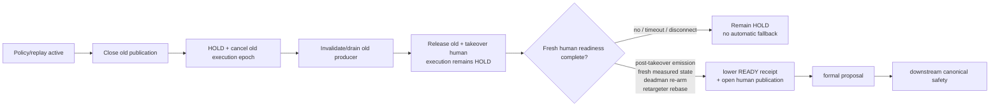

```text
episode_stop (legacy teleop)       = capture_only; motion authority unchanged
episode_stop (mixed formal)        = hold_before_unbind; explicit versioned profile
suspend_policy_keep_reference      = no handoff permission
hold_and_release_authority         = required precursor for handoff

connected != candidate != authority != ready-to-dispatch
```

CS-6b0当前direct-qpos debug Sim接线进一步细化如下。实线框是已经消费的lower-owned evidence；虚线语义（真实deadman与真实
retargeter receipt）目前仍由虚拟fixture注入，因此不能标成production human takeover：

```mermaid
sequenceDiagram
    participant R as Existing replay emission seam
    participant C as CS-6b0 transaction
    participant A as Shared authority/core
    participant M as Scheduled MuJoCo target
    participant H as Synthetic human source

    R->>A: replay proposal / selected / dispatched
    C->>C: explicit takeover intent; close both publications
    C->>A: HOLD
    A->>M: cancel segment + quick-stop
    M-->>C: software_queue ack
    A-->>C: execution epoch N→N+1
    C->>A: replay producer epoch E→E+1
    Note over A: old replay proposals remain immutable trace facts<br/>but leave active-epoch arbitration cut
    C->>A: release(replay), takeover(human)
    Note over C,A: execution remains HOLD; no human proposal yet
    H-->>C: fresh post-takeover HumanCommandEmission
    M-->>C: fresh measured qpos
    C-->>C: virtual deadman + rebase evidence
    C->>A: source-readiness evidence → READY request
    A-->>C: execution READY receipt
    H->>C: exact same identity/content/timing promotion
    C->>A: one formal emission + one proposal admission
    A->>A: authoritative canonical safety
```

```text
已验证：real HOLD ack / execution epoch / producer invalidation / authority epoch /
        no publication before READY / exact first-emission promotion / unsafe stays HOLD

已接通用seam：lower-owned replay one-emission fanout / root replay consumer /
             bounded human exact-emission ingress + passive observer fanout

尚未接：typed real deadman receipt / typed real retargeter rebase receipt /
        authoritative compound admission / real backend / policy or RTC

已接sim窄分支：CS-6b1d pose mixed handoff与CS-6b1f virtual-readiness formal
        capture；它们不外推为真实human READY、真机或production caller

原 CS-6a handoff_to(): 保留；只有调用新 CS-6b0 路径时才启用上述额外gate
```

CS-6b1现已把该冲突冻结为一个typed operation，而不是串接两条single-source intent：

```mermaid
sequenceDiagram
    participant O as Operator / Station intent
    participant S as Station reducer + pending CAS
    participant W as Existing side-effect worker
    participant C as CS-6b0 lower transaction
    participant P as Existing human emission provider

    O->>S: request_human_takeover(old, human, operation_spec_id)
    S->>S: freeze both source states; create one pending operation
    S->>W: enqueue after closing both publication barriers
    W->>C: forced HOLD/cancel + producer invalidation + authority transfer
    Note over C: quiescent backend-HOLD仍显式推进execution epoch
    C->>P: bounded acquire(post-takeover fresh readiness)
    P-->>C: same immutable emission + deadman/rebase evidence
    W->>S: pending-finalization CAS
    alt pending still current
        S->>C: bounded source-readiness/READY finalization
        Note over C: no pre-admission canonical-safety preview
        C-->>S: human_takeover_ready + aggregate evidence
        S->>S: old→preflighted; human→active; open human barrier
    else HOLD/ESTOP already won
        S-->>W: superseded
        W->>C: remain HOLD; never execute lower READY
        C-->>S: late completion rejected
    end
```

```text
禁止：GUI拼接release/request、放宽HOLD allowlist、用两个single-source completion冒充原子handoff
已验证：worker不阻塞control step / exactly-once formal promotion / timeout与stale保持HOLD /
        HOLD抢先时late worker不能恢复lower READY / default legacy CS-6a、CS-6b0路径保持
仍待接：typed lower deadman/rebase receipts、真实readiness provider、formal EpisodeLifecycleOwner
```

真实human方向当前停在“emission可见”，不能跨越成“READY已证明”：

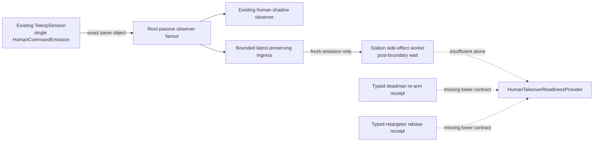

```text
允许：应用根在构造TeleopSession时组合已有被动observer；subscriber失败不改变teleop dispatch。
禁止：修改legacy遥操循环、把Q6 gesture rearmed当成deadman receipt、用emission时间戳伪造rebase、
      或让ingress直接实现readiness provider。
```

CS-6b1e把真实设备接入面收敛为“被动pose可见”，没有扩大human authority：

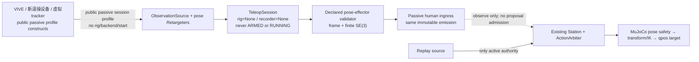

```text
通用层拥有：rig=None边界、source lifecycle、按spec声明的pose-effector contract校验、被动fanout。
设备profile拥有：Vive/其他source实例、retargeter、calibration、端口与工具frame配置。
`PassiveTeleopPoseSourceSpec`默认保留RM65双臂tuple，也可用`for_arm/for_effectors`构造单臂或其它明确topology；
当前CS-6b1f MuJoCo target仍是双臂能力profile，target不匹配时绑定必须fail closed。
仍未授权：真实human READY/promotion、真机target、Web/production caller、改写现有遥操/replay入口；sim虚拟provider仅限CS-6b1f。
```

CS-6b1f把“被动可见”与“正式采集”接成一个只在sim显式启用的闭环。它不让passive poll越过publication barrier，
也不把recorder塞进Station：

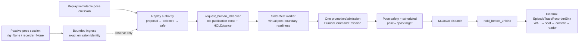

```text
复用边界：新遥操设备 → passive-session profile；新sim/机械臂 → authoritative target adapter + capability manifest；
新模型/replay →既有 immutable emission；readiness差异 →同一provider protocol。只有生命周期/协议真正不同才新增composition。
Station不拥有queue、cursor、epoch、dispatcher或episode owner；legacy teleop/replay/deploy和RTC默认路径不进入该图。
virtual readiness 仅接受 awaiting_human_readiness；无post-boundary sample、stale sample或late completion都保持HOLD，不能重开human barrier。
```

主线mixed representation按component固定；“arm不用qpos混合”不等于“所有component都用pose”：

```mermaid
flowchart LR
    H["Human pose emission"]
    R["Replay pose emission"]
    P["Policy pose emission"]
    C["Shared receiver causal prefix"]
    U["Exact authoritative control cut"]
    A["Arm authority + ActionArbiter"]
    M["Replaceable arm PoseMixingStrategy<br/>v1 shadow only"]
    W["weighted_se3_pose_fusion_v1<br/>no-proposal shadow; fail closed"]
    B["CS-6b1h formal gate<br/>ready→publish; missing/conflict/error→HOLD"]
    O["One pose-composer proposal<br/>only formal arms candidate"]
    E["Gripper / q6 / q16 candidates"]
    G["Mask-aware qpos/native strategy<br/>pure + shadow; admission gate pending"]
    J["Unique compound component assembly"]
    K["Frozen history / future action /<br/>modality / label / policy advisory"]
    V["Arm selection + output-pose parity"]
    S["Canonical safety by component"]
    F["Verified frame transform"]
    I["Coupled IK"]
    Q["Resolved arm qpos execution target"]
    D["Hand/gripper qpos/native target"]
    T["component_mixing_shadow<br/>ControlTrace/WAL; non-authoritative"]
    Z["SourceDifferenceObservation<br/>same snapshot/result; non-authoritative"]
    Y["Bounded guidance cue<br/>TTL; no-I/O only"]
    X["One dispatch envelope → component backends"]

    H -. authority_candidate=false .-> C
    R --> C
    P --> C
    C --> U --> A
    U -. exact immutable cut .-> M
    U -. human + replay input snapshot .-> W
    K -. admitted at or before cut .-> M
    M -. optional strategy .-> W
    M -. no authority / no dispatch .-> V
    W -. decision only .-> V
    W -. exact source/output residual .-> Z
    Z -. optional virtual guidance .-> Y
    Y -. no authority / no device I/O .-> T
    W -. exact result .-> B
    B -->|ready| O --> A
    B -->|not promotable| HR["request HOLD"]
    HR --> HLD["lower execution owner<br/>HOLD + cancellation receipt"]
    A -. authoritative comparison .-> V
    E -. future .-> G
    V --> J
    G -. preview only .-> T
    T -. no dispatch / no authority .-> J
    G -. future admitted join .-> J
    J --> S
    S --> F --> I --> Q --> X
    S --> D --> X
```

```text
arm mixed contract：pose；target内部 pose → verified transform → coupled IK → arm qpos
gripper/hand mixed contract：1DoF/q6/q16 qpos或typed native continuous；不经arm IK
当前arm strategy：discrete_authority_owner_pose_v1，只读shadow，和现有Arbiter做parity
已实现可选arm strategy：weighted_se3_pose_fusion_v1，显式weights/frame/disagreement/missing policy；
                    CS-6b1g已将passive human + replay接入同一receiver prefix，只形成no-proposal sim shadow；
                    default-off关闭时原cut/decision不变，开启时只允许trace cut/hash因新增admission变化
pose topology：共享v1 strategy/composer接受left/right arm的显式非空subset；默认仍为原coupled双臂并保持hash/顺序；
               当前CS-6b1i MuJoCo target仍是双臂，单臂必须由新target capability manifest显式放行
差异链：同一composition snapshot/result上计算source pair及source→output pose/qpos residual；
       `SourceDifferenceSpec`显式声明可比较role，禁止按shape猜测base/residual等语义；
       通用TopologyRuntime可选生成并返回，CS-6b1h/1i只透传；frame/representation不一致拒绝；
       diagnostic error不改composition/HOLD，结果只进入non-authoritative ControlTrace
引导链：首版仅把pose差异映射为bounded、TTL、无量纲`guidance_haptic_non_force` command和no-I/O receipt；
       qpos差异可记录但映射未定义；未接GUI/VIVE/真机，不是物理力反馈，也不能改变authority/HOLD/dispatch
后续hand strategy：只在相同action spec、joint order、units、active mask和同一causal cut内插值；
                 q16 NaN/padding slot不参与，离散token不插值
当前pure seam：`LinearHandQposInterpolationStrategy` + strict compound assembly；同一cut的component shadow已写入
             `component_mixing_shadow` ControlTrace/WAL，但仍未接authority/safety/dispatch
当前formal sim seam：CS-6b1h关闭raw human/replay/primary-policy authority，只允许pose composer proposal；
                    contributor input绑定source fact ID/hash；exact result promotion幂等，
                    TTL/epoch/conflict/error→request-HOLD，由lower receipt确认；HOLD后不自动恢复
正式compound authority：typed profile绑定spec/rule-set/strategy hash与完整components/groups；
                    一个composer proposal覆盖arms+required hands，proposal仅存活一个decision period；
                    safety/IK/receiver/任一receipt失败→ControlTrace failure + domain cancellation/HOLD；
                    START guard后才原子提升全部group；当前仅MuJoCo双RM65+双DM-Tac q6、默认关闭
session control：CS-6b1i用独立composition_session spec冻结composer/contributors/gate/boundary；
                generic controller持有registry/epoch/lifecycle/trace/barrier，MuJoCo wrapper只做backend接线；
                start READY后才开composer barrier，pause/end/error先barrier-off→HOLD/cancel；
                held不可由fresh input恢复，formal episode已seal/commit
sim-only capture fixture复用唯一`EpisodeTraceRecorderSink`，覆盖HOLD/no-action、abort→restart、多episode owner复用、WAL
writer failure与terminal closure；profile仍是`fixture_only`，sealed不等于capture-commit eligible。
可替换输入：已接纳且不晚于同一cut的history/future-action/modality/label/policy-advisory
正式激活gate：versioned spec + proposal/admission + ControlTrace + fallback/latency + safety + shadow parity
debug-only：direct arm-qpos human/replay mixed fixture
未来：同构臂profile重新评估arm direct-qpos mixed；不影响hand qpos interpolation主线
```

---

## 2. 控制边界与模型可见性

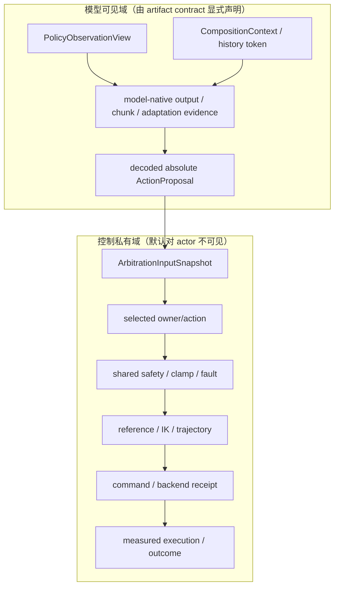

`reward`、owner、safety 修改、IK 状态和 dispatch metadata 不会因为“数据集中存在”就自动进入 actor 输入。
critic、reward、audit 或下一代 actor 是否能看到这些字段，由版本化 `TrainingViewContract` 和 artifact contract
单独声明。

---

## 3. 多频率不是一条固定流水线

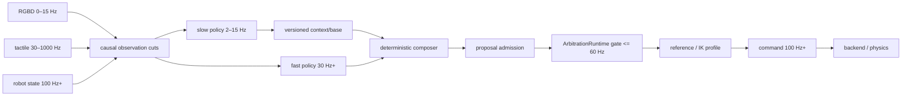

| 时钟 | 是否受 Arbiter 60 Hz 限制 | 当前说明 |
|---|---:|---|
| sensor / native recording | 否 | 保留原生 timestamp、frame ID、age 和 gap |
| policy/context/proposal producer | 否 | >60 Hz proposal 会被 causal cut 合并，不能保证逐条 selected |
| authoritative Arbiter decision publication | **是** | production decision policy v1：不超过 60 Hz |
| safety veto / HOLD / FAULT | 否 | 可异步立即使旧 execution epoch 失效，不伪装成普通超频 decision |
| coupled IK | 否（独立 capability） | 当前稳定验收约 60 Hz；不得把 nominal 75 Hz 配置当作真实验收 |
| reference interpolation / command / backend / physics | 否 | 可高于 decision rate，不能反向制造新 selected action |

当前 `15→60→120`、`15→75→150` 只是 profile，不是架构中的全局整数倍时钟。

---

## 4. 当前实际接线

### 4.1 真机 policy：legacy 执行 + passive shadow

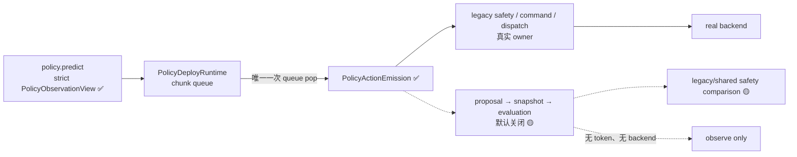

开启 shadow 不得再次读取模型、pop queue、改变 chunk index、`last_action`、dispatch count 或 loop rate。

### 4.2 GUI human：同一 emission 的被动观测

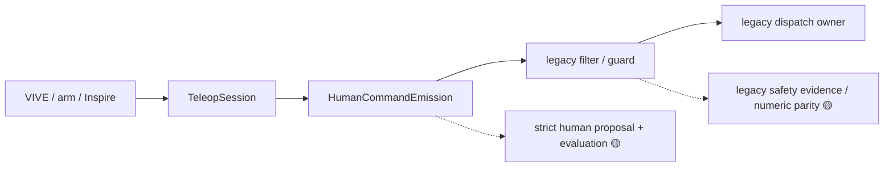

DMTAC 仍在 `TeleopSession` 外，是独立未覆盖支线；启用它的 formal profile 不能宣称 human action lineage 完整。

### 4.3 Replay：解释、binding 与 authority 分层

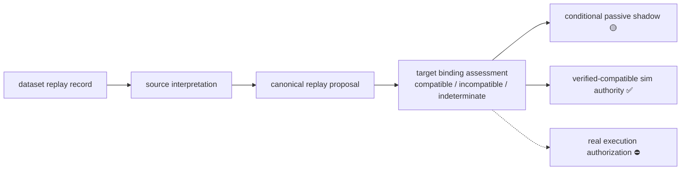

source fact、target compatibility 和 execution authorization 是三个不同 gate；不存在一个同时表达三者的
`compatible: bool`。

### 4.4 Sim：当前唯一的新 authoritative vertical slice

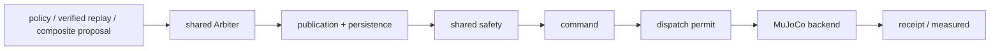

已覆盖 scoped policy、verified replay、cancellation/HOLD、deterministic 10/40/30 Hz slow/fast composition，以及
受限 async completion queue 的 jitter/deadline/cutoff/restart/burst/HOLD 竞争；scheduled qpos profile 还具有
receiver-side segment admission和实际120 Hz planner/qcmd lineage。它仍不是OS/GPU policy worker、generic DAG、
native RGBD/tactile或真机stop acknowledgement。deterministic facade与真实MuJoCo已有测试侧formal
seal/commit/read fixture；仍缺production sim entrypoint、长稳/power-loss/目标机性能验收。

---

## 5. Action 与执行事实如何分层

```mermaid
flowchart LR
    P1["human proposal"] --> Snap["ArbitrationInputSnapshot"]
    P2["policy proposal"] --> Snap
    P3["replay/composite proposal"] --> Snap
    Snap --> Selected["selected canonical action"]
    Selected --> Safe["safe canonical action"]
    Safe --> Target["ResolvedExecutionTarget"]
    Target --> Direct{"target kind"}
    Direct -->|"DIRECT_COMMAND"| BackendAccept["backend accepted"]
    BackendAccept --> DirectCommit["eligible anchor commit"]
    Direct -->|"POSE / QPOS / TRAJECTORY REFERENCE"| Segment["ReferenceSegmentAdmission"]
    Segment --> Pending["pending/effective anchor commit"]
    Segment --> Reference["derived reference frames"]
    Reference --> IK["IK / planner output"]
    IK --> Command["backend command"]
    Command --> Receipt["dispatch receipt"]
    Receipt --> Measured["measured state"]
```

这些阶段可具有不同 schema，不能共用一个 component mask，也不能从 command 数值反推 proposal owner。
事实层不定义默认训练 target；具体训练任务必须显式选择 action stage、component mask 和 provenance。

### Position reference 与安全 anchor

```mermaid
sequenceDiagram
    participant K0 as Earlier endpoint K_i / measured rebase
    participant K1 as Later safe endpoint K_i+1
    participant W as 60 Hz position worker
    participant S as Reference segment
    participant A as Safety anchor state

    K0->>W: ordered START parent
    K1->>W: ordered END parent
    W->>S: shared worker admits segment with both parents and interval
    S-->>A: create pending END commit candidate
    Note over S,A: active only when endpoint effective time is reached,<br/>evidence is causally available, and segment remains valid
    loop high-rate derived references
        S->>W: interpolate/resolve reference frame
    end
    S-->>A: supersede/cancel invalidates pending commit
    Note over W,A: derived frames do not create new Arbiter decisions<br/>and do not repeatedly commit the anchor
```

这是已确认、已在 scoped deterministic MuJoCo qpos receiver 接入、但尚未进入真实 position worker 的语义。图中的 earlier/later 是时间角色，不是左右机械臂；每个 parent
可以包含 coupled 双臂 component。admission 只说明执行目标/segment 被接纳，不等于 backend
执行成功、tracking 成功或连续碰撞安全；后续故障仍须通过 typed rejection、HOLD 和 execution epoch 处理。
legacy observation、counterfactual shadow 和 authoritative shared segment 也必须分型；只有最后一种能推进真实
safety anchor。

legacy worker 接入采用三层成熟度，不能从 observe-only 直接跳到 canonical admission：

```mermaid
flowchart LR
    Worker["legacy worker<br/>actual parent pair/reference"]
    Raw["LegacyPositionReferenceSegmentObservation<br/>first observed derived reference<br/>local generation namespace"]
    Bound["BoundLegacyReferenceSegmentObservation<br/>typed context + enforcement evidence<br/>non-authoritative"]
    Shared["ReferenceSegmentAdmission<br/>shared worker enforced M1C guards"]

    Worker --> Raw --> Bound
    Bound -. "does not upgrade" .-> Shared
```

e2-b 只实现实线部分。`CONTEXT_ONLY` 表示调用方提供了 execution epoch/generation，但 legacy worker 未检查；这不等于
`CREATION_CHECKED`、`DEQUEUE_CHECKED` 或 `PRE_BACKEND_CHECKED`。raw/bound observation 不推进 anchor、不申请
permit、不进入 backend。exact/hold reference 是独立 frame derivation，不伪造双 parent interpolation segment。

---

## 6. v2.4 数据与训练闭环

```mermaid
flowchart TB
    subgraph Capture["不可变 capture facts"]
        Native["native streams<br/>RGBD / tactile / state"]
        Source["human input / policy output / context"]
        Control["proposal / snapshot / decision / safety"]
        Execution["reference / command / receipt / measured"]
        Terminal["task / termination facts"]
    end

    Capture --> Seal["episode seal + commit<br/>durable high-water / completeness"]
    Seal --> Overlay["immutable derived overlay"]
    Overlay --> Reward["reward / annotation / intervention segmentation"]
    Overlay --> View["BC / DAgger / RL / fast-policy TrainingView"]
    View --> Train["learner"]
    Train --> Bundle["PolicyArtifactBundle"]
    Bundle --> Preflight["offline replay → sim → real shadow → authority"]
```

| 层 | 是否为在线事实 | 可否重新派生 | 例子 |
|---|---:|---:|---|
| 原始事实 | 是 | 否 | SensorSample、human input、PolicyOutput、ActionProposal |
| 在线控制事实 | 是 | 否 | snapshot、selected、safety、reference、receipt、measured |
| 学习派生事实 | 否 | 是 | reward、expert mask、credit window、intervention segmentation |
| 物化视图 | 否 | 是 | ActualDecisionView、fixed-rate BC/DAgger/RL view |

公开 capture finalize 后保持不可变；离线 reward、annotation 和新 TrainingView 写入引用 parent capture hash 的
derived overlay，不回写已 sealed 根目录。是否能训练不使用一个全局布尔值，而按 profile/view 报告 control trace、
各 stream、lineage 和 replay capability 的完整性。

---

## 7. 当前里程碑地图

```mermaid
flowchart LR
    M0["M0 baseline ✅"] --> M1["M1A–D contracts ✅"]
    M1 --> M2["M2 passive emission ✅"]
    M2 --> M3["M3 policy shadow 🟡"]
    M3 --> M4["M4 trace core / scoped durability 🟡"]
    M4 --> M5["M5 human + replay shadow 🟡"]
    M5 --> M55["M5.5 authoritative sim 🟡"]
    M55 --> M57["M5.7 shared execution parity<br/>当前"]
    M57 --> M58["M5.8-a1 pure gate + inventory 🟡<br/>M5.8-b authorized real mediation ⛔"]
    M58 --> M6["M6 single-policy real authority ⛔"]
    M6 --> M65["M6.5 replay authority ⛔"]
    M65 --> M7["M7 native streams / learner / multi-policy ⏳"]
    M7 --> M8["M8 multi-policy authority ⏳"]
```

异步 action chunk/RTC 是独立 deployment producer 支线，不改变上述 M5.8/M6 motion gate：

```mermaid
flowchart LR
    Sync["sync_queue_v1 production ✅"] --> R1["RTC-1 pure plan ✅"]
    R1 --> R2["RTC-2 deterministic sim ✅"]
    R2 --> R3A["RTC-3a isolated worker 🟡"]
    R3A --> R3B["RTC-3b split parity ✅"]
    R3B --> R35["RTC-3b.5 single admission truth ✅"]
    R35 --> R3C["RTC-3c virtual / no-action local dry-run ✅"]
    R3C -. "typed preview gate later" .-> R3D["RTC-3d lookahead ⏳"]
    R3C --> R4A["RTC-4a generic protocol / local migration ✅"]
    R4A --> R4BA["RTC-4b-A final-chunk offline adapter ✅"]
    R4BA --> R4BT2B["RTC-4b-T2b existing-server<br/>synthetic / no-action ✅"]
    R4BT2B --> R4BT2C["RTC-4b-T2c live worker→plan<br/>synthetic / no-action ⏳"]
    R4BA --> R4BB1["RTC-4b-B1 caller-free<br/>model seam ✅"]
    R4BT2C --> R4BT3["RTC-4b-T3 OpenPI raw-RTC caller\ndefault-off/no-action 🟡"]
    R4BT3 --> R6["RTC-6 real no-action shadow ⏳"]
    R4BT2B -. "optional continuation wiring" .-> R4BB2["RTC-4b-B2 capability/server<br/>integration ⏳"]
    R4BB1 --> R4BB2
    R4BB2 -. "optional richer provider" .-> R6
    M6["M5.8/M6 exact owner + hardware gate"] -. "independent prerequisite for motion" .-> R6
```

RTC-3c仅在RTC profile禁用position lookahead；现有`sync_queue_v1`数值、顺序、pop与emission hash不变。raw-RTC result
不能经RTC-3b candidate写入legacy deque；timed-plan唯一admission、transition-first和worker session已由RTC-3b.5
pure/local-only关闭。RTC-3c已在existing deploy application以默认关闭、builtin hold、`send_actions=false`接线并通过
local long-run/lifecycle fixture；它不等于real shadow或motion authority。RTC-4a generic capability/envelope/receipt与
两个local backend迁移fixture已闭合，且不导入具体模型/transport/sim/real backend。RTC-4b-A已用可替换的OpenPI
raw-RTC final-chunk adapter完成artifact/server/payload/continuous+discrete output/V22 codec离线往返，但只声明
`continuation=none`。RTC-4b-T2b已直接复用现有server完成synthetic transport/no-action loopback；T2c完成了
caller-free bounded worker/timed-plan live composition；T3又在既有OpenPI launcher增加显式 raw-RTC caller，复用同一
transport/client，profile固定`send_actions=false`并关闭lookahead，尚无真实observation/action-send evidence；
可选支线RTC-4b-B1已完成default-off、无server caller的model-side prefix seam，B2才负责capability/server接线与可验证
conditioning receipt。B支线不是RTC-4b-T或`continuation=none` RTC-6 no-action shadow的前置条件。RTC-3d typed
preview/lookahead仍是独立gate。
RTC-4b-B首个provider可以覆盖某个可检测的model/backend家族，但生产启用条件不得包含checkpoint/config名称或固定
horizon/dimension；unsupported实例的legacy部署必须保持可用。

M5.7 内部当前顺序：

```text
M5.7a   shared execution pure shadow                         ✅
M5.7b   safety-anchor lifecycle                              ✅ pure
M5.7c1  policy legacy-aligned comparison                     🟡 frontend shadow
M5.7c2  counterfactual anchor chain                          ✅ pure
M5.7d-a human direct legacy safety evidence                  🟡 frontend shadow
M5.7e1  resolved execution-target admission                  ✅ pure
M5.7e2a ordered segment + target-time anchor contract        ✅ pure
M5.7e2b1 raw legacy worker passive observation                🟡 scoped
M5.7e2b2 typed bound projection                               ✅ pure
M5.7e2b3 post-resolver legacy outcome                         🟡 scoped
M5.7e2b4 local-generation terminal                            🟡 scoped
M5.7e2b5 explicit resolver/planner failure observation         🟡 scoped
          production binding caller                           ⏳ blocked by shared context
M5.7e2c0 authoritative dispatch context seam                 🟡 scoped
M5.7e2c1 immediate + scheduled activation profiles           ✅ pure/default-compatible
M5.7e2c2 sim qpos segment + anchor timeline                  🟡 scoped
M5.7e2c3 actual 120 Hz planner/qcmd lineage                  🟡 scoped
M5.7e2d scheduled ControlTrace + conditional lineage          🟡 scoped
M5.7d-b human qpos limiter parity                            🟡 scoped
M5.7d-c position receipt/audit pure join                     ✅ pure/scoped
         production async join + ControlTrace                ⏳
M5.7f   SafetyMigrationMatrix pure gate                        ✅ pure
         first arms-only M5.8-a scoped matrix                  ✅ inventory-only
         M5.8-b/M6 evidence closure                              ⏳ blocked
         arms-only ControlExecutionManifest + trace dependency ✅ pure/formal fixture
         static SafetyConstraintOverride admission             ✅ pure / ⏳ caller migration
M5.8a1  pure final-call gate                                  ✅ fake only
         RM65 quick-stop operation + per-tick permit            ✅ pure/fake only
M5.8a2  legacy callback adapter/direct+async fake parity       ✅ scoped
M5.8a3  arms-only exact RM65 seam inventory                   ✅ structurally complete
         joint-target motion/home/quick-stop typed seam         ✅ pure wrapper / production unbound
         remaining required seams                               ⛔ unwrapped/not authorized
M5.8a4  one legacy owner/epoch/inventory composition          ✅ fake_only_unbound
         group check + final one-shot gate                       ✅ fake; not atomic real worker
M5.8a5  all-required-worker epoch drain aggregate              ✅ pure/fake
         arms-only 3-participant drain plan                      ✅ scoped/unbound
         real worker receipt + drain barrier                       ⏳ not wired
M5.8a6  manifest/inventory/drain/matrix evidence bundle          ✅ unbound
         shared runtime adopts same owner/token/epoch source   ✅ fake handoff
M5.8a7  RM65 joint-target default-off pre-SDK adapter           ✅ pure wrapper / production unbound
M5.8a8  RM65 stop/start/cleanup per-call typed adapter           ✅ pure wrapper / production unbound
M5.8b0  stationary exact Slow-Stop final-call field evidence     ✅ scoped/partial-lineage
M5.8b1  typed work carrier + real-worker drain methods           ✅ default-off/fake SDK
         unique fake composition + quick-stop/trace/deadline       ✅ default-off
         isolated real-A idle-worker composition + mock fixture     ✅ code-ready
         real-A field drain/stop evidence                            ✅ scoped/idle-only
         target-bearing production worker mediation                 ⛔ separate authorization
M5.8b   real backend gate under legacy owner                  ⛔ before above complete
```

M4L/M5L learning observability 是并行支线：纯 contract/fixture 已开始，但真实模型 adapter 尚未暴露 fast-weight、
noise 或 model-native chunk evidence。它不阻塞 M5.7e2，也不能因没有具体模型 API 而在通用 runtime 中猜字段。

---

## 8. 尚未解决的问题与前提

| 优先级 | 缺口 | 当前影响 | 解除条件 |
|---|---|---|---|
| P0 | canonical real position reference admission 尚无 runtime producer | deterministic sim已有canonical admission；legacy pre/post-resolver及local terminal仍未enforce M1C | 真正shared worker在creation/dequeue/pre-backend检查epoch/token后生产real admission |
| P0 | scheduled generation 的真实 worker enforcement 尚未接 | sim receiver已分离active generation与pending reservation并在START原子切代；legacy worker仍只提供观察事实 | 将同一语义接入真实worker的creation/dequeue/pre-backend检查；不得把scoped sim结论外推到真机 |
| P0 | formal sim capture 尚缺production/长稳 acceptance | deterministic与真实`MujocoScene + actuated rig`均已用真实WAL/owner/seal/commit/reader重建；START前HOLD不伪造activation/frame；seal后进程终止保持uncommitted且可审计恢复 | 当前成熟度为`formal_sim_capture_fixture_complete`；继续补长稳/power-loss/目标机性能，不能称production sim entrypoint |
| P0 | SafetyMigrationMatrix 尚未闭合到 real mediation | 首个arms-only M5.8-a matrix已签署inventory-only evidence，但所有included rule在M5.8-b/M6仍blocked | 接真实worker/backend evidence后逐条关闭；不能由inventory hash推导硬件ready |
| P0 | 真机最终 backend seam 尚未完成全链校验 | M5.8-b0两侧exact Slow-Stop permit均accepted、SDK=0、8.6/10.8 ms且无可辨qpos运动；binding明确motion=false。首轮evidence lineage为partial v1，且只有hold final-call seam | 新格式补完整authorization/permit trace；后续另行授权并绑定motion worker、drain barrier与全部required seam gate |
| P0 | target-bearing real worker cancellation ack 未接production | real-A已证明无target真实worker可按同一epoch完成三participant drain并持久化诊断WAL；本次discarded/in-flight均为0，不授予motion，也不等于production caller | 带target/in-flight work的production mediation仍需独立授权、composition和验收，失败则保持legacy owner并FAULT |
| P0 hardware gate | 有限步只读 SDK state 已通过，但运动安全链尚未验收 | 两侧各5次state/tool-frame读取返回0且`arm_err/sys_err=0`，TCP profile明确且qpos在URDF内；左J3仅余0.069 rad | 在独立窄授权下验证joint-enable/ESTOP物理链、fresh-state preflight、legacy-owner permit、drain和stop ack；只读证据不得提升为motion evidence |
| scoped field evidence | M5.8-b0 stationary Slow-Stop | 两侧permit accepted、SDK=0、post delta `<5.3e-5 rad`；只证明exact final safety call，首轮expanded lineage不完整 | 保留fixture/hash审计；不据此声称physical ESTOP、worker drain、measured-stop或motion mediation完成 |
| scoped field evidence | M5.8-b1-real-A idle-worker drain | 真实worker 103/93 idle tick、send=0、epoch 0→1、三drain receipt、两Slow-Stop及10/10 durable fact均通过；manifest/default未变化 | 保留fixture/hash；不得seal为公开capture或继承为后续motion配置/M6 authority |
| closed/no-hardware | RM65 default/runtime limit 与 active URDF曾冲突 | 共享limit镜像、backend/sim消费者与RL task profile已统一到URDF J4 ±2.44346 rad；解析URDF的漂移测试锁定；历史3.10 fallback已移除 | 真机home仍必须来自显式station alignment或fresh measured，默认preview seed不构成motion evidence |
| P0 integration | 并行sim actuation profile v1→v2原子收口 | 先前Cube-Lift config/test与real2sim source SHA漂移已同步 | 2026-07-21全量2605 passed、6 skipped，CS-2 baseline gate已恢复 |
| closed/deploy-local | RTC timed plan与RTC-3b legacy queue曾是两套admission语义；模型协议也曾与具体OpenPI计划耦合 | RTC-3b.5/3c建立唯一producer/emission seam；RTC-4a将scheduler/continuation、capability/envelope/receipt与local/remote backend seam独立于具体模型和真机；RTC-4b-A完成首个可替换OpenPI final-chunk离线adapter，可选B1完成caller-free/default-off model seam；T2b已完成existing-server synthetic/no-action兼容证据 | RTC-1～4b-A聚焦回归130 passed，当前兼容矩阵154 passed、1 skipped；B1 pure/fake 16 passed、2 deselected，V22回归10 passed、3 skipped；默认sync/no-action边界不变；下一主路径门槛是T2c live synthetic worker→timed-plan composition，B2 capability/server continuation接线独立后置 |
| P1 | human position formal join、hand/DMTAC 未覆盖 | pose/qpos limiter parity与position receipt→audit pure join已有，但production async join/ControlTrace及hand链仍不完整 | 独立 profile/binding；不适用则显式 `not_applicable` |
| P1 | measured divergence guard 无真机阈值 | 不阻塞 legacy-owner M5.8-a wrapper，但阻塞 M6 shared authority | capability/profile 给出阈值、freshness、violation policy 和验收 evidence |
| P1 | policy/replay/formal sim capture 未接 production owner | 当前 trace 不能作为完整公开训练 capture | source-specific requirement profile、episode owner、WAL/seal/reader 验收 |
| P1 | async slow/fast topology 尚无真实 worker | 受限deterministic completion queue已覆盖jitter/restart/cutoff，但不能代表OS/GPU并发或network partition | production worker/supervisor另行shadow验收；不以M5.5e1冒充 |
| P2 | native tactile/state stream 未落地 | 不能构造高频 tactile/fast-policy view | M7A StreamCatalog、native writer、cut/window reader、gap policy |
| P2 | learning observability 只有纯 contract | Flow/noise、episodic adaptation 等不可恢复事实尚未产生 | concrete policy adapter 提供真实 API 后接 typed evidence hook |
| P2 | learner/artifact closure 未实现 | 尚未完成 capture→train→artifact→redeploy 的实证闭环 | M7B deterministic views、training manifest、artifact preflight 与 shadow |
| P2 | canonical action carrier/execution v1 仍绑定left/right、direct arm qpos6与每side一个q6/q16末端 | 不限制arm pose fusion；阻塞非left/right和一个arm多个末端的低成本接入 | additive component carrier→v1 lossless adapter→新target profile；7DoF resolver独立验收 |
| P1 capability gap | committed v2.4没有copy-on-write维护工具 | in-place episode compact与tactile recompress已在任何写入前fail closed，原capture保持immutable；不影响capture/read/train或纯控制M5.8-b | 后续实现parent-hash + derivation manifest + 新dataset/commit identity的derived maintenance；禁止重写原root |

### 并行改动对主线的影响图

```mermaid
flowchart LR
    Parallel["并行功能改动"] --> Exact["exact manifest/hash preflight"]
    Exact -->|pose/camera/rate匹配| Candidate["RM65 arms-only候选"]
    Exact -->|OpenPI/DMTAC/UMI/RL不同profile| Separate["独立ExecutionManifest"]
    Candidate --> Regress["全量无硬件回归"]
    Regress -->|5 failures closed| M58["M5.8-b另行真机授权"]
    Regress -->|仍失败| Block["fail closed"]
    Parallel --> Capture{"是否已commit v2.4"}
    Capture -->|是| Derived["copy-on-write derived dataset"]
    Capture -->|否/legacy| Maintenance["显式profile下维护"]
```

| 变化 | 当前结论 |
|---|---|
| workspace-near-boundary pose默认值 | 影响artifact/dataset frame contract；只认payload/hash，不认历史文件名 |
| RealSense YUYV native transport与v3 placement | source adapter保持配置色彩输出，但camera manifest必须重新绑定 |
| 15/60/120默认timing | 仅profile默认；不把reference/command误限到Arbiter 60 Hz |
| DMTAC/UMI/OpenPI/RL新增能力 | 独立profile，不继承arms-only候选的authority evidence |
| finalized episode compact/触觉重压缩 | 对committed v2.4暂时禁止原地apply；必须生成derived dataset |

```text
Profile能力复用
  shared code/contract/pure evidence            可按hash复用
  exact相同URDF/component/backend seam evidence 可作为parent引用
  profile-specific delta evidence               只补差异
  real motion authorization                     不跨manifest继承
```

这表示profile不会因独立授权而落后；它会同步获得共享功能，只在自己的execution/safety/hardware差异尚未验收时
保持shadow或blocked。

reference-segment、pending/effective commit语义已经确认并完成pure contract。e2-b已有scoped pre-resolver、
post-resolver和local-generation terminal，bound projection也有pure fixture；production binding caller、per-frame failure
outcome和real M1C enforcement仍未接。它们补齐前，任何legacy observation都不能被投影为canonical admission。

---

## 9. M5.8 前的 Go/No-Go

首个放行单位固定为`m6_candidate_policy_arm_qpos_v1`：policy-only双臂qpos motion authority、30 Hz decision、
scheduled segment与当前120 Hz planner/qcmd evidence。operator只通过独立safety/lifecycle permit执行HOLD/ESTOP/
recovery/home/rearm，不产生human motion proposal；hand/DMTAC/replay/pose impedance/fix-arm human均由manifest显式
`not_applicable`。图中的60 Hz若出现只表示timing/capability语义，不表示已有60 Hz reference producer。

只有以下条件全部满足，才可把 dispatch gate 接到真实 legacy backend seam：

- 每个启用的 frontend 有显式 safety-anchor/target profile；
- policy、human direct、position 的 legacy/new comparison 可解释；hand/DMTAC covered 或明确不适用；
- typed execution-target/reference publication 和 anchor commit point 已接真实 worker；
- SafetyMigrationMatrix 不再存在 `pending-contract`；
- M1C execution epoch 覆盖 pending reference/command callback；
- motion、safety-control、lifecycle permit 分型明确；
- 异步 worker 的每个实际 SDK tick 使用独立 one-shot permit；上层 keyframe permit 不得跨 tick复用；
- RM65 quick-stop 多 tick 与 DMTAC live torque update 已有窄 typed operation，不能依赖通用 bypass；
- gate 接线前后 legacy command 数值、数量、顺序不变；
- 整个 M5.8 期间 motion owner 仍是 `legacy_control_path`。

M6 只允许做 owner token 切换，不得同时首次引入 shared safety、reference publication、dispatch gate、新 learner、
fast weights、noise adapter 或 replay 真机 authority。

---

## 10. 代码与文档定位

| 主题 | 当前主要位置 |
|---|---|
| canonical action/proposal/Arbiter | `robot_motion/action/` |
| receiver admission/epoch/dispatch owner | `robot_motion/runtime/` |
| policy observation/chunk/emission | `robot_motion/deploy/` |
| position/reference/IK | `robot_motion/position_control/`、`teleop_runtime/position_control/` |
| real frontend wiring | `teleop_runtime/session.py`、`teleop_runtime/deploy/run_policy.py` |
| human/replay shadow adapters | `teleop_runtime/action/` |
| ControlTrace runtime | `teleop_runtime/control_trace/` |
| persistent contracts/readers | `dataset_contracts/`、`dataset_interface/` |
| authoritative sim fixtures/backend | `sim/mujoco/` |
| async action chunk / RTC | [`dexteleop_rtc_visual_guide.md`](../dexteleop_rtc_visual_guide.md)、[`dexteleop_rtc_landing_plan.md`](../plans/dexteleop_rtc_landing_plan.md) |
| unified Control Station / GUI | [`dexteleop_control_station_plan.md`](../plans/dexteleop_control_station_plan.md) |
| detailed target architecture | [`dexteleop_architecture_planning.md`](../plans/dexteleop_architecture_planning.md) |
| exact batches and rollback | [`dexteleop_control_core_landing_plan.md`](../plans/dexteleop_control_core_landing_plan.md) |
