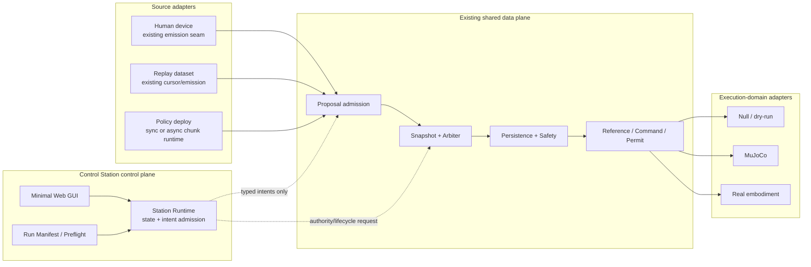

# DexTeleop Control Station：多源控制实验台与统一 GUI 落地规划

状态：`CS-2a human + CS-2b-c pose replay + CS-2c sync-policy + CS-2d RTC-policy formal fixtures scoped complete；CS-3a existing deploy RTC passive source scoped complete；CS-6a/6b direct arm-qpos mixed仅保留debug/contract fixture；CS-6b1c passive human ingress complete；CS-6b1d arm-pose mixed sim第一段与replaceable strategy shadow complete；CS-6b1e device-neutral passive pose source已接入replay-authoritative sim；CS-6b1f opt-in pose HIL formal capture complete；CS-6b1g fixed-weight SE(3) generic composition及shared-receiver dual-input sim shadow complete/default-off；CS-6b1h composer-only formal pose fusion deterministic sim第一段complete/default-off；CS-6b1i generic typed composition session + formal sim capture complete/default-off，typed re-arm/GUI/real/policy/RTC pending；CS-6b2a passive component source contract complete；CS-6b2b sample/admission/safety前置 complete；CS-6b2c opt-in multi-group pose+DMTAC formal sim execution complete；CS-6b2d receiver cut + native stream storage/reader sim fixture complete；CS-6b2e native stream episode seal/commit binding complete；CS-6b2f bounded inline process seam complete；CS-6b2g external receipt + post-finalize native seal本地契约 complete；CS-6b2h selected RGB process receipt bridge complete/default-off；native-rate RGBD、高频tactile与顶层profile接线仍pending / no production entrypoint / no real motion authorization`

更新日期：2026-07-24

当前实现状态：

- 根级 `control_station/contracts.py` 已落地manifest、source slot、target binding、无raw-action字段的typed
  intent、receiver admission receipt和operator-control lease；
- `control_station/state_machine.py` 已落地deterministic CS-0 lifecycle reducer，覆盖manifest/revision/
  lease fail-closed、source/target connect/preflight、shadow、HOLD/ESTOP和STOPPED；连接、预检与shadow均严格区分
  `operation_requested`和带evidence的typed completion，intent accepted不会冒充adapter success；
- `control_station/{adapters,runtime}.py` 已增加无I/O的null target/fake source、串行receiver admission与独立
  operation-result admission seam；adapter执行不持有station admission lock，且仍无action/dispatch/predict/cursor/episode API；
- `control_station/operation_coordinator.py` 已落地CS-1c有界coordinator：容量覆盖queued+in-flight work，operation在
  intent admission前先预留容量，queue full/not-running会以HTTP 503在runtime admission前拒绝，因而不会遗留无法完成的
  pending operation；只接受exact manifest coverage的`DeterministicNoIoStationAdapter`，adapter异常会转为typed failure并
  恢复prior station state；
- `control_station/events.py` 已落地容量1–4096的non-authoritative UI event ring。慢reader不反压runtime，淘汰会显式返回
  `gap_detected/total_evicted`；event publish失败只计数，不改变intent/result admission。它不是ControlTrace、capture fact或
  completeness evidence；
- `control_station/status.py` 与 `web/` 已增加可丢弃重建的status projection、独立HTML/JS/CSS、CS-1a只读builder及
  CS-1b typed-intent builder；CS-1b强制null target、manifest显式排除motion、loopback bind、显式bearer token、same-origin
  检查、16 KiB默认上限、exact字段白名单和safe-intent allowlist；
- `control_station/sources/synthetic_human.py` 与 `composition/mujoco_human.py` 已落地CS-2a1：无设备、无worker、无queue的
  synthetic双臂q6 source生成immutable `HumanCommandEmission`，经现有`HumanProposalAdapter`进入同一
  `MujocoDeployRuntime` authoritative core；exact manifest禁止额外replay/composer authority和binding漂移；
- CS-2a1 binding只证明`authoritative_data_plane_bound=true`，同时明确
  `station_authority_lifecycle_bound=false`；它不暴露浏览器raw-action API，不拥有formal episode，也不新增production入口；
- CS-2a2a已用`deployable_sim_scheduled_qpos_v1`、source-specific synthetic-human execution manifest、真实WAL/
  `EpisodeTraceRecorderSink`/seal/commit/committed reader完成test-side formal capture；immediate-qref仍保持`fixture_only`，不能
  因trace sealed就冒充commit-eligible；测试fixture只负责wiring，没有复制episode或持久化逻辑；
- `state_machine.py`与`composition/mujoco_human_station.py`已完成CS-2a2b scoped lifecycle fixture：candidate/authority intent
  只建立pending operation，带binding/owner/epoch/gate evidence的completion才推进状态；`active/running` completion后才开放
  synthetic-human publication。release会先关闭publication，再由同一MuJoCo core接纳HOLD并产生execution cancellation；Station
  保持`hold` latch，不会自动回到armed。该fixture没有新建Arbiter、owner token、epoch registry或dispatcher；
- 根级source-agnostic `StationPublicationBarrier`已把proposal admission与release线性化：barrier锁覆盖既有lower admission；
  已经开始的admission先完成，随后release关闭barrier并由lower HOLD取消旧execution epoch，release不能插入半次admission；
  release HOLD失败时Station进入latched `fault`，不能从prior active状态派生回`running`；
- CS-2a2b又增加测试侧bounded `SideEffectStationOperationCoordinator`：容量在intent admission前预留，release request在
  worker入队前关闭barrier，prepare/adapter异常会生成typed failure并清除pending；它复用同一station result-admission seam；
  其中`operation_prepare`的正式边界已冻结为：对`operation_requested`在入队前执行；lease acquisition/release、stop_runtime等
  不拥有pending operation的accepted intent不调用prepare，只有显式lower-safety的`hold`/`estop`例外。pending operation的
  prepare异常会在同一receiver admission seam生成`operation_prepare_exception:<ExceptionType>` typed failure、解决并清除
  pending、释放capacity且不入队；非operation safety prepare失败和无法完成result admission的coordinator/lifecycle内部错误
  继续抛出，避免伪造无pending的operation completion；
  现有CS-1c Web builder以exact type只接受no-I/O coordinator并明确拒绝该side-effect worker；
- 独立`build_scoped_sim_authority_control_station_server()`现已只为CS-2a2b开放typed lifecycle/candidate/authority API：
  exact side-effect coordinator、exact sim target、loopback bind以及`browser_raw_action_submission/real_motion/
  production_entrypoint`三项manifest exclusion缺一即拒绝。Web token仍只授权HTTP；lease、typed completion、publication
  barrier与既有MuJoCo owner/epoch检查独立生效。状态页从server allowlist动态生成intent选项并显示non-authoritative
  publication/owner/epoch projection；raw qpos/action、real target和旧CS-1c widening均已测试拒绝。该builder无production caller，
  因此仍不能称production Station authority binding；
- `control_station/control_trace.py`现已冻结`station_run_manifest`、intent/result transition与publication-barrier transition
  的纯投影和注入式`StationControlTraceBridge`；coordinator与barrier observer在scoped composition中自动发布这些事实，
  bridge不拥有episode/WAL或durability policy；
- `deployable_sim_scheduled_qpos_station_v1`现已将Station四类事实和scheduled-qpos执行链作为required family。测试侧
  composition复用真实MuJoCo runtime、ControlTraceRuntime/WAL、subordinate episode lifecycle、seal/commit publisher和
  committed reader，完成control-plane→proposal→decision→segment→planner/qcmd→HOLD/cancellation闭环。旧profile把新增
  事件保持optional，因此不改变公开数据集既有finalize/seal；该结果仍只称formal fixture/runtime integration，不称production
  Station entrypoint；
- Web token、operator-control lease和motion authority严格分离；CS-1b仍只做receiver admission；CS-1c的HTTP线程也只做
  typed parse/admission与nonblocking enqueue，响应明确`adapter_executed_inline=false`，completion只由独立worker返回；
- CS-2b-a已完成qpos-compatible exact immutable replay emission；CS-2b-b已完成exact arm-base pose与verified
  canonical-desk transform两种独立sim manifest。pose保持proposal/selected/safe，desk→arm-base只在shared safety后、
  coupled IK前发生，qpos是独立resolved target；source adapter不做IK或frame conversion；
- `teleop_runtime.replay.emission_fanout`现允许existing executor一次构造的同一immutable emission进入GUI shadow和外部
  bounded subscriber；per-subscriber full/error均不影响legacy replay。root `ReplayGuiStationConsumer`显式启动并只经Station
  publication barrier提交；CS-2b-c测试侧composition现复用真实dataset loader/preflight/worker和同一个checked
  `ReplayTrajectoryGroup`，没有第二cursor、resampler或source-frame fact。replay专用
  `deployable_sim_scheduled_pose_to_qpos_station_v1` profile已完成WAL、seal/commit和committed reader重建；legacy Rig仅由
  device-free fake替代，故成熟度仍是formal fixture而非production GUI或真机replay authority。现有`qpos_target` GUI分支
  没有lower-owned immutable emission seam，继续fail closed；
- `composition/mujoco_human_replay.py`已落地CS-6a首个双source **direct-qpos debug/contract fixture**：exact synthetic-human q6与
  already-created immutable qpos replay emission共享同一`MujocoDeployRuntime`、ActionArbiter、dispatch owner、execution
  epoch与scheduled receiver。source切换固定为`HOLD/cancel old epoch → optional release → typed takeover → READY`，
  authority event同时推进dispatch-owner registry看到的authority epoch，避免decision epoch与最终permit gate分叉；inactive
  source在任何source fact/proposal产生前拒绝；
- 2026-07-23 representation gate冻结：除显式debug fixture外，mixed human/replay/policy的arm source、selected和
  canonical-safe component统一为pose。arm qpos只能作为verified frame transform与coupled IK之后的resolved execution target，
  不能成为当前arm mixed source contract。夹爪、q6/q16手保持typed qpos/native continuous representation，未来走独立
  active-mask-aware interpolation与component safety，再与arm decision合成。现有CS-6a/6b direct arm-qpos fixture保留用于
  authority/epoch/cancellation/readiness因果验证；arm direct-qpos mixed延后到同构臂profile；
- CS-6a不是连续blend，也不是双source同时component ownership。v1一个session内每个source最多激活一次，因而只覆盖
  human→replay或replay→human的一次单向交接；在typed proposal invalidation或新producer epoch未接入前，明确禁止切回曾
  激活source，避免proposal buffer中的旧future在重新取得lease后复活。MuJoCo HOLD同时清除active scheduled reference并对
  planner quick-stop，后续新generation不会执行已取消旧work；
- 2026-07-22复核冻结：CS-6a的`takeover → READY`只能视为synthetic fixture的最小离散交接证据，不能复用于真实human接管。
  policy/replay等非human source停止后，即使human device仍connected，也只能保持observe/candidate；human publication不得自动
  开放。正式human takeover必须保持execution gate为HOLD，清除takeover前proposal，等待post-takeover fresh human emission、
  fresh measured state、deadman重新武装、retargeter rebase与canonical safety evidence全部完成后才允许READY。任一步失败均
  留在HOLD；HOLD失败进入FAULT，不回退旧source；
- capture lifecycle与motion lifecycle继续正交：现有teleop的`episode_stop`固定为`capture_only`，不得改变authority或停止
  tracker/IK；新的mixed formal profile固定为`hold_before_unbind`，先关闭source publication并取得HOLD/cancellation/terminal
  evidence，再解除episode membership。两种策略必须写入manifest，不能由GUI按钮或recorder finalize隐式选择；
- policy暂停分型为`suspend_policy_keep_reference`与`hold_and_release_authority`两种不同操作语义。
  前者不允许handoff；后者必须关闭publication、推进execution epoch、清除scheduled work并取得backend HOLD evidence，随后才
  能开始显式authority transaction。policy error、RTC underrun/late completion和worker stop不能自动授权human；
- `control_composition.lifecycle.handoff`现唯一持有上述模型、本体和backend无关的纯事务；旧
  `control_station.handoff`转发层已在调用审计后删除。typed request依次消费
  `ExecutionHoldReceipt`、`SourceInvalidationReceipt`、release/takeover、post-takeover readiness与READY receipt；任一乱序、
  request/epoch错配、stale input、invalid source-readiness receipt或failed ack都fail closed，且相同receipt幂等。`capture_only`不能被偷偷解释为
  motion stop，`suspend_policy_keep_reference`也不能进入handoff；
- `composition/mujoco_human_replay.py`新增独立、单向、显式调用的CS-6b0 sim gate，同时完整保留原CS-6a `handoff_to()`数值和
  顺序。新路径先关闭human/replay publication，使用真实MuJoCo cancellation/`software_queue` ack推进execution epoch，再将旧
  replay producer推进到新epoch，使其已接纳proposal在Arbiter active-epoch cut中整体失效；replay fixture没有worker，drain明确
  为`not_applicable`而非伪造完成。authority只在lower HOLD/cancellation ack完成后release/takeover；READY前只做
  non-publishing human adapter/source-readiness与真实MuJoCo qpos采样，不做pre-admission canonical-safety preview；
  deadman/rebase仍是测试注入的虚拟typed evidence；
- CS-6b0把preview过的human emission identity、content hash与effective interval保留为一次性promotion约束。READY后第一条正式
  `HumanCommandEmission`必须exact匹配，随后仍只经原`submit_human_emission()`产生一次source fact和一次proposal admission；不同
  emission、不同timing、旧replay late submission均在影响reference前拒绝。该历史direct-qpos fixture的25项pure+MuJoCo聚焦测试
  仍覆盖unsafe first preview保持HOLD；它不代表实际遥操deadman/retargeter，也不承载pose HIL episode，后者见CS-6b1f；
- CS-6b1前架构gate已完成：可复用Station target lifecycle现位于后端无关的
  `control_station/targets/authoritative.py`，source binding位于`control_station/sources/`且不导入具体sim/hardware；MuJoCo
  exact profile校验仍留在现有composition，不为新机械臂、遥操设备、sim环境、模型架构或checkpoint复制控制栈。
  manifest统一以`AuthorityStore`作为canonical authority epoch source，dispatch-owner registry只作为permit mirror；
  RobotMotion公开typed gate transition/snapshot和producer activation receipt，sim公开raw qpos measurement。CS-6b0已不再
  切片trace、读取cancellation ack store或直读MuJoCo scene。旧composition/preflight/source import保持兼容，teleop/replay
  legacy链路未改。周期性架构gate见`control_station/README.md`；本轮Control Station/RTC shadow回归133 passed，底层
  authority/cancellation/MuJoCo/RTC回归78 passed；
- CS-6b1a pure operation contract已完成：新增一个generic `request_human_takeover`，以target human slot、old non-human slot和
  immutable operation spec ID绑定单一pending transaction；请求本身不改变两个source状态，只有带aggregate evidence的
  `human_takeover_ready` completion才能原子切换active source。HOLD/ESTOP终止pending，late success不能解除安全latch，
  transaction期间也不能并发修改source/target。该reducer不含sim、设备、数据集、模型或checkpoint类型；pure
  handoff/coordinator/barrier回归已通过；
- CS-6b1b scoped sim executor已完成：pre-request operation spec绑定source/action/target/observer compatibility，worker在lower
  HOLD/invalidation/authority transfer后等待同一canonical human emission；最终safety/measurement/READY由Station
  pending-finalization CAS提交，HOLD/ESTOP抢先会阻止lower READY。quiescent backend-HOLD使用显式forced cancellation推进execution
  epoch，timeout/stale readiness留在HOLD，formal promotion仍exactly once。它复用现有SideEffect coordinator、CS-6b0 data plane和
  replay/human emission seam，没有第二queue/cursor/Arbiter/episode owner。最终合并的Control Station、MuJoCo deploy与底层
  authority/epoch/cancellation/owner相关回归在加入passive human ingress后为221 passed；该组合已重分类为direct-qpos
  debug/contract fixture。真实设备deadman/rebase receipt、真机target、hand qpos strategy、Web allowlist与production compound
  admission仍pending；pose HIL 的sim-only formal capture由CS-6b1f单独承载；
- debug-only `deployable_sim_scheduled_qpos_human_replay_handoff_v1`已把human/replay各自source lineage、三条authority event、
  execution gate/cancellation、scheduled reference、receipt/measurement和execution manifest纳入同一formal capture；真实
  WAL/seal/commit/reader可重建两个ActualDecision。fixture不读取遥操设备或dataset、不拥有replay cursor/resampler、没有
  Station Web/API、policy/RTC source、real backend或production caller；
- **CS-6b1f（sim human-in-the-loop formal capture，opt-in complete）**：
  `build_scoped_cs6b1f_mujoco_pose_human_replay_station()`把已有
  device-neutral passive pose source、replay-authoritative pose data plane、typed
  `request_human_takeover`、两个 publication barrier、SideEffect coordinator 和
  外部 `EpisodeTraceRecorderSink` 接成一条可重放的 sim capture 链。虚拟
  `VirtualSimHumanTakeoverReadinessProvider`只提供sim deadman/rebase evidence；
  post-boundary emission以同一immutable identity只promotion/admit一次，arm source/
  selected/safe仍是pose，MuJoCo target内部才解析qpos。新的
  `deployable_sim_scheduled_pose_human_replay_station_v1`要求Station lifecycle、
  replay/human lineage、scheduled pose→qpos和HOLD/cancellation facts，并在
  `hold_before_unbind`后由外部recorder完成WAL/seal/commit/ActualDecisionView重建。
  本轮新增的`test_cs6b1f_formal_hil_capture_seals_and_rebuilds_pose_lineage`验证
  同一WAL/recorder链路的seal、commit和两帧pose decision重建；新增的virtual readiness
  timeout、stale queued sample和late completion corner regression均保持HOLD且不产生
  human emission，HIL promotion测试另做重复运行以覆盖worker时序。组合不拥有queue、cursor、epoch、dispatcher或episode owner；没有新entrypoint，旧
  teleop/replay/deploy/RTC默认行为不变。真实设备的typed deadman/rebase receipt、
  真机target和Web allowlist仍未开放；新设备、target、sim或模型继续复用既有
  source/target/provider seam，不按具体设备或checkpoint复制composition。
- `composition/mujoco_policy.py`已落地CS-2c首个sync policy-only data-plane slice：binding冻结既有
  `PolicyDeployRuntime`配置与canonical action-adapter contract，composition只消费唯一queue pop形成的同一
  `PolicyActionEmission`。MuJoCo proposal保留exact emission ID、effective interval、inference/chunk lineage；Station
  不调用predict/merge/pop、不拥有action queue。独立exact manifest现已把同一emission seam接入typed Station
  connect/preflight/candidate/authority lifecycle：只有completion evidence完成后publication才开放，release先关闭barrier再由
  lower MuJoCo core产生HOLD/cancellation。policy专用`deployable_sim_scheduled_qpos_policy_station_v1`现已把exact
  `PolicyActionEmission`与`source_validation`设为required，并以lower runtime自己的两帧lookahead/两次唯一pop完成真实
  WAL、seal/commit、committed reader与ActualDecisionView重建；Station没有predict/merge/pop。当前明确排除artifact
  preflight、RTC、production entrypoint与真机；
- `teleop_runtime.deploy.rtc_step_fanout`现已在唯一正式emission返回点提供默认关闭、注入式、
  bounded/nonblocking的`PolicyActionEmissionFanout`；只有同一due-pop已经形成accepted emission commit时才发布，
  每个subscriber的full/error独立计数，不改变lower control loop。CS-3a直接复用lower-owned
  `RtcPolicyEmissionSourceBinding`、根级`RtcPolicyStationConsumer`和`target_kind=null`/shadow-only manifest：
  Station只通过同队列有序fence决定observer可见区间，不持有frontend、worker、plan、predict/merge/pop、emission commit、
  candidate、dispatcher、episode或motion authority。scoped fixture已证明connect/preflight/start/stop不改变producer state hash、
  selected-emission count或lower queue-pop，且回调收到同一个immutable emission；`RtcFrontendStepFanout`仅保留debug兼容，
  尚无production composition、OpenPI transport、real target或正式capture；
  root `RtcPolicyPassiveStationBootstrap`还可先准备subscriber queue/fanout，再等待lower frontend一次性发布真实binding后构造
  Station，避免application层重复RTC config猜hash；它不启动deploy或Station server；
- CS-3a专用loopback Web builder已复用`SideEffectStationOperationCoordinator`异步执行connect/preflight/start/stop；
  exact null-target/shadow-only manifest、required no-motion exclusions、无candidate/authority intent与无browser action payload
  缺一即拒绝，status始终`motion_authorized=false`。builder不自启动且无canonical entrypoint caller；
- CS-0/1 pure/no-I/O或loopback tests覆盖容量预留、adapter异常、HTTP非内联执行、
  event gap、根级package discovery与lower-package reverse-import firewall；与RTC、Arbiter、dispatch-owner和ControlTrace
  聚焦交叉回归此前为133 passed；CS-2a1/2a2a/2a2b现有10个human-only MuJoCo contract/lineage/capture/lifecycle test；
  最新candidate/authority reducer与scoped MuJoCo组合聚焦回归25 passed；
- 当前没有production entrypoint、真实source/target adapter、device/model/dataset caller、dispatcher、episode owner或
  motion authorization。CS-1a server不会自行启动，也未被现有正式入口调用。
- CS-6a新增5项聚焦测试（双方向各一次单向交接、priority-only拒绝、submission/handoff并发线性化、formal capture）；
  连同既有human/replay/scheduled-MuJoCo/trace回归本轮为67 passed。该计数是本地scoped证据，不替代全量或真机验收。
- 2026-07-21在`dexteleop310`重跑全量为2605 passed、6 skipped、3 warnings、7 subtests；此前6项并行MuJoCo
  actuation profile v1→v2名称/hash漂移已收口，CS-2a不再受该baseline阻塞。

## 0. 文档职责

本文规划一个与具体遥操设备、数据集、policy artifact、机器人本体以及 real/sim backend 解耦的应用层控制实验台。
它负责“连接、预检、观察、授权请求、运行编排和 capture 生命周期”，不重新实现动作语义或执行链。

权威关系如下：

1. [`dexteleop_architecture_planning.md`](dexteleop_architecture_planning.md) 定义长期控制、数据和训练语义；
2. [`dexteleop_control_core_landing_plan.md`](dexteleop_control_core_landing_plan.md) 定义 M0–M8 控制迁移、真机 gate 和证据；
3. [`dexteleop_rtc_landing_plan.md`](dexteleop_rtc_landing_plan.md) 定义异步 action chunk/RTC 的 producer-local 语义；
4. 本文只定义 Control Station 的 application composition、GUI 和多 source/target 管理边界；
5. [`dexteleop_architecture_visual_guide.md`](../docs/architecture/dexteleop_architecture_visual_guide.md) 只做导航和事实可视化，不新增 contract。

若本文与前三份 contract/安全约束冲突，以前三份文档和实际代码为准。Control Station 不能成为绕过 M5.8/M6、
replay M6.5 或 RTC-7 独立授权的入口。

---

## 1. 直接结论

可以建立统一 GUI，但它应被定位为：

> **DexTeleop Control Station 是控制平面和实验编排器，不是第二套控制核心、Arbiter、dispatcher、policy scheduler
> 或 episode owner。**

第一版从最小本地 Web GUI 开始，但从第一天保持完整边界：

- human、replay、policy 是三个对等的 source slot；
- null/dry-run、MuJoCo、real robot 是可替换 execution-domain binding；
- source 只产生 typed proposal/emission，不直接调用 target backend；
- target 只消费共享执行链发布的 directive/command，不反向读取 source；
- GUI 只提交 typed operator intent，浏览器不得提交任意 qpos/pose/SDK packet；
- 每个 control domain 仍只有一个 authority chain、一个 dispatch owner、一个 execution epoch source；
- 一个 formal capture 仍只有一个 `EpisodeLifecycleOwner`；Control Station 只发起 begin/finalize 请求；
- 切换 source 可以在 shadow 状态完成；切换 target 只能在 STOPPED/HOLD、无有效 motion owner 的状态完成；
- real/sim 使用同一 application contract，但各自有独立 compatibility、capability 和 authorization evidence；
- 混合 source 只能通过版本化 authority/composer contract，不能由 GUI 滑块临时 blend。

第一版不取代现有正式入口：

```text
human GUI/collection  python -m teleop_runtime.debug.run_vive_rm65_real_teleop --gui
headless collection   python -m teleop_runtime.collection
policy deployment     python -m teleop_runtime.deploy
```

在完成 sim vertical slice、三类 source 单独验收和 legacy-real passive parity 之前，不新增或宣传新的 production
entrypoint。`teleop_runtime/core/kernel.py` 继续保持 experimental，不作为本平台基础。

### 1.1 GUI/control-plane ownership修正（2026-07-25）

`control_station`冻结为面向GUI的application control plane。它不只是HTML/status格式化：
typed operator intent admission、application lifecycle state、operation coordination、声明式profile
选择和source/target窄端口绑定继续保留。它也不是action data plane，不得持有可复用动作算法、设备/模型实现、
simulator execution、dataset projection或capture writer。

当前依赖方向保持不变：下层package不得导入`control_station`。实际结构问题是若干Station文件仍物理持有可复用的
下层实现；其目标ownership现冻结为：

| 当前实现 | 目标ownership |
|---|---|
| composition cut/TTL/context/eligibility/strategy/fallback/difference/session/handoff | `control_composition` |
| human proposal/cut admission, passive emission ingress/fanout and passive teleop session | `teleop_runtime.action` |
| replay binding and passive emission consumption | existing `teleop_runtime.replay` / `robot_motion.replay` seams |
| policy/RTC emission binding and formal emission validation | `robot_motion.deploy`；application fanout留在`teleop_runtime.deploy` |
| OpenPI artifact and RTC protocol assessment | `deployments.openpi` |
| MuJoCo measurement, target readiness/re-arm, resolution and execution evidence | `sim.mujoco` |
| authority, safety, IK, reference scheduling and dispatch | `robot_motion` |
| ControlTrace/v2.4 projection and capture persistence | `dataset_interface` and the unique capture owner |

`control_station/composition/`暂时作为compatibility-scoped application fixture保留。首先从中移除可复用数值、
source-specific、target-specific以及dataset/model逻辑；余下的GUI可选接线再改名为声明式
`control_station/profiles/`。由于Station是application leaf，profile可以导入多个下层package，但只能绑定已有typed
port和manifest，不得创建第二套source queue、cursor、worker、authority/epoch owner、safety stage、
reference scheduler、dispatcher或episode lifecycle。

落地顺序：

1. **CS-B0 boundary gate：**冻结reverse dependency、stable core、dataset/model/sim/numerical debt
   allowlist及hash/行为parity；当前dataset debt精确限于`control_trace.py`和已有
   `composition/mujoco_pose_composer.py`投影接线；
2. **CS-B1 source去重：**RTC重复binding实现已删除，Station旧名称保持同一canonical type alias；
   replay继续直接复用下层binding。下一批只迁出passive human/teleop/synthetic source，且等待并行real-teleop
   ownership接口稳定；
3. **CS-B2 data/model分离：**用protocol-neutral receipt/event和外部adapter替换Station持有的ControlTrace与OpenPI投影；
4. **CS-B3 profile减薄：**将MuJoCo readiness/execution和残留通用composition实现迁回owner；
5. **CS-B4 package收口：**把薄application assembly改名为`profiles/`，移除无caller兼容导出，最后再评估正式GUI入口迁移。

每一步都保持semantic hash及现有human/replay/deploy入口，不授予motion authority，也不改变真机设备启动。
正在进行的`teleop_runtime/real_teleop` ownership重构视为并行主线；发生重叠的B1迁移等待其接口稳定。

---

## 2. 当前代码事实与需要解决的问题

### 2.1 可复用基础

| 现有能力 | 可复用方式 | 不能误解为 |
|---|---|---|
| `robot_motion.runtime` identity/epoch/owner/permit | 作为唯一控制事实源 | GUI 自己维护一套 owner 状态 |
| proposal/snapshot/Arbiter/persistence/safety | 所有 source 共用的数据平面 | GUI 直接选择数值动作 |
| `PolicyActionEmission` passive seam | 部署 source 的唯一 queue-pop 输出 | GUI 再次 pop chunk |
| replay source-frame emission queue | replay source 的唯一 cursor/resample 输出 | GUI 再读 dataset 建第二个 cursor |
| `TeleopSession` human command/emission hook | human source 的兼容 seam | GUI 再读一次遥操设备 |
| `MujocoDeployRuntime` | 第一条 authoritative target vertical slice | sim 依赖 `teleop_runtime` |
| ControlTrace/WAL/seal/reader | 统一运行与 capture evidence | GUI 自建第二套 episode lifecycle |
| `teleop_runtime.registry` | 可作为早期 factory 参考 | 已经具备 manifest/preflight/authority 语义 |

### 2.2 现有 GUI/入口的结构问题

- `run_vive_rm65_real_teleop.py` 同时负责设备构造、标定、GUI、采集、safety、position worker 和 dispatch，
  不适合继续承载 replay/policy/sim 多模式；
- `calibration_web_ui.py` 将大量 HTML/JS、状态和按钮事件嵌在单个 Python 文件中，展示层与运行语义耦合；
- replay 有独立 `web_gui.py` 和 `ReplayGuiSession`，其 cursor、硬件和 lifecycle 与 human GUI 平行发展；
- policy deploy 的 composition 仍集中于大型 `run_policy.py`；
- 当前 registry 只解决名称到 factory 的映射，没有 source/target contract assessment、preflight、authority 和 trace
  requirement；
- 如果简单把三个现有 GUI 拼在一起，会形成多 runtime、多 owner、多 cursor 和重复设备读取。

因此新平台应复用现有事实 seam，并逐项把 composition 从大型入口迁出；不复制现有 GUI 的内部结构。

### 2.3 异步 action chunk 当前进度（已核验）

截至 2026-07-25，异步部署不是概念规划，已有以下落地：

```text
RTC-1  immutable inference request/result + target-time plan/merge       ✅ pure
RTC-2  delayed chunk → due pop → authoritative MuJoCo                  ✅ deterministic
RTC-3a bounded OS-thread inference carrier                              ✅ isolated
RTC-3b split predict/admit sync-parity seam                             ✅ local-only
RTC-3b.5 timed-plan single admission truth closure                      ✅ pure/local only
RTC-3c virtual-policy/default-off/send_actions=false frontend           ✅ local/no-action
D-LA target-side typed preview/lookahead gate                           ⏳ downstream
RTC-4 raw final-chunk adapters/transport                                🟡 connected/no authority
```

实际模块：

- `robot_motion/deploy/inference.py`；
- `robot_motion/deploy/chunk_plan.py`；
- `robot_motion/deploy/runtime.py`中的`predict_chunk()`/`admit_prediction_result()`；
- `sim/mujoco/deploy/rtc_policy.py`；
- `teleop_runtime/deploy/policy_worker.py`。

2026-07-21 聚焦回归：

```text
tests/test_policy_chunk_plan.py
tests/test_mujoco_rtc_virtual_policy.py
tests/test_deploy_rtc_policy_worker.py
tests/test_deploy_rtc_prediction_admission.py
tests/test_deploy_rtc_producer_state.py

53 passed
```

兼容矩阵为150 passed, 1 skipped。早期shared deployment、既有MuJoCo async和authoritative deploy的
`103 passed`以及Control Station/RTC/Arbiter/owner/trace交叉选择的`113 passed`保留为历史
台账，不替代本次精确命令。

正式 `run_policy.py` 仍调用同步 `PolicyDeployRuntime.predict_and_queue()`；当前 worker和split seam均没有production
caller，也不提供M1C worker-drain或motion authority。Control Station 必须如实显示这一成熟度，不能将“worker/split
API存在”显示为“实时部署已启用”。

---

## 3. 架构不变量

1. Control Station 位于 application/control plane；`robot_motion` 控制核心不依赖它。
2. `control_station/` 是仓库根级 application leaf：它可以按adapter边界导入 `robot_motion`、`teleop_runtime`、
   `deployments`、`dataset_interface`、`sim`；上述任一模块都不得反向导入 `control_station`。
3. `sim` 不依赖 `teleop_runtime`。MuJoCo adapter 由根级 application composition 同时导入两者，而不是反向依赖。
4. GUI server、浏览器断连或状态推送失败不得改变 control-loop、queue、cursor、dispatch 或 capture completeness。
5. 浏览器事件先变成 immutable `StationIntentDraft`，由 runtime receiver validation/admission 后才成为
   `StationIntent`；HTTP receive time 不是 authority admission。
6. station status 是物化观察视图，不是控制事实；owner/epoch/decision 仍来自共享 runtime。
7. 一个 source slot 只能观察自己的既有 emission seam，不能拥有另一 source 的 queue、device 或 model client。
8. policy source 不得从 GUI thread 调用 `predict()`；replay source 不得从 GUI thread读取 dataset；human source不得从
   GUI server thread读取 tracker。
9. source connect 不等于 candidate eligibility；candidate eligibility 不等于 authority；semantic compatibility不等于
   motion authorization。
10. HOLD/ESTOP、motion authority 和 lifecycle recovery 使用不同 intent/permit family。
11. GUI 不提供“忽略 preflight”“force send”“raw SDK call”或复用 permit 的快捷入口。
12. 任意 motion test 都必须是 server-side 版本化 operation/profile；不能把浏览器数值直接当 canonical action。
13. `ActionArbiter` production decision policy v1 的 60 Hz 上限保持不变，且只限制 Arbiter authoritative decision；
    source、sensor、RTC worker、reference、command 和 backend cadence不受该 GUI 限制。
14. 多浏览器 tab 共享同一个 runtime；只有持有 operator-control lease 的 client可以提交非只读 intent。
15. target binding 或 execution manifest 改变时，旧 preflight、compatibility assessment和authorization全部失效。
16. GUI 不修改 sealed capture；dataset选择和 replay cursor事实仍由 replay/runtime contract管理。

---

## 4. 目标拓扑



Control Station 不位于 proposal→dispatch 的数值路径中。即使 GUI 关闭，已启动 runtime 的 HOLD/fault/timeout必须由
控制核心继续执行；GUI 不能成为安全 watchdog。

---

## 5. 最小 application contract

这些对象放在仓库根级 `control_station/`。它是会引用各运行模块、但不被任何运行模块引用的顶层应用包，不属于
真机 `teleop_runtime`，也不属于 `sim`、`deployments` 或dataset package。只有经第二调用方证明确实是共享控制语义
的对象，才下沉到 `robot_motion` 或pure data contract；不能为了消除根级依赖而把application contract塞回下层模块。

### 5.1 `ControlStationRunManifest`

```text
ControlStationRunManifest
├── manifest_id / version / semantic hash
├── runtime_session_id policy
├── control_domain binding
├── execution manifest + capability refs
├── source slot specs
├── authority policy ref
├── decision schedule ref
├── trace requirement profile
├── capture policy
├── allowed station intents
└── explicit exclusions
```

测试路径、临时目录、浏览器 client ID、pytest case名称不进入 semantic hash。

### 5.2 `SourceSlotSpec`

```text
SourceSlotSpec
├── source_slot_id
├── source_kind: HUMAN / REPLAY / POLICY / COMPOSITE / RECOVERY
├── producer identity / epoch policy
├── source action contract hash
├── required observation/device/dataset/artifact refs
├── supported uses: RECORD_ONLY / SHADOW / CANDIDATE / AUTHORITY
├── expected emission seam
├── trace requirement refs
└── explicit exclusion/incompatibility status
```

运行状态独立为：

```text
DISCONNECTED → CONNECTED → PREFLIGHTED → SHADOW → CANDIDATE → ACTIVE
                                      ↘ FAULTED / STOPPED
```

### 5.3 `ExecutionDomainBinding`

```text
ExecutionDomainBinding
├── binding_id / semantic hash
├── target_kind: NULL / SIM / REAL
├── TargetRuntimeActionContract
├── ExecutionCapabilityProfile
├── component/selection-group catalog
├── owner/authority/execution-epoch source refs
├── backend inventory/preflight refs
├── trace/capture capability
└── authorization state (separate runtime fact)
```

同一个 manifest 不能仅通过将 `target_kind=SIM` 改成 `REAL` 继承 motion authorization。

### 5.4 `StationIntent` 与 receipt

第一版只允许枚举化 intent：

```text
CONNECT_SOURCE / DISCONNECT_SOURCE
LOAD_REPLAY / LOAD_POLICY_ARTIFACT
RUN_PREFLIGHT
START_SHADOW / STOP_SHADOW
REQUEST_CANDIDATE / RELEASE_CANDIDATE
REQUEST_MOTION_AUTHORITY / RELEASE_MOTION_AUTHORITY
HOLD / ESTOP
REQUEST_RECOVERY / HOME / REARM
BEGIN_CAPTURE / FINALIZE_CAPTURE / ABORT_CAPTURE
START_TYPED_MOTION_TEST
STOP_RUNTIME
```

每次 intent 返回 `StationIntentAdmissionReceipt`，至少记录：accepted/rejected、runtime state版本、manifest hash、
operator lease、causal event ID、typed reason。HTTP 200只表示服务器处理了请求，不表示 motion accepted。

连接、断开、preflight和shadow start/stop还必须经过第二阶段：

```text
StationIntent accepted
→ PendingStationOperation / *_requested state
→ adapter performs work
→ receiver-admitted StationOperationResult + evidence refs
→ effective connected/preflighted/shadow state
```

因此`RUN_PREFLIGHT`被接收绝不直接产生`PREFLIGHTED`，adapter失败会恢复先前状态并保留typed failure；迟到、重复或
绑定到旧intent的completion fail closed。以后motion/capture operation也沿用request/result分型，但必须由各自权威
owner产生更强的permit、receipt或commit事实，不能只靠station result。

### 5.5 station 状态视图

`ControlStationStatusSnapshot` 可以汇总：

- domain/manifest/target；
- station lifecycle；
- owner token、authority epoch、execution epoch只读投影；
- source slot状态；
- safety/gate/worker health；
- trace durable high-water和capture状态；
- 最新 typed fault/rejection。

该 snapshot 是 UI cache，可丢弃重建；它不是 ControlTrace 原始事实，也不能被 replay用于重建 decision。

---

## 6. 三类 source 的正确接法

### 6.1 Human source adapter

```text
existing tracker/device owner
→ existing TeleopSession emission
→ passive typed human adapter
→ proposal admission
```

GUI 负责显示 device/calibration/readiness，不能自行读取 tracker 或构造第二条 retarget loop。第一版只迁移 human arm
路径；hand/DMTAC根据 execution manifest显式 covered 或 `NOT_APPLICABLE`。

### 6.2 Replay source adapter

```text
existing ReplayExecutionController
→ same immutable source-frame emission
→ source interpretation + target binding assessment
→ proposal admission
```

Control Station 只控制 load/start/pause/seek请求。seek必须由 replay owner形成 typed cursor transition；GUI不得再次
读取 parquet 或独立 resample。`INDETERMINATE` 只允许 conditional passive shadow，real authority仍属M6.5独立授权。

### 6.3 Policy/RTC source adapter

同步和异步 policy 对 station 暴露同一个 producer状态接口，但内部 owner不同：

```text
sync_queue_v1:
  PolicyDeployRuntime synchronous predict → one official queue pop → emission

async_aligned_chunk_v1:
  observation cut → request → bounded worker → immutable completion
  → control-thread admission/plan merge → one due pop → emission
```

Control Station 可以展示或记录：

```text
inference request/epoch
triggered/started/completed/received timestamps
active request and worker state
chunk/plan generation and mutable horizon
queue/plan depth in steps and seconds
due emission chunk ID/keyframe index/target_effective_at
merge/admission result and discard reason
deadline/underrun/late-result counters
```

但 station 不得：

- 调用 `predict()`；
- 持有或修改 `TimedPolicyActionPlanSnapshot`；
- 调用 `prepare_next_action()`/pop；
- 自行decode relative action或决定last-action；
- 在worker callback中直接创建 proposal或调用backend；
- 将worker stop receipt冒充M1C execution drain。

GUI 开/关、浏览器重连、status polling必须保持 queue pop count、chunk index、inference schedule、merge序列和dispatch
count完全不变。

---

## 7. Target adapter 与环境替换

### 7.1 Null target

用于 CS-0/CS-1。接受状态/preflight和shadow evaluation，但永远没有 motion owner/permit/backend。它不是“成功
dispatch”的模拟器。

### 7.2 MuJoCo target

第一条完整 authoritative vertical slice，复用 `sim.mujoco.deploy`。composition位于仓库根级`control_station` application
层，`sim`自身不导入Control Station或`teleop_runtime`。human/replay/policy必须分别通过相同
proposal→Arbiter→execution链验证后，才允许混合。

### 7.3 Real target

早期只做 legacy owner passive binding，复用当前正式入口和M5.8 evidence。Control Station不能因连接成功就启动设备或
授予motion。real adapter必须绑定exact execution manifest、inventory、SafetyMigrationMatrix、operator authorization和
current owner/epoch事实源。

更换本体时只替换 source/target adapter并重新做contract assessment；当前`RobotAction` v1仍是RM65双臂形态，不能宣称
任意DOF。Control Station本身不解析`left_arm`名称或q6 shape。

---

## 8. 最小 GUI 信息架构

第一版只做一个页面、五个区域：

1. **Run/Domain**：manifest、target、domain、station state、owner/epoch；
2. **Sources**：human/replay/policy卡片及 connected/preflight/shadow/candidate/active 状态；
3. **Execution**：null/sim/real binding、capability和backend health，只读显示；
4. **Authority & Safety**：preflight、start shadow、request/release authority、HOLD、ESTOP；
5. **Trace**：最近 typed event、fault、WAL health、capture状态。

第一版不加入：

- calibration全功能页面；
- camera/tactile大图流；
- arbitrary qpos/pose输入框；
- source blend权重滑块；
- 在线训练控制；
- 通用DAG编辑器；
- 浏览器内dataset编辑/删除；
- 真机home/rearm的默认启用按钮。

这些后续通过 capability-specific panel增加，不能让最小 shell复制现有巨大GUI。

Web层继续使用标准库本地 HTTP server即可，避免此阶段增加依赖；但HTML/CSS/JS必须拆到static文件，Python只负责
typed API、静态资源和bounded status/event fanout。默认只绑定`127.0.0.1`；远程访问、认证和多操作员协作另行设计。

---

## 9. 建议文件落位

```text
control_station/
├── __init__.py
├── contracts.py              # manifest/source slot/target binding/intent
├── state_machine.py          # pure station lifecycle
├── runtime.py                # application owner；不做动作数学
├── status.py                 # 可重建UI projection
├── events.py                 # bounded non-authoritative UI cache
├── operation_coordinator.py  # independent null/fake worker
├── source_registry.py        # explicit builders + preflight
├── target_registry.py
├── sources/
│   ├── synthetic_human.py    # CS-2a1 no-device immutable emission fixture ✅
│   ├── human.py              # future existing-device emission seam adapter
│   ├── replay.py             # existing source-frame emission adapter
│   └── policy.py             # sync/RTC runtime status + emission adapter
├── targets/
│   ├── null.py
│   ├── mujoco.py
│   └── legacy_real.py
├── composition/
│   ├── dry_run.py
│   ├── mujoco_human.py       # CS-2a1 exact human-only MuJoCo binding ✅
│   ├── mujoco.py             # future multi-source registry/composition
│   └── legacy_real_shadow.py
└── web/
    ├── server.py
    ├── api.py
    └── static/
        ├── index.html
        ├── app.js
        └── styles.css
```

约束：

- `control_station`可以依赖下层模块，下层模块不得导入`control_station`；
- lower runtime只暴露自己的native emission/status/builder seam，Control Station adapter在根级完成翻译；
- `web/`不能导入vendor SDK；
- source adapter不能导入另一个source；
- target adapter不能拥有source cursor/worker；
- `runtime.py`接收已构造adapter，不在import时启动设备；
- 不将新代码塞入`run_vive_rm65_real_teleop.py`或`run_policy.py`；两者只增加窄composition hook；
- 现有正式入口在迁移期保持不变。

### 9.1 根级迁移规则

CS-0/CS-1a当前没有production caller，因此直接迁移到根级package，不保留
`teleop_runtime.control_station`兼容shim。迁移要求：

1. semantic hash不得包含Python module path，移动前后相同manifest/state事实hash保持一致；
2. `pyproject.toml`显式发现`control_station*`；
3. 测试和文档统一使用`import control_station`；
4. 增加反向依赖扫描，禁止`robot_motion`、`teleop_runtime`、`deployments`、`dataset_*`、`sim`和`hardware`
   导入根级package；
5. 不因移动新增`__main__.py`、启动设备或production entrypoint；
6. 后续existing frontend只暴露lower-owned hook，由根级composition主动绑定，不能反向注册Control Station。

---

## 10. Station lifecycle 与操作租约

```text
EMPTY
  → CONFIGURED
  → CONNECTED
  → PREFLIGHTED
  → SHADOW_READY
  → ARMED
  → RUNNING
  → HOLD / FAULT
  → STOPPING
  → STOPPED
```

关键规则：

- `CONNECTED`只表示资源可读，不表示action contract兼容；
- `PREFLIGHTED`必须绑定exact manifest hash；任何target/artifact/dataset/profile变化使其失效；
- `ARMED`只在source candidate、target capability、trace requirement和owner状态均满足时允许；
- `HOLD/FAULT`使旧execution epoch work失效，不依赖GUI继续在线；
- 一个client可以持有短期`OperatorControlLease`，其他client只读；lease失效不能自动授权任何动作；
- HOLD/ESTOP可配置为不依赖普通control lease，但仍需typed source、审计和防重复语义；
- 服务重启后默认STOPPED/HOLD，不能恢复浏览器之前的“RUNNING”按钮状态。

---

## 11. 真机测试和 source 验收顺序

首个真机候选仍是`m6_candidate_policy_arm_qpos_v1`，Control Station不改变其范围。后续实测严格分开：

```text
T0 read-only / stop-only / drain evidence                 已有scoped证据
T1 bounded server-side micro-motion operation              单独授权
T2 human teleop only                                       单source manifest
T3 replay only                                             单source manifest + M6.5 gate
T4 policy deploy only                                      单source manifest
T5 authority handoff                                       至少两source均单独通过后
T6 deterministic composer/mixed control                    独立manifest与safety evidence
```

T1的浏览器只选择版本化operation和方向/次数等受限参数；server根据fresh measured state、URDF、capability和
workspace构造typed target。浏览器不能提交绝对joint数组。T2/T3/T4必须各自产生独立trace、stop/cancel和rollback
evidence；任何一个source通过不授权其他source。

混合阶段先验证离散authority handoff，再验证明确的base+residual composer；不实现任意比例混合。

---

## 12. 分阶段落地

### CS-0：文档、pure contract 与防火墙

- 冻结本文不变量、manifest/source/target/intent/state contract；
- 使用fake/null adapter测试，不启动server、不连接设备；
- 增加import-direction测试；
- 不新增production entrypoint。

CS-0a/CS-0b已满足：相同manifest/intent序列得到相同state/receipt hash；模块无backend/sim/SDK import；任意
`request_motion_authority`在CS-0 reducer中明确拒绝；null/fake composition只完成typed request/result，不暴露action、
dispatch、predict、cursor或episode API。

### CS-1：最小本地 GUI shell

- CS-1a：独立static assets、`GET /api/health`、`GET /api/state`，所有POST fail closed；
- CS-1b：再增加有界、typed `POST /api/intents`，不得接收raw action；
- CS-1c：bounded event/status fanout与显式operation coordinator，不在HTTP线程执行adapter；
- null target + fake human/replay/policy source；
- 单operator lease；
- GUI失败对runtime零影响。

CS-1a已满足：本机loopback只读页面、静态资源分离、安全响应头、unknown/path traversal拒绝、POST不改变state hash或
admission sequence。CS-1b也已满足：仅null/no-motion manifest可构造typed server；bearer token不替代operator lease，
raw action/未知字段/超限body/跨origin/非POST写方法均在runtime admission前拒绝；typed stale/lease rejection仍作为明确
receipt返回。CS-1c也已满足：独立builder共享唯一runtime/event ring/coordinator；HTTP线程不执行adapter；bounded
capacity在intent admission前预留，overload不会制造pending fact；null/fake adapter completion由独立worker receiver-admit；
异常转换为typed failure；event cache可淘汰并报告gap，但不承担ControlTrace或capture completeness。三种builder均不自动
启动，没有production caller或motion授权。

CS-2a现拆成两个明确成熟度：

- **CS-2a1（scoped complete）**：Python侧显式提交finite双臂q6，产生immutable human emission，经现有adapter和同一sim
  authoritative core运行；manifest漂移、额外replay/composer authority和非human control mode均fail closed；浏览器不能
  提交raw qpos；
- **CS-2a2a（fixture complete）**：scheduled-qpos source-specific execution manifest + 真实WAL/seal/commit/reader；不新增
  production application root；
- **CS-2a2b（formal scoped + loopback API complete / production pending）**：pure reducer和test-side adapter已证明lease→preflight→candidate→
  authority必须逐项等待typed completion；只有completion后Station才进入`RUNNING`并开放publication。release先关闭
  publication，再由同一core产生HOLD/cancellation evidence并保持Station `HOLD`。原子publication barrier已经接入有界
  side-effect coordinator；注入式trace bridge和专用scheduled profile也已完成formal seal/commit/read。独立scoped-sim
  Web builder现已复用该worker与barrier，旧CS-1c仍exact-type拒绝side effect；API没有action payload、real target或production
  caller。不得用CS-2a1 binding receipt、CS-2a2a capture commit或Web token伪造Station `RUNNING`/motion-authority fact。

### CS-2：MuJoCo 单source vertical slices

依次接：

1. synthetic human；
2. canonical replay：exact qpos-compatible emission（CS-2b-a）与pose-capable shared execution（CS-2b-b）
   已完成scoped contract；CS-2b-c又复用production loader/preflight/GUI worker的同一checked group与immutable emission，
   完成replay专用formal fixture。`qpos_target` GUI branch继续因缺lower-owned emission seam而fail closed；
3. policy sync data plane、Station lifecycle与policy-specific formal capture已scoped接通；
4. async aligned chunk虚拟policy正式只消费
   `RtcPolicyEmissionSourceBinding + PolicyActionEmission`；source binding和emission hash证明lower-owned epoch/config/
   commit identity。完整`RtcFrontendStep`仅作debug compatibility验证；Station不能推进RTC prediction/merge/pop。
   downstream publication lifecycle与
   immediate-qref专用formal capture均已scoped闭合；connect/preflight/release不驱动RTC producer lifecycle；
5.真实OpenPI loopback（后续）。

每次只启用一个source，复用same authoritative runtime、formal capture和reader。RTC source必须证明GUI不增加
inference/pop/merge。

### CS-3：现有 real frontend passive composition

- human/replay/deploy三个现有入口分别暴露default-off station adapter；
- legacy owner不变；
- station只显示和发shadow/hold intent；
- 不新建设备读取、cursor、policy worker或dispatcher；
- 比较station开/关时dispatch、queue、last-action、loop timing完全一致。

当前子状态：

- **CS-3a deploy RTC passive source（scoped complete / rearm rotation pending）**：唯一lower formal emission之后的
  committed-only fanout、target-neutral epoch-scoped binding、null-target shadow-only Station与有序启停fence已落地；
  没有target adapter side effect、producer lifecycle、ControlTrace episode或real authority；loopback-only typed API已用
  bounded side-effect worker验证同一启停语义，但无production caller。旧binding在producer rearm后fail closed，
  production接线前必须由lower owner显式发布下一epoch binding transition，Station不得自行推导；
- **CS-3b-a OpenPI RTC source preflight projection（scoped complete）**：root application只消费下层已经构造完成的
  artifact preflight、RTC capability/request negotiation、server-metadata validation与CS-3a source binding，生成按维度分型的
  immutable assessment；Control Station不得据此创建websocket、加载artifact、启动policy producer，也不得把
  `server metadata曾验证`解释为`live transport当前在线`。pure projection与null-target manifest binding已由fixture验证，
  mismatch只允许`record_only`，accepted assessment也仍禁止execution candidate和motion；
- **CS-3b-T live transport/observation readiness（pending）**：现有`OpenPIWebsocketTransport.metadata`会主动连接并在拒绝时
  重试，且尚无稳定transport session/health evidence。因此live websocket、真实observation freshness与application startup
  owner继续由lower deploy composition负责，未完成前不得标记production-ready；
- **CS-3b production deploy composition（pending）**：只有CS-3b-a与CS-3b-T分别完成后，才把二者和正式入口绑定；
- human/replay real frontend passive composition仍分别后置，不能由CS-3a外推。

### CS-4：统一真机微动与安全操作台

- 绑定M5.8 exact manifest/inventory/owner/epoch；
- 先接typed current-state target，再接受限微动；
- 每个actual SDK tick使用one-shot permit；
- operator authorization、drain、Slow-Stop和trace完整；
- 仍不混合source。

### CS-5：三类真机source分别验收

- human-only；
- replay-only；
- policy-only；
- RTC policy作为新的独立profile，不继承sync policy motion authorization。

### CS-6：handoff 与 mixed source

- **CS-6a（debug/contract fixture complete，非主线representation）**：以contract-compatible direct-qpos synthetic human与
  immutable qpos replay source-frame做一次单向离散authority handoff；共享一个sim core和dispatch owner，验证HOLD/new
  execution epoch、authority release/takeover、permit epoch同步、scheduled-work cancellation以及双source formal capture。
  该fixture只验证控制因果，不定义mixed action contract；
- **CS-6b0（scoped complete）**：已把旧replay source绑定到真实new producer epoch invalidation，并冻结
  `capture_only`/`hold_before_unbind` episode boundary和两类policy pause；独立、模型/本体无关的handoff transaction为：
  `publication close → HOLD/cancel → old producer invalidation/drain → release/takeover while HOLD → post-takeover human readiness
  → READY`。MuJoCo scoped gate已验证一次replay→synthetic-human exact promotion；仍不开放bidirectional toggle，也不以短TTL、
  device connected或旧latest command代替freshness；
- **CS-6b1a（pure contract complete）**：交接现以单一`request_human_takeover`接入Station typed intent/completion，显式
  绑定old/target slot与不可变operation spec。pending期间两个source状态不提前变化，READY aggregate evidence后才原子提交；
  HOLD/ESTOP取消pending且late completion不能恢复RUNNING。它是backend/model/device-neutral reducer，不能扩展成每种source pair
  一套operation或coordinator；
- **CS-6b1b（scoped sim executor complete）**：既有CS-6b0 lower handoff transaction已接入publication barrier、现有
  SideEffect coordinator和pending-finalization CAS，而不是把当前
  `handoff_to()`暴露成浏览器动作API。该executor仍绑定CS-6a direct-qpos debug fixture，仅证明generic operation可驱动lower
  transaction，不得升级为主线mixed target；lower-owned replay one-emission fanout与root generic consumer seam已经存在，且保持
  exact immutable object identity。
  主线两边必须协商同一pose/frame/component contract，并复用已验证的CS-2b pose safety→transform→coupled IK→resolved qpos
  target pipeline，不能绕过typed binding、在source adapter中做IK或另建cursor。human方向必须使用CS-6b0
  post-takeover readiness gate，不得沿用CS-6a immediate-READY。当前generic Station reducer不能直接复用两条既有intent完成
  该事务：`release_motion_authority`成功后会正确latch到HOLD，而HOLD状态明确拒绝新的`request_motion_authority`；反过来直接请求
  human会留下旧source仍为active。该冲突已由CS-6b1a的typed multi-source/multi-phase operation冻结，CS-6b1b不得放宽HOLD
  allowlist或让两条single-source completion拼出隐式接管。实现时复用backend-neutral authoritative target adapter和generic source binding；
  exact MuJoCo校验是profile层，不得把sim类型写回source contract，也不得按设备或模型复制operation reducer。当前provider仍是
  synthetic fixture；
- **CS-6b1c（passive human emission ingress complete / readiness blocked）**：root现有通用的bounded latest-preserving
  `HumanCommandEmission` ingress与exception-isolated observer fanout，既不改`TeleopSession`也不拥有device/retargeter/worker/
  authority；测试锁定exact object identity、overflow eviction、post-boundary freshness与subscriber failure isolation。该ingress
  明确不实现readiness provider：当前真实遥操仅有emission、filtered-command和legacy-dispatch observation，Q6 `rearmed`是手势
  状态而非通用deadman receipt，也没有post-takeover retargeter-rebase receipt。下一步必须先在lower teleop lifecycle定义并产生
  两个typed receipt，再由root装配已有observer；禁止用connected、latest emission、gesture字符串或本地时间戳伪造READY；
- **CS-6b1d（arm-pose mixed mainline，第一段scoped complete）**：复用canonical GUI replay的`bimanual_ee_pose_v1` immutable emission、human
  pose emission adapter、CS-2b-b/2b-c pose target pipeline以及CS-6b1a transaction；source/selected/safe保持pose，只有target
  resolver输出qpos execution target。sim replay→synthetic pose-human现已锁定exact frame/component/action hashes、一次formal
  promotion、HOLD/cancel/epoch行为和legacy replay pop/dispatch不变；不得复用direct-qpos mixed manifest冒充完成。新增的
  `PoseMixingStrategy`是`robot_motion`中的pure可替换arm分支，输入同一cut的pose candidates与可选history/future-action/modality/
  label/policy-context；context必须是receiver-admitted causal fact，strategy不得拥有authority、queue、safety、IK或dispatch。
  首版discrete-owner strategy仅做read-only shadow parity，不影响现有执行；未来任何SE(3) residual、component routing或learned
  gating都必须有版本化spec、正式proposal/admission与ControlTrace gate，不能把shadow decision直接当authority。该v1分支
  只覆盖arm并拒绝hand/end-effector payload；夹爪、q6/q16手保持qpos/native continuous component，后续以active-mask-aware
  插值分支处理，再通过唯一compound assembly与arm pose decision合成；
- **CS-6b1g（fixed-weight SE(3) pose fusion，shared-receiver sim shadow complete）**：
  `WeightedSE3PoseFusionStrategy`位于backend/model/device-neutral的`robot_motion`纯策略层。它对同一receiver cut、
  同action space/reference frame/controlled frame的arm pose candidates执行归一化加权平移与确定性reference上的
  shortest-path SO(3) tangent mean；weights、平移/旋转分歧阈值、missing candidate policy和reference选择均进入版本化spec。
  缺失候选、frame/action-space不一致、非法quaternion或候选分歧越界均产生显式`no_action/invalid`，不调用authority、
  canonical safety、IK或dispatch。hand/gripper qpos仍由独立component strategy处理。该数值核心现由generic
  `CompositionSpec(algebra="weighted_se3_pose_fusion")`复用，`PolicyTopologyRuntime.evaluate_composition()`只生成
  snapshot/result和trace，不发布proposal；旧composition algebra的spec/hash保持兼容。方案1现以显式
  `pose_fusion_shadow_spec`接入CS-6b1f deterministic MuJoCo：passive human和replay adapter输出都作为
  `authority_candidate=false`的composition input进入authoritative receiver同一causal prefix，并严格复用本轮
  authoritative proposal cut。human source/adapter与composition input/snapshot/result lineage完整；重复human emission
  幂等，正式promotion复用同一source fact。profile默认关闭时原cut/decision和执行链不变；开启时cut sequence与decision
  trace hash因新增admission而有意变化，但proposal ID/hash、selected action、replay pop、safety/reference/command/dispatch
  不变。missing/TTL/conflict/exception均只影响shadow。它仍不是正式fusion proposal/authority，也未接policy、RTC、真机或
  production入口；
- **CS-6b1h（composer-only formal pose fusion，deterministic sim第一段complete）**：
  独立profile关闭primary-policy与replay proposal authority，human/replay仅作为同一receiver prefix中的non-authoritative
  contributor；唯一arms proposal producer是pose composer。兼容命名的
  `CompositionAuthorityGateSpec/Disposition`只生成绑定exact result的
  `submit_candidate/request_hold`下游请求；它不执行HOLD、不签发authority或safety receipt。
  required-role missing、TTL、epoch invalidation、conflict和composer error在该profile中请求lower HOLD，
  实际cancellation由既有execution owner接纳并回receipt；parallel source proposal仍由authority profile禁止，
  canonical safety仍由下游强制执行。formal disposition先检查exact `CompositionEvaluation`，再以同一result一次性promotion，不能重新capture更晚cut；同decision key/result
  幂等。ready proposal仍走原Arbiter→canonical safety→pose transform→coupled IK→scheduled MuJoCo dispatch；HOLD后fresh
  input不会自动READY或预发恢复proposal。兼容
  `composition_authority_disposition`只记录submit/request原因；实际HOLD由独立lower
  execution/cancellation事实证明。
  human/replay contributor另记录`composition_contributor_input`，其source fact ID/hash必须精确解析到既有source/
  representation事实；无source lineage的旧`composition_input`事件和hash不变。
  formal strategy v2现可通过`MujocoDeployRuntime`构造参数显式注入，不进入sim config或默认profile hash。
  deterministic migration adapter在同一input snapshot上与v1 composer左右臂pose/action hash一致，但生成独立v4
  result/proposal lineage；CS-6b1h application binding仅在注入时升级到含strategy-spec hash的v2 domain，未注入时v1
  binding hash保持不变。该结果已覆盖唯一composer proposal→既有Arbiter/safety/reference/dispatch全链，错误spec在profile
  build阶段拒绝。当前仍没有operational GUI入口、policy/RTC contributor或real binding，旧CS-6b1f/1g不变；

  共享数值层已补充两个后端无关增量，但未改变该concrete profile：pose strategy/composer可由manifest声明
  `left_arm`/`right_arm`非空subset，默认双臂hash、顺序和行为不变；当前CS-6b1i MuJoCo target仍保持双臂能力。
  同一composition cut现可在显式`SourceDifferenceSpec`下生成并返回non-authoritative source/output pose或qpos差异；
  spec绑定composition hash及可比较role，通用`PolicyTopologyRuntime`负责计算/trace，CS-6b1h/1i只做default-off透传。
  diagnostic失败不得影响result/disposition/HOLD；重复decision幂等。pose差异还可映射为bounded、TTL约束的
  `guidance_haptic_non_force`虚拟cue；当前只有no-I/O adapter与可选ControlTrace，GUI、真实触觉、HOLD clear和真机均pending。

  | formal composer 条件 | disposition |
  |---|---|
  | human + replay同cut有效，融合ready | 发布唯一composer proposal |
  | required contributor TTL过期或producer epoch失效 | request-HOLD → lower cancellation receipt |
  | 所有contributor缺失 | request-HOLD → lower cancellation receipt |
  | frame/quaternion/pose disagreement冲突 | request-HOLD → lower cancellation receipt |
  | evaluation/promotion异常 | request-HOLD → lower cancellation receipt |
  | gate已经HOLD，随后出现fresh input | 保持HOLD；等待外部typed re-arm，不预发proposal |
- **CS-6b1i（generic composition session + formal sim capture，complete/default-off）**：
  新增单次使用的`CompositionSessionOperationSpec`及独立`start_composition_session`/`stop_composition_session`
  operation，不复用human takeover。backend-independent `CompositionSessionController`持有spec registry、epoch、
  lifecycle、trace observer与publication barrier；MuJoCo wrapper仅持有具体readiness/HOLD/adapter/input/step接线。
  Station中只有composite source进入candidate/active；human/replay保持preflighted，
  contributor身份由session spec显式冻结。start result必须为`composition_session_ready`且携带evidence，才打开同一composer
  publication barrier。HOLD/ESTOP/stop或data-plane composition失败都会先barrier-off、lower HOLD/cancel，再写不可逆
  `composition_session_transition`；held状态不能由fresh input或重复start恢复。现有`EpisodeTraceRecorderSink`已验证
  spec→start→contributor input→result/disposition→composer proposal→safety/reference/dispatch→hold/stop的同episode
  seal/commit。当前不提供typed re-arm、GUI、真机、policy/RTC contributor或production入口；
- **CS-6b1e（device-neutral passive live pose，scoped complete）**：新增只接既有`ObservationSource`/pose `Retargeter`的
  通用构造层，固定创建`TeleopSession(rig=None, recorder=None)`，拒绝record和hardware-arm eligibility，并在root逐项校验
  source spec 声明的 pose effectors、`cartesian_pose`、exact reference frame、finite homogeneous SE(3)；默认 spec 仍是
  bilateral RM65 tuple，`PassiveTeleopPoseSourceSpec.for_arm/for_effectors` 可构造单臂或其它明确 topology。CS-6b1d可在typed human source connect后启动
  该lower source并单步观察，但当前不把emission提交为proposal；测试锁定replay仍是唯一authority、没有human dispatch/trace fact，
  且默认未绑定时既有CS-6b1d行为不变。该层不import Vive、sim、robot或model；具体设备/profile只负责构造source、retargeter和
  calibration。实际Vive、手部串口、工具TCP、tracker alignment、arm/hand backend和safety参数以现有正式真机数采链路
  `teleop_runtime.collection.run_collect.build_collect_app`为配置事实源；现已由公开的
  `teleop_runtime.configs.build_bimanual_passive_session`复用source/retargeter/calibration构造，并强制
  `rig=None`、`recorder=None`和no hardware-arm eligibility。Control Station不得复制其设备默认值或import私有
  `_build_*`函数；构造不启动source，真实设备尚未field-run，human READY仍受CS-6b1c的typed
  deadman/rebase receipt gate阻塞；
- **CS-6b1f（sim pose HIL formal capture）**：在不改变CS-6b1e passive semantics的前提下，显式builder复用同一
  `MujocoHumanReplayHandoffComposition`、Station barriers/coordinator和外部recorder。replay先保持authority；虚拟provider在
  worker侧等待post-boundary passive emission，完成typed takeover后才允许一次human promotion。profile
  `deployable_sim_scheduled_pose_human_replay_station_v1`覆盖source lineage、Station lifecycle、scheduled pose→qpos、
  authority/gate/cancellation和terminal facts，`hold_before_unbind`后seal/commit并重建ActualDecisionView。该profile是sim-only、
  default-off、无production caller；真实provider、真机target、Web allowlist和RTC仍独立gate。未来新设备/target/sim/model只要
  复用既有typed source/target/provider seam，不新增queue/cursor/epoch/episode owner或按实例复制composition；只有生命周期/协议
  真正不同才增加模块。
- **CS-6b2a（passive component-aware live source，scoped complete）**：
  `PassiveTeleopComponentSessionSource`复用CS-6b1e同一个`TeleopSession(rig=None, recorder=None)`、observer fanout和
  non-dispatch lifecycle，不按设备、本体、sim或模型复制source module。数据驱动
  `PassiveTeleopComponentSpec`可声明arm-pose、hand-qpos-only或pose+hand tuple；arm只接受explicit
  `ArmActionSpec`绑定的finite homogeneous pose，hand/gripper只接受explicit `HandActionSpec`绑定的canonical full-slot
  qpos，并检查side、command type、frame、spec metadata、q16 inactive NaN与zero-padding语义。旧
  `PassiveTeleopPoseSessionSource`行为不变，仍精确拒绝任何hand/qpos。`HumanProposalAdapter`现按绑定的
  `ActionComponentCatalog.action_space`产生action，避免hand-only emission凭当帧payload误推成arm-qpos profile，并对
  pose/qpos catalog冲突fail closed。该slice只做到passive emission/source validation；不进入mixing、formal proposal
  admission、canonical safety、reference、dispatch或capture commit。当前仍受action-v1的left/right arm/hand及q6/q16
  topology约束；任意DOF/第三effector必须走规划中的generic component-action bridge，不能在此继续加shape分支；
- CS-6b2第一段已落地为backend/model/device-neutral的component shadow：同一arbitration cut先投影arm pose，再按显式
  hand spec对DMTAC/q6/q16 candidate做active-mask-aware qpos strategy，并只做严格compound structural join。新增的
  `component_mixing_shadow` ControlTrace fact记录strategy、snapshot、component decision hash和preview action，明确
  `non_authoritative=true`；它不进入ActionArbiter、canonical safety、reference、dispatch或现有teleop/replay/deploy入口。
  sim-only fixture复用唯一`EpisodeTraceRecorderSink`，覆盖HOLD/no-action、abort后restart、多episode owner复用、WAL durability
  failure和terminal closure；profile保持`fixture_only`，所以sealed但不冒充capture-commit eligible；
- **CS-6b2（component-aware mixed数采接线，第一段 scoped complete）**：已完成上述pure shadow、显式trace projection与sim-only
  lifecycle fixture。下一小步是把它作为现有真实sim capture的optional shadow observer接入（仍不dispatch），并补齐 hand
  spec/joint-order/units/active-mask/bounds/safety 与 downstream admission receipt；只有这些 gate 与同一causal cut闭合后，才可
  进入正式compound assembly和production capture profile。现有arm pose/replay/teleop/deploy入口保持不变，GUI或composition不得
  自建第二episode/finalize语义；
- **CS-6b2b（formal compound前置，scoped complete）**：receiver-local input sample identity随human emission进入
  ControlTrace；正式human proposal admission复用唯一ProposalBuffer；hand qpos按explicit `HandActionSpec`通过canonical
  bounds/step safety并与arm共用一个anchor lifecycle。MuJoCo canonical-desk transform与pose IK resolver仅透传already-safe
  hand值，scheduled rig在同一guarded reference activation点才提交DMTAC transport target，未激活future/HOLD不产生提前
  gripper reference。该实现未打开runtime hand catalog：下一步必须先冻结arm/hand selection-group和multi-group compound
  dispatch语义，再接formal target/receiver；Inspire/灵巧手driver后置；
- **CS-6b2c（opt-in multi-group compound sim，scoped complete）**：旧`arms` catalog不变；新profile增加
  `left_hand`/`right_hand`，允许三组来自不同proposal，但必须由`CompoundDispatchManifest`在唯一target time汇合。
  arm沿用resolved qref segment，hand作为同点held target；receiver admission绑定完整context、resolution与manifest，
  START时一次验证并原子激活全部pending generation，之后才进入DMTAC transport。profile默认关闭，启用时强制提供
  canonical shared safety，且当前只接受已有DMTAC q6 spec；replay/composer、Inspire driver、真机均未放行。formal fixture
  已验证VIVE arms与左右Q6独立emission、不同selected proposal、成功激活及START前HOLD不泄漏future hand target；
- **CS-6b2d（receiver cut + native streams，scoped complete）**：通用receiver builder保留lower sample identity并增加
  receiver-local availability/admission evidence；同一control cut可被arms/left-hand/right-hand三个proposal共同引用且只记录
  一次。纯stream catalog、append-only episode writer和validated reader支持content-addressed payload、sample幂等去重、
  sequence gap/drop统计、双时钟证据、index/manifest integrity与sealed后拒绝追加。compound sim fixture已写入双VIVE pose、
  双Q6输入、sim arm/hand measurement及实际DMTAC command；HOLD-before-START时command stream为空。当前writer未接
  production collection process、真实RGBD/tactile producer或真机；
- **CS-6b2e（native episode commit binding，scoped complete）**：`EpisodeTraceRecorderSink`以显式opt-in factory创建
  同UUID/index的subordinate writer；release原子摘取并seal native manifest，v2.4 commit只在ControlTrace和native两者均sealed
  后发布，并绑定可复核的manifest hash。native失败不破坏legacy finalize，但禁止v2.4 commit。manifest store、dataset reader和
  正式MuJoCo human-only fixture已验证same-episode hash闭环；默认capability关闭时旧commit payload/hash不变。下一步只处理
  bounded process-writer append/backpressure/drop receipt，不允许control loop同步写文件；
- **CS-6b2f（bounded inline process seam，scoped complete）**：现有process worker按可选stream contracts创建child-owned
  native writer；parent proxy只对小型pose/qpos做non-blocking submit。queue full或inline size超限均返回typed rejection，并在
  seal前计入manifest drop/gap；UUID/index不匹配或native未seal即legacy finalize会fail closed。无contracts时旧worker请求、
  stats及episode行为不变。RGBD/tactile禁止走该pickle通道，下一步需把现有shared-memory snapshot中的selected payload映射到
  stable native sample identity；顶层GUI/真机profile仍未启用；
- **CS-6b2g（external receipt + two-stage seal，scoped complete）**：新增capture-time sample intent与post-finalize durable
  artifact receipt；只有显式external stream在release时freeze，并在legacy specialized writer完成后按sample identity、
  dataset-relative path、artifact hash/size和encoding/compression完整接纳，再seal native manifest。inline stream仍保持原
  release-time seal。reader返回verified locator，缺失/额外/越界/篡改receipt均fail closed且只阻止v2.4 commit。当前仅有fake
  video/tactile本地验证；现有video/tactile writer尚未产生receipt，shared-memory identity mapping和production profile仍pending；
- **CS-6b2h（selected RGB process bridge，scoped complete）**：process child从既有shared-memory snapshot登记
  `selected_rgb` intent，并按source frame identity去重；legacy MP4 writer在显式artifact-report finalize中close/fsync后返回
  hash/size和sample→video-frame映射，finalize bridge再把逐sample receipt交给原episode sink完成native seal。默认没有
  contract/binding，原MP4/finalize/sink行为不变；GUI/真机profile未启用。该能力只代表sample-selected RGB，不代表camera
  native-rate capture；RGBD producer stream、高频tactile和多文件artifact bundle仍pending；
- **CS-6c（后置）**：待human/replay往返交接与数采闭环稳定后，再接policy；RTC source必须等待其独立producer gate完成。
  最后才加入版本化base+residual composer，不实现任意比例blend；
- DAgger/intervention capture只增加可追溯标签和派生视图，不改变motion owner、authority epoch或actual decision事实。

### CS-7：正式入口迁移

只有现有GUI/replay/deploy功能逐项parity后，才决定是否增加
`python -m control_station`作为canonical entrypoint，并同步README/安装/运维文档。旧入口在满足legacy
迁移政策前保持active compatibility shim。

---

## 13. RTC 与 Control Station 的阶段依赖

RTC继续按其独立计划推进：

```text
RTC-3b predict/admit拆分与sync parity
→ RTC-3b.5 timed-plan唯一admission / transition-first / worker session ✅
→ RTC-3c target-neutral PolicyActionEmission boundary（RTC-only lookahead disabled）✅
→ RTC-4 raw final-chunk provider/transport/real no-action evidence

independent downstream:
PolicyActionEmission → ordinary deploy or contributor adapter
→ target compatibility / canonical safety / reference / sim authority
→ D-LA typed preview（仅在需要scheduled lookahead时）
```

Control Station可在RTC-3完成前实现CS-0/CS-1；CS-2的异步source先接RTC-2 virtual runner。真实部署source接入条件：

- 只有一个plan owner；
- 只有一个in-flight request；
- completion由control thread receiver admission；
- 每tick最多一个due emission；
- passive station observer不改变worker mailbox；
- producer epoch变化拒绝旧completion；
- emission携带exact epoch-scoped `source_binding_hash`；
- rearm后由lower owner显式发布新binding，Station不得猜测或沿用旧binding；
- worker stop不冒充execution drain；
- RTC mode、artifact、codec、frame和layout hash全部显示并进入manifest。

Control Station不把RTC变成M6前提；非RTC同步policy仍可按原M6候选推进。RTC真机authority必须使用独立manifest/evidence。

---

## 14. Capture、replay 与训练闭环

Control Station最终应管理但不拥有以下闭环：

```text
source/runtime facts
→ one EpisodeLifecycleOwner
→ immutable v2.4 ControlTrace + native streams
→ seal/commit
→ replay/training view
→ policy artifact bundle
→ deployment preflight
→ same source slot + same control core
```

GUI中的“开始采集/结束采集”只是owner请求。finalize失败、trace不完整、WAL未durable或sidecar未commit时，UI必须显示
uncommitted，不能用绿色“保存成功”覆盖真实状态。public dataset finalize语义不因Control Station改变。

---

## 15. 最关键验收矩阵

| 场景 | 必须证明 |
|---|---|
| GUI打开/关闭/重连 | source queue、cursor、inference、dispatch、episode状态不变 |
| 多浏览器 | 最多一个control lease；runtime实例不重复 |
| human + station | tracker只读一次、retarget只算一次、同一emission lineage |
| replay + station | dataset/cursor/resample只存在一份 |
| policy sync + station | prediction schedule、chunk/pop/last-action完全相同 |
| policy async + station | 不增加request/completion/pop；late/old epoch照常fail closed |
| null target | 永不产生accepted dispatch receipt |
| sim target | source分别authoritative；same trace可重建 |
| target切换 | RUNNING/ARMED状态fail closed；preflight/authorization失效 |
| HOLD/FAULT | 不依赖browser在线；旧epochwork被拒绝 |
| capture | 一个episode owner；seal/commit语义保持 |
| real micro-motion | 受限typed operation、fresh state、permit、drain和stop证据 |
| mixed source | 显式authority/composer；无GUI数值blend |

---

## 16. 当前非阻塞待决项

这些不阻塞CS-0/CS-1：

- 正式产品名称和未来entrypoint名称；
- 生产Web框架（第一版标准库足够）；
- 远程浏览器认证和TLS；
- camera/tactile流媒体协议；
- 通用PolicyGraph编辑器；
- 第二本体的generic action envelope；
- 在线learner调度。

真正阻塞real motion的仍是M5.8/M6证据，而不是GUI实现。真正阻塞RTC production source的，是
`predict_chunk()`/`admit_prediction_result()`拆分和frontend default-off wiring，不是status页面。

---

## 17. 推荐下一批

按风险和可复用价值，当前推荐：

```text
CS-0a  pure manifest/source-slot/target-binding/intent/state contracts       ✅
CS-0b  null/fake adapters + runtime composition/lease tests                  ✅
CS-1a  static minimal GUI + loopback read-only state                          ✅
CS-1b  authenticated typed intent admission（null target / no motion）         ✅
CS-1c  bounded events + explicit no-I/O operation coordinator                 ✅
CS-2a1 MuJoCo synthetic-human authoritative data-plane composition             ✅ scoped
CS-2a2a scheduled-qpos formal capture fixture                                   ✅ scoped
CS-2a2b Station lifecycle/candidate/authority fixture                           ✅ scoped
         bounded side-effect worker（non-Web）                                   ✅ scoped
         Station lifecycle ControlTrace + scheduled formal seal/commit/read      ✅ scoped
         dedicated loopback Web authority API                                     ✅ scoped
CS-2b-a MuJoCo qpos-compatible immutable replay emission                           ✅ scoped
CS-2b-b exact arm-base pose → shared safety → coupled IK → qpos target             ✅ scoped
         canonical-desk verified transform（shared safety后、coupled IK前）          ✅ scoped
         lower-owned one-emission fanout + root Station consumer                    ✅ scoped seam
CS-2b-c dataset-backed ReplayGuiSession composition + formal replay capture         ✅ scoped fixture
CS-2c  MuJoCo sync policy-only data plane                                            ✅ scoped
         Station lifecycle                                                            ✅ scoped
         policy-specific formal capture                                               ✅ scoped fixture
CS-2d  MuJoCo RTC-3c virtual policy-only data plane                              ✅ scoped
         Station downstream-publication lifecycle                                ✅ scoped
         RTC-specific immediate-qref formal capture                               ✅ scoped fixture
CS-3a  existing deploy committed-emission fanout + null-target Station             ✅ scoped
         cross-rearm source-binding rotation                                        ⏳
         loopback typed passive-shadow API                                         ✅ scoped
CS-3b-a artifact/protocol/source-binding coherence projection                       ✅ scoped pure
CS-3b-T live transport session + real-observation readiness                         ⏳
         production startup composition                                              ⏳
CS-6a/6b direct-qpos mixed authority/readiness fixture                               ✅ debug only
CS-6b1c passive human exact-emission ingress + observer fanout                       ✅ scoped seam
CS-6b1d arm-pose mixed sim + discrete-owner replaceable strategy shadow                ✅ scoped
CS-6b1e device-neutral passive pose session + replay-only-authority integration         ✅ scoped/no device start
         typed lower deadman/rebase receipts + real readiness provider                ⛔ real-only blocked
CS-6b1f opt-in sim pose HIL + external-recorder formal capture                         ✅ scoped; virtual readiness only
CS-6b1g fixed-weight SE(3) shared-receiver human+replay sim shadow                    ✅ scoped/default-off
CS-6b1h composer-only formal pose fusion + formal-strategy-v2 parity                  ✅ deterministic sim/default-off
CS-6b1i generic typed composition session + formal episode capture                     ✅ deterministic sim/default-off
         typed re-arm + GUI/real + policy/RTC contributor                              ⏳
CS-6b2a passive pose/hand-qpos component source + catalog-bound adaptation        ✅ scoped
CS-6b2  component shadow + trace/lifecycle fixture; production compound gate   ✅ scoped / ⏳
CS-6b2e native stream same-episode seal/commit binding                          ✅ scoped
CS-6b2f bounded inline pose/qpos process submit + drop receipts                  ✅ scoped
CS-6b2g external artifact receipt + post-finalize native seal                     ✅ scoped/local fake
CS-6b2h selected RGB SHM identity + legacy MP4 receipt bridge                      ✅ scoped/default-off
         native-rate RGBD/tactile artifact bundle + profile activation             ⏳
future  arm direct-qpos mixed for homogeneous-arm profile                             ⏸ deferred
future  gripper/q6/q16 qpos interpolation + compound component assembly               ✅ pure seam / ⏳ component gate
```

CS-2b-a已完成sim-only qpos manifest、typed lifecycle、atomic publication boundary和exact immutable
`ReplaySourceFrameEmission` identity检查；Control Station不读取dataset、不持有cursor/resampler，也不创建第二source-frame
fact。该scope只适用于target和source均明确为`bimanual_qpos_v1`的typed capture/emission。现有canonical GUI replay
worker实际输出`bimanual_ee_pose_v1`，而CS-2b-a shared MuJoCo runtime的catalog、安全、capability和receiver均为qpos-only；
两者已由typed binding判为`VERIFIED_INCOMPATIBLE`并在runtime启动前fail closed。因此CS-2b-a不能冒充GUI replay authority。

CS-2b-b现已保持pose proposal→selected→safe事实，并在下游生成独立的transform/IK/qpos execution-target lineage。
exact arm-base与canonical-desk transform使用不同manifest；后者要求source/target pose contract、target-supported transform和
binding receipt逐项一致。现有executor仍只构造一次immutable emission；`teleop_runtime.replay` fanout把同一对象放入GUI
shadow与外部bounded queue，root `ReplayGuiStationConsumer`再经Station publication barrier提交，任一subscriber失败不影响
legacy cursor、resample或dispatch。CS-2b-c现已由测试侧composition复用production dataset loader、preflight与GUI worker，
并以replay专用formal profile完成source emission→binding/authorization→proposal/decision/safety→resolved qpos target→segment/
planner frame→receipt/measurement/terminal的WAL/seal/commit/read闭环。fixture只负责construct/inject/run/assert，未复制episode、
WAL或reader。它不提供production application root、真机replay authority或硬件调用；`qpos_target` GUI branch因没有同等级
lower-owned emission seam仍在启动前fail closed。CS-2c首个data-plane slice现已只消费既有`PolicyActionEmission`并保持
queue-pop count不变；typed Station lifecycle也已scoped验证authority完成后开放、release前关闭publication。下一policy
formal fixture又用专用profile完成emission→Station→scheduled execution的WAL/seal/commit/read；这仍不是artifact-ready或
production policy source。CS-2d首个data-plane slice现已消费
`RtcPolicyEmissionSourceBinding + PolicyActionEmission`：只有binding与emission内嵌`source_binding_hash`精确一致的
正式emission可进入既有MuJoCo authority；完整frontend step仅保留debug compatibility检查，第二次提交和
scheduled-segment伪装仍fail closed。Station lifecycle现只约束downstream
publication；connect/preflight不启动worker，release关闭barrier并HOLD execution core，但RTC producer state hash保持不变。
RTC专用immediate-qref profile又完成真实WAL/seal/commit/read与ActualDecisionView重建，且明确把scheduled segment family
标为`NOT_APPLICABLE`。predict/plan/merge/pop所有权继续完全位于RTC lower runtime；该结果仍不是artifact/transport/
production/real source evidence。
CS-3a又在不改变上述CS-2d authority fixture的前提下，把现有deploy control loop已commit的正式emission送入
default-off bounded fanout。根级consumer只持有subscriber queue和target-neutral source binding；start/stop shadow使用与
emission同一队列的fence，避免启用前backlog在启用后被误记。manifest没有candidate/authority intent且target为null；测试证明
Station lifecycle不改变RTC producer snapshot、selected-emission count或queue-pop。该结果仅关闭existing deploy passive
source seam；binding仍是epoch-scoped且尚无跨rearm rotation，不是production Station入口、OpenPI/transport evidence、
real target preflight、capture或motion authorization。
与此并行，RTC主线已完成RTC-3c virtual-policy、default-off、`send_actions=false` frontend wiring，且仅RTC profile禁用
position lookahead。M5.8主线继续
target-bearing无硬件race/drain，再按单独授权进入真机微动。
三条主线通过manifest和现有shared runtime会合，不在Control Station内互相复制。
