# DexTeleop 实时 Action Chunk（RTC）实现与规划图示

更新日期：2026-07-23

## 文档用途

本文把 DexTeleop 当前 action chunk、raw-RTC、model-RTC 的代码事实、兼容边界和后续 gate 画成一组可视化流程。
它是以下文档的图示索引，不新增 contract、真机授权或 motion authority；显式 raw-RTC caller 仍只作为
default-off、`send_actions=false` 的部署接线：

- [`dexteleop_architecture_planning.md`](dexteleop_architecture_planning.md)：长期控制、时间、authority 与 trace 语义；
- [`dexteleop_control_core_landing_plan.md`](dexteleop_control_core_landing_plan.md)：当前主批次、前提、回滚和真机 gate；
- [`dexteleop_rtc_landing_plan.md`](dexteleop_rtc_landing_plan.md)：RTC-0–RTC-7 的详细 contract 与验收矩阵；
- [`dexteleop_architecture_visual_guide.md`](dexteleop_architecture_visual_guide.md)：全项目控制、数据与训练闭环；
- [`temp_rtc.md`](temp_rtc.md)：研究备忘，不是实施规范。

如果图示与前三份事实文档或代码不一致，以主架构、control-core landing plan、RTC landing plan 和当前代码事实为准。

状态图例：

| 标记 | 含义 |
|---|---|
| ✅ | 当前工作树已有实现和对应 scoped fixture |
| 🟡 | 只在 deterministic sim、隔离 worker 或 compatibility seam 中成立 |
| ⏳ | 已规划，production 接线或验收尚未完成 |
| ⛔ | 当前阶段明确禁止启用 |

所有“完成”都有作用域。本地测试通过不等于已合并、production ready、真机 shadow ready 或 motion authorized。

### 两种 RTC 的冻结定义

```text
raw-RTC   = existing observation -> final action chunk
            model/server unchanged; client worker -> timed plan/admission/emission

model-RTC = model consumes versioned future-action prefix/mask/conditioning
            and returns a conditioning receipt; independent future branch
```

本图中凡 `continuation=none`、final-chunk、异步 worker 或 timed-plan 接线均只能称为 raw-RTC；凡
prefix/mask、conditioning receipt 或 identity promotion 均属于 model-RTC。model-RTC 默认关闭，不能作为
raw-RTC 的隐含前置条件；两者均不取得 teleop/replay 或真机 dispatch authority。

---

## 1. 当前结论

| 能力 | 当前状态 | 准确含义 |
|---|---|---|
| 现有同步 action chunk | ✅ 默认保留 | RTC profile默认`off`时仍调用`predict_and_queue()`；replace/append、prefix、逐项pop不变 |
| RTC-1 immutable request/result/timed plan | ✅ pure/local only | 有 request、result、target-time plan、merge/commit contract；无 production caller |
| RTC-2 deterministic MuJoCo runner | ✅ scoped authoritative sim | 可重放 latency/jitter/cutoff/HOLD/epoch/committed-prefix；不是真实 OS/GPU scheduler |
| RTC-3a bounded OS-thread carrier | ✅ shared/local | 单 in-flight、request capacity 1、bounded result；已接default-off local frontend，但无SDK authority |
| RTC-3b `predict_chunk()` / `admit_prediction_result()` | ✅ sync-parity seam | 已拆分模型计算与控制线程 queue mutation；正式 caller 仍走原同步方法 |
| RTC-3b.5 single admission truth closure | ✅ pure/local only | timed plan唯一merge、transition-first、worker session、RTC-only lookahead-disabled profile与due-pop observability已闭合 |
| RTC-3c default-off frontend | ✅ local virtual dry-run | existing deploy入口显式profile接线；builtin hold、`send_actions=false`、RTC-only lookahead disabled，sync lookahead不变 |
| RTC-3d pre-motion lookahead gate | ⏳ later | typed preview receipt完成前，RTC profile不得重新启用position lookahead |
| RTC-4a generic protocol/client seam | ✅ pure/local only | scheduler/continuation分轴、capability/envelope/receipt与两个local backend迁移fixture；无具体模型或transport |
| RTC-4b-A OpenPI raw-RTC final-chunk adapter | ✅ offline/fake transport | artifact/server/input/output/V22 codec完整绑定；只声明`continuation=none`；adapter本身不创建websocket、worker或frontend |
| RTC-4b-T3 OpenPI raw-RTC caller | 🟡 code + local/fake frontend + read-only guard | 既有OpenPI launcher仅在显式raw profile创建adapter；`--rtc-real-shadow`才允许live endpoints，并将RM65/DMTAC/hand置为observation-only；`--debug`记录model-neutral `rtc_transport_exchange` latency/hash事实；尚无真实observation/action send evidence；[scoped evidence](evidence/rtc/rtc_4b_t3_openpi_raw_rtc_local_evidence_v1.json) |
| raw-RTC action representation | 🟡 OpenPI absolute + relative live no-action complete | R-A1/R-R1均在plan前形成chunk-bound typed result；R-R2已用registered relative checkpoint完成same-chunk sync/RTC gold及worker→timed-plan→单emission；真实observation、正式target/safety与motion仍未接 |
| RTC-4b-T0 generic worker bridge | ✅ local/fake backend | core迁入`robot_motion.deploy`；通用client executor接bounded worker→timed plan，2/4/8 horizon与blocked backend通过；无target caller |
| RTC-4b-T1 transport lifecycle | ✅ local/fake transport | typed cancel/close receipt、hook隔离、worker drain事实、pending/failed-close re-arm拒绝与fresh reconnect；无server/network |
| RTC-4b-T2a transport deadline/localhost | ✅ no-model local websocket | 通用phase deadline/receipt映射、timeout socket退役、cancel竞争、fresh reconnect与metadata continuity；无模型/GPU/action send |
| RTC-4b-T2b existing-server loopback | ✅ remote live / synthetic no-action | 现有OpenPI server两次返回finite 50×16 final chunk，metadata hash跨fresh reconnect一致；实例只作证据，不接真实observation/worker/plan/action send |
| RTC-4b-T2c live worker/timed-plan shadow | ✅ remote live / synthetic no-action | cold ready result按TTL拒绝；fresh warm result从50帧唯一接纳44个future keyframes。320 ticks无预算超限，零emission/legacy pop，worker/transport完整关闭 |
| RTC-4b-T2d portable framework composition | ✅ pure/local | structural adapter把capability/spec/executor直接绑定shared frontend；普通local/HTTP/IPC可用无继承simple adapter，OpenPI无需shim；均不复制identity或scheduler |
| RTC-4b-T2e vla-scratch additive adapter | ✅ no-model local/ZMQ | 基线零修改；第二框架促成generic `FinalChunkRtcBackend`；VLA仅保留sample/调用/提取，原生ZMQ 2-camera/state→4x7 chunk已通 |
| RTC-4b-T2f full DexTeleop sample view | ✅ pure/local + baseline type probe | artifact-order `front/left_wrist/right_wrist`、canonical双臂26D state/action与4-step chunk进入既有processed keys；维度/horizon不是常量，discrete/padded tail fail closed |
| RTC-4b-T2g process-boundary virtual policy | ✅ baseline native cross-process | 未修改 vla-scratch：一个 virtual `BasePolicy` 模型实例由 `ServePolicy` wrapper 承载，原生 `ZmqPolicyClient` 跨独立进程完成三相机/1×26 state→4×26 finite chunk；环境不重合不构成阻塞，无 checkpoint/GPU/action send |
| RTC-4b-B1 OpenPI offline model seam | ✅ remote source / caller-free | 独立Pi0/Pi0.5 hard-prefix sampler + `Policy.infer_rtc()`；default-off，server未改 |
| `async_aligned_chunk_v1` real shadow | ⏳ | RTC-3c只完成local virtual dry-run；真实observation/transport no-action shadow仍属RTC-6 |
| `rtc_flow_inpaint_v1` model-RTC | ⏳ | RTC-4a只提供通用handshake；仍需任一具体model backend实现并返回有效conditioning receipt |
| 真机 RTC motion authority | ⛔ | 必须在非 RTC M5.8/M6 验收后，另发 RTC-specific manifest 和现场授权 |

当前OpenPI raw-RTC adapter为`35 passed`，shared raw frontend fixture为`2 passed`，generic runtime composition为`10 passed`，vla-scratch additive adapter为
`8 passed`，vla-scratch完整canonical sample view为`5 passed`，generic final-chunk backend为`3 passed`；本轮 raw-RTC 四文件回归为
`82 passed`，仓内 RTC/OpenPI 全集回归为`213 passed, 1 skipped`；此前同口径完整RTC聚焦矩阵为`192 passed`，
OpenPI/default deploy/position/MuJoCo兼容矩阵为`160 passed, 1 skipped`；model-neutral worker bridge历史fixture为`6 passed`；RTC-4b-T1历史四文件聚焦矩阵为
`51 passed`。RTC-4b-T2a新增通用deadline contract、fake websocket和实际localhost websocket scoped fixture；T2b再以
远端现有OpenPI server完成两次synthetic/no-action final-chunk与fresh reconnect，首轮含编译约`9.79 s`、第二轮约
`0.80 s`，8个transport phase receipt全部completed。精确边界和hash见对应evidence。2026-07-22先前主线
deployment/OpenPI/position/MuJoCo兼容矩阵为`154 passed, 1 skipped`。
T2b原始范围、source SHA、chunk/metadata hash与服务清理事实记录在
[`rtc_4b_t2b_openpi_live_no_action_evidence_v1.json`](evidence/rtc/rtc_4b_t2b_openpi_live_no_action_evidence_v1.json)。
T2d通用组合边界、source SHA和回归命令记录在
[`rtc_4b_t2d_framework_composition_local_evidence_v1.json`](evidence/rtc/rtc_4b_t2d_framework_composition_local_evidence_v1.json)。
T2e只读基线审计、processed-sample binding与原生ZMQ no-model loopback记录在
[`rtc_4b_t2e_vla_scratch_additive_local_evidence_v1.json`](evidence/rtc/rtc_4b_t2e_vla_scratch_additive_local_evidence_v1.json)。
T2f artifact-derived三相机/双臂canonical sample、baseline类型消费和环境边界记录在
[`rtc_4b_t2f_vla_scratch_dataset_view_local_evidence_v1.json`](evidence/rtc/rtc_4b_t2f_vla_scratch_dataset_view_local_evidence_v1.json)。
T2g 独立进程 virtual-policy server/client 与现有 wire contract 记录在
[`rtc_4b_t2g_vla_scratch_process_boundary_virtual_policy_evidence_v1.json`](evidence/rtc/rtc_4b_t2g_vla_scratch_process_boundary_virtual_policy_evidence_v1.json)。
T2g 为 `/tmp` scoped probe，不改变 `192 passed` 的纯 RTC 回归计数。
RTC-3c/4a evidence中的`152 passed, 1 skipped`是当时测试集的历史计数。
2026-07-23新增typed canonical payload、互斥result/keyframe、receipt一致性与G0→G1→G2→G3 gold ladder后，首轮定向
fixture为`32 passed`、RTC/OpenPI/VLA矩阵为`225 passed`；R-A0b/c/d落地后typed emission/safety/session定向矩阵为
`80 passed`，扩展RTC/OpenPI/VLA/deploy/safety/ControlTrace no-hardware矩阵为`303 passed`。这是
local/fake/loopback/no-action范围，不替代真实policy capture、sim2real observation或motion证据。
R-A1新增直接表示/OpenPI/safety矩阵为`147 passed`，RTC/OpenPI/timed-plan/emission/deploy扩展矩阵为
`278 passed`。R-R1新增versioned request representation context、generic relative canonicalizer/frontend及
control-thread anchor复核；本轮representation/generic/OpenPI聚焦`65 passed`，扩展RTC/OpenPI/deploy矩阵
`246 passed, 1 skipped`，另有canonical safety/trace/position兼容`85 passed`。不包含模型server、sim
observation或动作下发。
OpenPI relative adapter接线后，adapter/launcher定向矩阵为`69 passed`，RTC/OpenPI无硬件矩阵为
`246 passed, 1 skipped`，canonical/position/deploy兼容矩阵为`83 passed`；实际absolute `92599`与relative h16
`150000` artifact已通过本地新config解析。R-R2进一步用registered relative `149999/h50`形成真实response：
same-chunk sync/RTC解码误差为零，warm worker inference约`1.19 s`，41个control ticks最大约`18.9 ms`，
result唯一接纳并只形成一个no-action emission。记录见
[`rtc_rr1_openpi_relative_adapter_local_evidence_v1.json`](evidence/rtc/rtc_rr1_openpi_relative_adapter_local_evidence_v1.json)
与
[`rtc_rr2_openpi_relative_live_no_action_evidence_v1.json`](evidence/rtc/rtc_rr2_openpi_relative_live_no_action_evidence_v1.json)。
此前`103 passed`与`94 passed, 1 skipped`保留为历史台账。control-core 最新全量台账同时记录
先前MuJoCo actuation profile v1→v2 的 config/test/real2sim hash漂移已收口；2026-07-21全量为
`2605 passed, 6 skipped`，RTC与CS-2 baseline恢复green，可以继续签署
新的 M5.5/CS-2 sim evidence。

```text
当前最重要的边界

已有 production 默认行为   = sync_queue_v1
已实现 RTC preparation     = robot_motion timed plan + worker/coordinator + generic model-client executor
框架最小接入面             = capability + request spec + prepared-input/decoder executor factory
已完成表示gate             = R-R1 fixed-request-anchor relative canonicalizer + generic/OpenPI frontend
真实输出独立gate           = 具体runtime safety profile + measured/committed anchor evidence
R-R2下一证据               = real observation/transport no-action（需独立camera/real scope）
下一通用real gate          = RTC-4b-T3 real observation no-action shadow（独立camera scope）
可选后续 gate             = RTC-4b-B capability-driven model continuation
已存在但受限               = worker → builtin hold / send_actions=false local deploy frontend
更未存在                   = RTC → real dispatch authority
```

Control Station不是RTC路径的一层，也不是RTC live transport前提。RTC core不导入Control Station；任何UI/passive consumer
都属于独立application composition，只能消费外部事实，不能进入worker、merge、pop、commit或target authority。

---

## 2. 三条路径不要混为一条

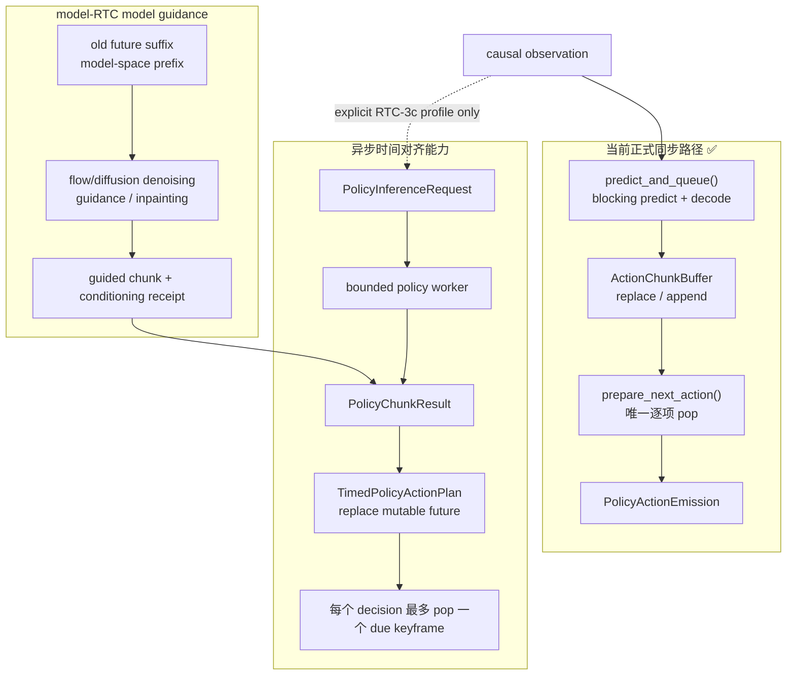

`async_aligned_chunk_v1` 解决 control loop 被 blocking inference 卡住、late result、stale epoch、过期前缀和 mutable
future replacement。`rtc_flow_inpaint_v1` 在其上增加模型 denoising 内的 prefix guidance。把同步 websocket 调用放进
线程只能称为 raw-RTC 异步时间对齐；只有模型实际消费 future prefix/mask 并返回 receipt 才能称为 model-RTC。

因此现有`observation -> final action chunk` server已经足以落地RTC-4b-T和后续no-action shadow；它无需理解RTC envelope。
只有选择非`none` continuation、要求新suffix在生成时受旧future prefix约束时，才进入RTC-4b-B模型推理侧适配。

---

## 3. 现有 action chunk 顺序如何保留

### 3.1 正式同步路径没有切换

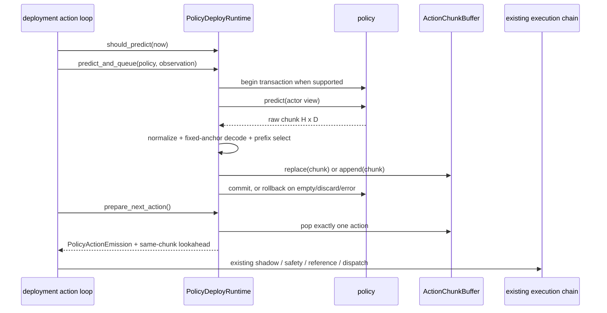

RTC-3b 没有把 `run_policy.py` 改成下图的 split caller；它只准备了可测试的拆分面。

### 3.2 RTC-3b split seam

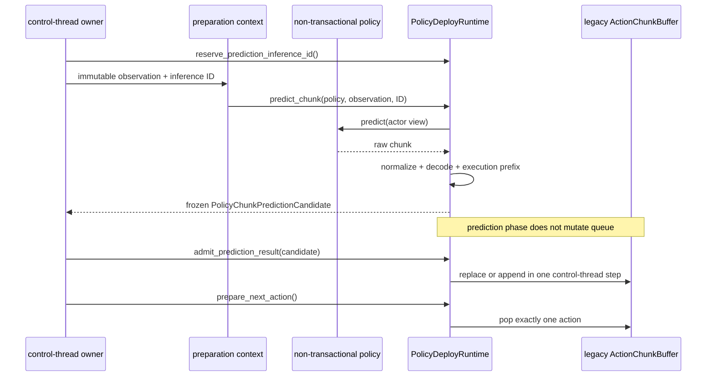

已验证旧同步路径与 split seam 的：

- decoded action 数值和 prefix；
- chunk ID/index/source size/execution steps；
- replace/append 和 queue length；
- same-chunk lookahead 不跨 chunk；
- chunk lineage 与 emission semantic hash；
- pop count 和逐项执行顺序。

candidate 冻结会保留 canonical encoding 中 `list` 与 `tuple` 的类型标签，避免“数值相同但事实 hash 改变”。

### 3.3 replace、append 与 prefix 的准确含义

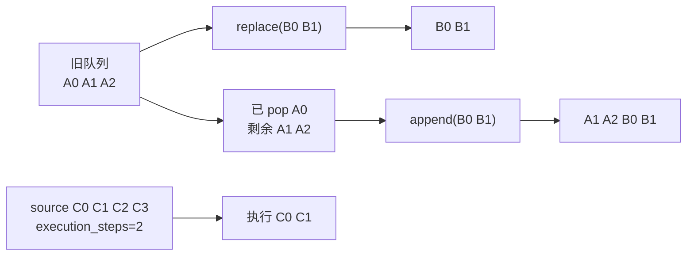

这些仍是 legacy `ActionChunkBuffer` 语义，不是 RTC mutable-future merge。RTC 不能借“append/replace”之名重写已经
committed 的 future keyframe。

### 3.4 debug/replay transaction 保持同步

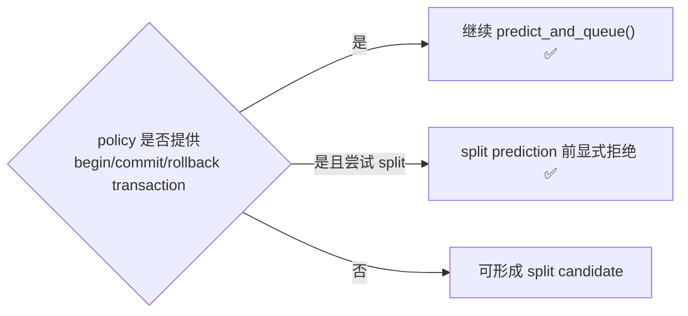

当前没有 worker-owned transaction、control-thread admission ACK/rollback handshake，因此不得把 transactional debug/replay
policy 放进异步 worker。本项目 replay 链路没有因 RTC 被修改。

---

## 4. Legacy queue 与 RTC timed plan 是两个容器

| 属性 | `ActionChunkBuffer` | `TimedPolicyActionPlan` |
|---|---|---|
| 当前 production caller | 有，同步 deploy | 无 |
| 索引 | deque 顺序 | target effective time + cursor |
| 更新 | replace/append 整个 chunk | 保留 executed/committed prefix，替换 mutable future |
| request identity | 无 RTC request/epoch | request/session/domain/producer epoch |
| committed boundary | 无 | 显式 `producer_plan_committed_through` |
| late/stale result | 无专用 merge contract | receiver-side crop/reject/merge receipt |
| pop | 下一个队首 action | 当前 decision cut 唯一 due keyframe |
| 当前作用域 | 正式同步兼容 | pure contract + deterministic sim |

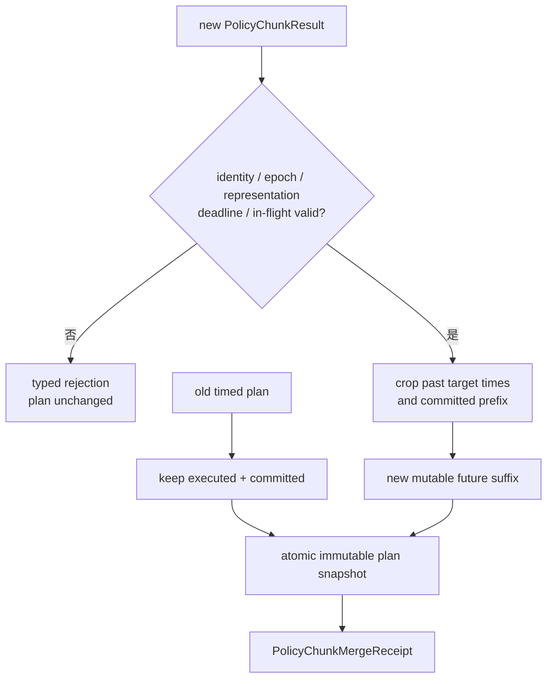

RTC-3b 的 `admit_prediction_result()` 当前只证明拆分后的 legacy queue parity，不等于上图的完整 RTC result admission。
真正 frontend 接线必须把 request/epoch/committed-future 检查绑定到 pure timed-plan contract，不能只把 candidate 追加进 deque。

### 4.1 RTC-3b.5 收敛后的唯一状态机

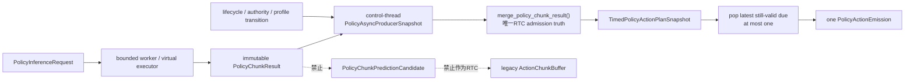

`PolicyChunkPredictionCandidate`和`admit_prediction_result()`继续服务`sync_queue_v1`兼容验证，但不进入RTC-3c。
active request、worker session和timed plan由同一个control-thread snapshot/transition拥有；plan已有的generation/cursor/
committed-through不在frontend复制成第二份可独立写入的状态。

---

## 5. RTC-1 pure 时间与因果 contract

### 5.1 关键时间点

```mermaid
flowchart LR
    Cut["observation.cutoff_at"] --> Trigger["request_triggered_at"]
    Trigger --> Start["inference_started_at"]
    Start --> Complete["inference_completed_at"]
    Complete --> Receive["result_received_at"]
    Receive --> Admit["result_admitted_at"]
    Admit --> Target["keyframe.target_effective_at"]
    Target --> Emitted["keyframe.emitted_at"]
    Emitted --> Proposal["proposal.available_at\nreceiver fact"]
    Proposal --> Command["command scheduled/sent/receipt"]
    Command --> Measure["measurement.sampled_at"]
```

runtime scheduling 只使用显式 local monotonic clock/domain。远端 wall time 可用于相关性和审计，不能决定本地 eligibility。
producer 不能自报 authoritative `available_at`。

### 5.2 delay 不是一个字段

```text
d_forecast_steps = request 时用于 trigger / model guidance 的保守预测
d_elapsed_steps  = result receive 相对 observation cut 的时间估计
s_consumed_steps = request cursor 到当前 cursor 的实际消费量
```

merge 以实际 cursor、target time 和 committed receipt 为准。loop jitter、missed tick、pause 或 lookahead staging 会让
`d_elapsed_steps` 与 `s_consumed_steps` 不一致，不能用一个四舍五入的 `d` 覆盖两者。

### 5.3 trigger 与 coverage

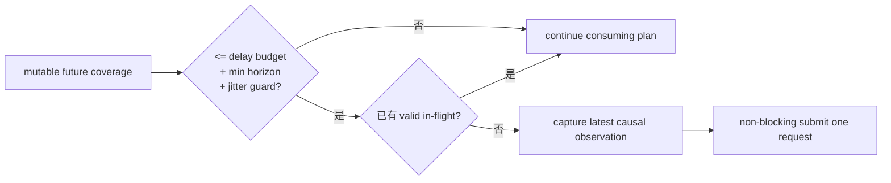

如果 horizon 无法覆盖 delay budget 和 fresh suffix，profile 必须 fail closed 或进入显式 hold/pause/fault；不能在 control
thread 隐式退回 blocking synchronous inference。

---

## 6. RTC-2 deterministic MuJoCo 链路


已覆盖：

- zero/fixed latency、`d=1..4`、under/over forecast；
- result 恰好在 decision cutoff 前/后；
- duplicate/out-of-order/fault/invalid/empty result；
- 29 Hz 非整数 cadence 和 missed-tick no-burst；
- generation 1→2 successor、committed endpoint、pending/active reference；
- HOLD/FAULT/TRANSITIONING 与 completion 竞争；
- qcmd、measured qpos、cancellation 和完整 trace hash 重放。

### HOLD 与晚到 completion

```mermaid
sequenceDiagram
    participant G as execution gate
    participant P as RTC plan owner
    participant E as producer epoch
    participant M as result mailbox

    G->>P: HOLD / FAULT / TRANSITIONING
    P->>G: existing cancel/gate path first
    P->>E: increment producer epoch
    P->>P: clear producer-local timed plan
    Note over M: old completion remains observable; it is not silently deleted
    M-->>P: late old-epoch result
    P-->>M: reject producer_epoch_mismatch + request_not_in_flight
```

这证明 lifecycle invalidation 和 deterministic result admission，不证明真实线程 drain、网络 reconnect 或硬件停止确认。

---

## 7. RTC-3a isolated worker 只负责模型调用

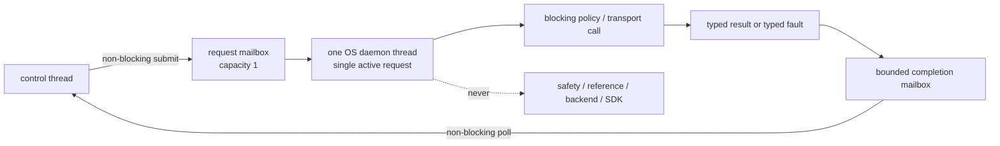

worker 输入绑定 immutable `PolicyInferenceRequest + PolicyObservationView`。异常转换成 typed fault。若 stop timeout 时
blocking call 仍在执行，receipt 明确是 `executing_call_not_drained` 且 `execution_drain_evidence=false`；它不是 M1C/M1D
`WorkerEpochDrainReceipt`。

RTC-4b-T1把transport取消也保持在这个边界内：

```mermaid
sequenceDiagram
    participant C as control / lifecycle owner
    participant W as bounded worker
    participant X as isolated cancel hook
    participant T as session transport

    C->>W: stop(timeout)
    W->>X: dispatch request_cancel once
    X->>T: latch cancel + async close
    T-->>X: cancel receipt; later close-completion receipt
    W-->>C: cancellation receipt + thread_exited fact
    alt thread_exited = false
        C->>C: ABANDONED_UNDRAINED / reject late completion
    else thread_exited = true
        C->>C: worker session DRAINED
        C->>T: begin_session after close completed / fresh reconnect
    end
```

`request_cancel=requested`只表示取消请求已被transport接受，close completion是另一个transport事实，`thread_exited`
才是inference worker drain事实。close pending或失败时`begin_session`必须拒绝。即使第三方
cancel hook本身阻塞，也只会留下`pending` receipt，不能阻塞default zero-timeout control stop。

RTC-4b-T2a把deadline继续限制在可迁移的client transport层：

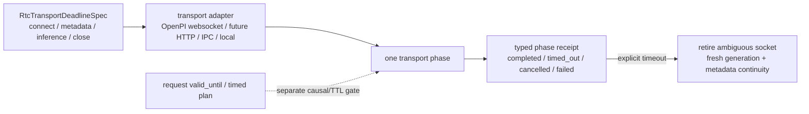

deadline spec不含model/checkpoint/config/action dim/horizon，也不进入capability或server payload。未配置的phase保持具体
transport旧行为；显式超时只拒绝该transport结果，不能生成fallback chunk、推进plan或声称worker drain。OpenPI只是首个
映射实现，实际localhost fixture使用synthetic final chunk且不加载模型。

RTC-4b-T2b只把T2a transport换到一个真实加载的现有server上，仍未接producer或执行链：

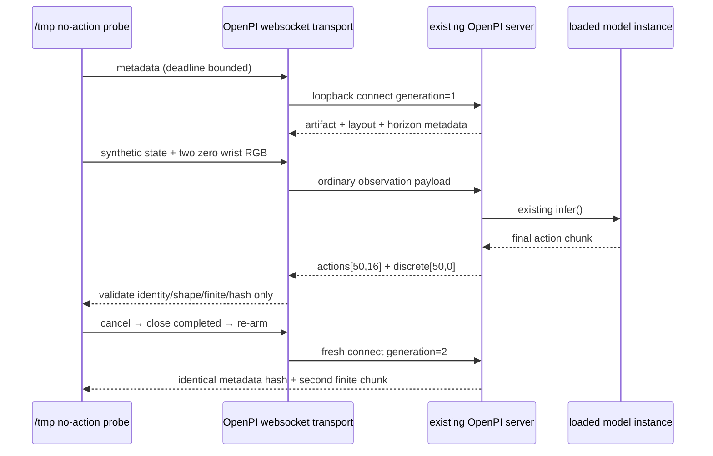

图中的`0712-wrist-cube@92599`只是一条代表性loaded-instance evidence，不是启用谓词。T2b没有导入
`robot_motion`、`teleop_runtime`、`hardware`、`sim`或`control_station`，没有调用planner/safety/executor，也不证明
control loop不阻塞。T2c已在同样synthetic/no-action边界内完成现有bounded worker与唯一timed-plan producer live组合；真实
相机observation仍后置并需要独立scope。

T2c首次组合探针已经暴露并修复了一个真正的adapter边界缺口，同时没有扩大模型或目标依赖：

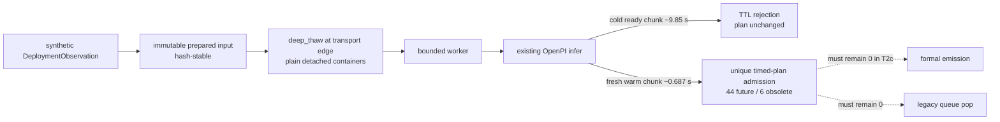

`deep_thaw`不改变prepared fact及其semantic hash，只在调用外部transport前创建plain container副本，因此HTTP、IPC、
本地runtime或其他模型family可以复用同一immutable→wire边界。首次尝试恰遇并行训练占满GPU，typed fault正确fail closed；
资源释放后使用同一artifact/config重新冷启动，cold result只因TTL过期拒绝，fresh warm result一次性形成44-keyframe plan。
320个30 Hz ticks无budget exceed，formal emission与legacy pop均为0；close前plan hash唯一，close后plan归零。完整数值和hash见
T2c scoped evidence，代表性checkpoint仍不进入通用启用条件。

```text
worker 可以做                         worker 不可以做
  blocking model/network call          merge authoritative plan
  bounded result publication           pop action
  typed exception result               safety / IK / reference
  local stop attempt                    backend / SDK dispatch
  preserve request identity             claim execution drain
```

### 7.1 RTC-3c 已接入的单tick顺序

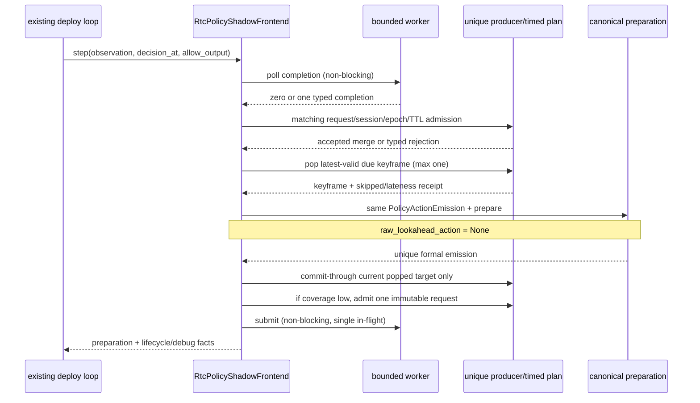

RTC关闭时这条分支不存在，loop继续执行原`predict_and_queue() → ActionChunkBuffer → prepare_next_action()`。
RTC打开时不再调用同步predict，不读写legacy deque；下游仍消费同一个`PolicyActionPreparationResult`，所以arbiter
shadow、canonical safety与dry-run execution观察点不需要建立第二套动作语义。当前debug JSONL只是non-formal
observability，不是M4 durable ControlTrace。

---

## 8. Representation：absolute / relative 分支在 plan 前汇合

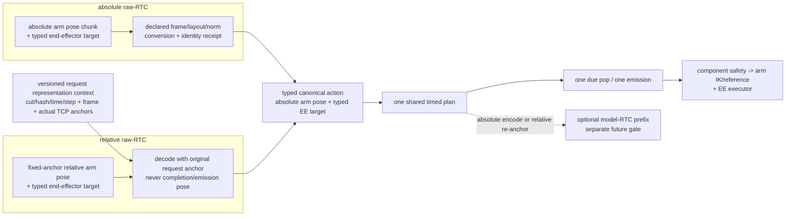

absolute/relative 是 raw-RTC 的 source-representation branch，不是两套 worker 或 scheduler。两条分支进入 plan 前都形成
canonicalization receipt，并收敛为同一 typed canonical action；plan、merge、due-pop、emission、epoch 与 TTL 完全共用。

relative chunk 的整个 chunk 共享原 request observation cut 的左右 actual TCP anchor，不是 row-to-row chained delta。
result 到达较晚时只裁掉过期前缀，不能按 completion/emission 时 measured pose 重锚定。arm pose 的 frame conversion/
re-anchor 不得改变 gripper、Inspire Hand 等 typed end-effector qpos/position target。

当前 result/keyframe 已二选一保存 legacy `NormalizedAction` 或 typed `CanonicalPolicyAction`。R-A1 absolute decoder
在result前绑定source/canonical chunk hash、连续source index与codec/frame/layout/norm/conversion identity；OpenPI只有
显式`typed_canonical_v1`才走native typed分支，默认legacy codec/result不变。MuJoCo/CS-2d direct arm qpos只用于
deterministic scheduler fixture，不是 production RTC schema。model-RTC 的 future prefix encode/re-anchor 位于虚线分支，
不阻塞relative raw-RTC，也不要求现有模型server改接口。

R-R1已将`action_pose_mode`投影进RTC config，并由optional
`PolicyActionRepresentationContext`把relative request与原observation事实绑定。context不进入模型payload；
relative adapter缺builder、context cut/time/contract不一致、decoded arm coverage/frame不一致或control-thread receipt
anchor不匹配时均fail closed。generic virtual-policy已产生typed absolute emission，未读取completion/emission时新pose。

### 8.1 Gold 对照梯子

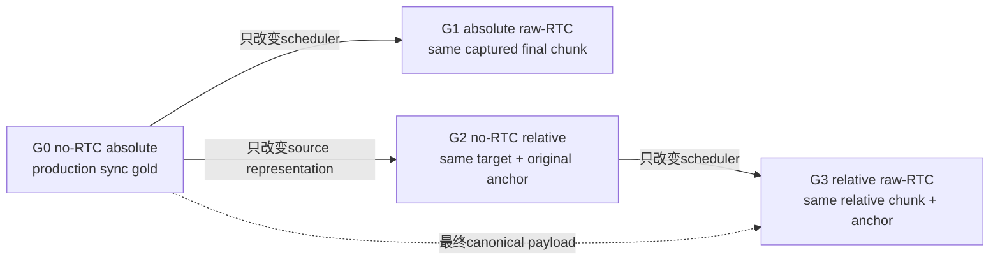

G0由正常无RTC调用捕获的observation cut、final chunk和metadata构成；G1–G3重放同一输入，不重新在线采样。G0↔G1先
隔离scheduler，G0↔G2再隔离relative codec，最后才验G2↔G3。receipt因source mode不同可以不同，但canonical pose、
typed end-effector target、顺序及正式emission必须按比较层级一致。completion时current pose重锚定作为negative control。

---

## 9. RTC-3c 禁用 lookahead；sync 行为不变

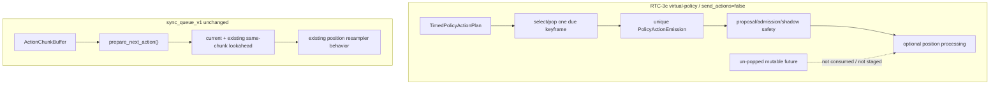

RTC-3c 的 `producer_plan_committed_through` 只覆盖已经pop、已经形成正式emission/admission而不能再被result改写的当前
keyframe，不包含passive future successor。这样新result可替换所有尚未pop的mutable future，不会撞上hidden staged
successor。

```text
RTC-3c: position_lookahead = disabled, scope = RTC profile only
sync_queue_v1: lookahead values/order/pop count/emission hash unchanged
```

RTC lookahead重新启用属于独立`RTC-3d / pre-motion-lookahead gate`：

```mermaid
flowchart LR
    Identity["typed preview identity + valid_until"] --> Safety["canonical safety verdict"]
    Safety --> Accept["downstream acceptance receipt"]
    Accept --> Ref["reference generation / source index"]
    Ref --> Commit["producer commit-through"]
    Commit --> Promote["later identity promotion<br/>without duplicate admission"]
    Promote --> Enable["RTC lookahead may be enabled"]
```

在该链完成前不修改position executor的preview协议；现有`PositionDeployExecutor.submit()`也不能被改称shared
target-time reference admission。

---

## 10. 通用 RTC core、模型 adapter 与 concrete transport 的边界

```mermaid
flowchart TB
    Core["robot_motion.deploy.rtc_protocol\npure capability/envelope/receipt"]
    Client["deployments.client.rtc\nmodel-family-neutral adapter seam"]
    LocalA["deterministic local backend A"]
    LocalB["deterministic local backend B"]
    OpenPI["OpenPI final-chunk adapter\nartifact + fake transport"]
    Other["future ACT/Diffusion/native adapter"]
    Decode["model-space codec\n-> canonical absolute actions"]
    Result["PolicyChunkResult\nno plan authority"]

    Core --> Client
    Client --> LocalA --> Decode
    Client --> LocalB --> Decode
    Client -. "RTC-4b-A final chunk" .-> OpenPI --> Decode
    Client -. "same contract" .-> Other --> Decode
    Decode --> Result
```

RTC-4a不导入Torch/JAX/websocket、sim、teleop或hardware；模型迁移只替换backend与codec，不能改变producer
epoch/timed-plan/due-pop/emission/safety/dispatch。把任意现有`transport.infer()`放进worker只能解除control-loop
blocking；客户端拿到最终chunk后再做blend不能冒充model-RTC guidance。model-RTC必须在声明continuation capability的
具体model backend内实现，并通过通用handshake明确声明：

```text
protocol/mode/guidance implementation
action pose/layout/normalization
horizon / execution horizon / delay units
codec / frame / artifact hashes
conditioning receipt capability
```

缺字段、mode/hash/mask/horizon不匹配时fail closed。不能通过model name猜支持，也不能把通用weighted blend放进Arbiter。
OpenPI只是RTC-4b首个候选adapter，不是RTC协议权威来源。

### 10.1 continuous / discrete 输出不能合并猜测

```mermaid
flowchart LR
    Artifact["PolicyIOLayout"] --> Float["float32 actions [H,Df]"]
    Artifact --> Token["optional int64 tokens [H,Dt]"]
    Float --> Response["RTC response envelope"]
    Token --> Response
    Response --> Decoder["layout-bound decoder"]
    Decoder --> Canonical["canonical absolute actions"]

    Token -. "continuation != none" .-> Block["typed discrete prefix/receipt missing\nfail closed"]
```

RTC-4b-A允许final-chunk `continuation=none`完整携带continuous与discrete输出。不得把token转成float、丢弃或用默认夹爪
值替代。当前conditioning prefix只有continuous矩阵，因此带token的flow/trained/native continuation保持blocked；这是一项
representation gate，不是某个模型家族的特殊限制。

### 10.2 OpenPI 的可选 continuation 接入不是 checkpoint 分支

下图只描述`continuation != none`的RTC-4b-B model-RTC扩展。`continuation=none`的raw-RTC直接调用现有server，不经过本图的
capability wrapper或RTC sampler。

```mermaid
flowchart TB
    Start["OpenPI server startup"] --> Enabled{"explicit RTC enable?"}
    Enabled -- "no (default)" --> Vanilla["existing Policy + sample_actions<br/>existing metadata and websocket"]
    Enabled -- "yes" --> Inspect["inspect loaded model instance<br/>artifact + transforms + norm stats + sample kwargs"]
    Inspect --> Supported{"provider support predicate passes?"}
    Supported -- "no" --> Reject["fail RTC startup with typed reasons<br/>legacy startup remains available"]
    Supported -- "yes" --> Capability["instance-derived immutable capability"]
    Capability --> Wrapper["optional RTC policy wrapper"]
    Wrapper --> Request{"RTC envelope present?"}
    Request -- "no" --> Delegate["delegate original Policy.infer exactly once"]
    Request -- "yes" --> RtcSampler["separate RTC-only sampler<br/>hard prefix projection"]
```

生产判断不得出现 `model_id == ...`、`config_name == ...`、`checkpoint_step == ...`、固定50步/16D/32D或固定15 Hz。
首个provider可以只实现JAX Pi0/Pi0.5 flow sampler，但它按实际接口和表示能力匹配所有兼容实例；其他backend通过新增provider
扩展。unsupported实例在普通部署下不受影响，只在显式RTC请求时fail closed。

```mermaid
flowchart LR
    Prefix["external model-space prefix"] --> ExistingIn["existing action transforms<br/>normalize + pad"]
    ExistingIn --> Internal["internal prefix"]
    Internal --> Flow["existing velocity field<br/>one forward per Euler step"]
    Noise["same initial noise"] --> Flow
    Flow --> Project["project masked rows to<br/>x_known(next_t)"]
    Project --> ExistingOut["existing output transforms"]
    ExistingOut --> Exact["validate/final external prefix projection"]
    Exact --> Receipt["actions + conditioning receipt"]
```

原`sample_actions()`必须保持不动，RTC使用独立JIT入口；未携带RTC envelope的request不得消费额外RNG、预处理两次或触发RTC
compile。RTC capability由当前loaded model、artifact、layout/codec/frame、真实normalization stats、sampling参数、horizon/
dimension生成；model action period来自无默认值的显式RTC profile/artifact字段，并在模型调用前与request精确匹配。
不能写入per-checkpoint registry白名单，也不能原地修改checkpoint。

---

## 11. Sim、real dry-run 与 real authority 的分层

```mermaid
flowchart LR
    Pure["RTC-1 pure contracts ✅"] --> Sim["RTC-2 deterministic sim ✅"]
    Sim --> Worker["RTC-3a isolated worker 🟡"]
    Worker --> Split["RTC-3b split parity ✅"]
    Split --> Closure["RTC-3b.5 single admission truth ✅"]
    Closure --> Dry["RTC-3c virtual no-action local dry-run ✅"]
    Dry --> Generic["RTC-4a generic capability/local loopback ✅"]
    Generic --> Final["RTC-4b-A final chunk / fake transport ✅"]
    Final --> Typed["RTC-5A typed canonical action ⏳"]
    Typed --> Abs["RTC-5B absolute raw-RTC ⏳"]
    Typed --> Rel["RTC-5C relative raw-RTC ⏳"]
    Sim2Real["sim2real-owned observation contract ⏳"] -. "external input only" .-> TargetSim
    Abs --> TargetSim["RTC-5D target-side sim integration ⏳"]
    Rel --> TargetSim
    TargetSim --> RealShadow["RTC-6 real observation / no action shadow ⏳"]
    RealShadow --> Authority["RTC-7 independent real authority ⛔"]
    Dry -. "independent gate" .-> Preview["RTC-3d typed preview/lookahead ⏳"]
    Abs -. "optional later" .-> Server["RTC-4b-B model continuation ⏳"]
    Rel -. "optional later" .-> Server

    M6["non-RTC M5.8/M6 owner + safety + hardware gate"] -. "prerequisite" .-> Authority
```

| 层 | 可以证明 | 不能证明 |
|---|---|---|
| pure contract | identity/time/merge/hash determinism | thread、network、sim physics、real safety |
| deterministic sim | causal admission、one-pop、reference/qcmd/measured lineage | OS scheduling、GPU、network partition、hardware ack |
| isolated worker | bounded mailbox、single in-flight、blocked-call lifecycle | frontend budget、M1C drain、plan correctness、SDK safety |
| no-hardware frontend | control loop不等待、唯一plan admission、epoch/TTL/hold、one-emission、无新增 dispatcher | OpenPI/real latency、typed preview、motion safety、physical stop |
| representation convergence | absolute/relative final chunk收敛为typed canonical pose + EE target | sim observation parity、IK/safety authority、model continuation |
| real no-action shadow | artifact/transport latency与planned action envelope | motion authorization |
| RTC real authority | exact manifest范围内的现场能力 | 其他profile、replay/human/mixed authority |

real-A idle-worker drain/stop-only 现场证据不被 RTC 继承。它没有 target-bearing work、RTC plan、policy transport 或 motion
authority；RTC worker 也不能复用其一次性 authorization/token/WAL。

RTC 不实现 MuJoCo→Real observation。相机/状态拼装、frame alignment、modality parity 与 observation hash由sim2real
并行主线发布；RTC只消费其immutable cut。synthetic qpos observation可继续测试scheduler，但不能代签通用模型输入。

---

## 12. 下一批推荐顺序

```mermaid
flowchart TB
    Evidence["RTC-3b.5-A scoped evidence ✅\n记录并行主线失败，不顺手修"]
    State["RTC-3b.5-B unique producer state ✅\ntimed-plan merge only"]
    Transition["RTC-3b.5-C transition-first ✅\nworker session + late completion"]
    Cadence["RTC-3b.5-D cadence fixture ✅\nRTC lookahead disabled"]
    Due["RTC-3b.5-E stale-due observability ✅\nsemantics unchanged"]
    Budget["decode/merge/control-loop p99 budget ✅"]
    Virtual["virtual policy default-off 240-tick fixture ✅\nsend_actions=false"]
    Trace["formal trace schema only after producer stabilizes"]
    Frontend["RTC-3c local exit review ✅"]
    Capability["RTC-4a generic capability + two local backends ✅"]
    FinalModel["RTC-4b-A final chunk adapter ✅"]
    Typed["R-A0 typed canonical payload ✅\nresult/keyframe/merge/pop"]
    TypedEmission["R-A0c typed emission ✅\nlegacy hash unchanged"]
    TypedSafety["R-A0b typed EE safety ✅\npure/fake profile"]
    TypedPrepare["R-A0d typed preparation ✅\nno backend authority"]
    TypedCaller["typed proposal/target caller ⏳\nreal profile + anchor evidence"]
    Absolute["R-A1 absolute raw-RTC ✅\npure/generic/OpenPI fake"]
    Relative["R-R1 relative raw-RTC ✅\npure/generic frontend"]
    Target["R-S1 target-side sim\nwait for sim2real observation contract"]
    Model["R-M1 optional model-RTC continuation"]
    Green["并行MuJoCo profile/hash恢复全量green"]

    Evidence --> State --> Transition --> Cadence --> Due --> Budget --> Virtual --> Frontend
    Frontend --> Capability --> FinalModel --> Typed --> TypedEmission
    TypedEmission --> TypedSafety --> TypedPrepare --> Absolute --> Relative
    Absolute --> TypedCaller
    Relative --> TypedCaller
    TypedCaller --> Target
    Absolute -. "later" .-> Model
    Relative -. "later" .-> Model
    Virtual -. "later" .-> Trace
    Green -. "签署新的cross-module sim evidence前需要" .-> Frontend
```

### 12.1 RTC-3c local gate 已闭合

第1–6项由RTC-3b.5关闭；第7–10项已由RTC-3c local frontend fixture关闭：

1. `PolicyInferenceRequest/PolicyChunkResult`只进入timed-plan唯一merge；RTC-3b candidate/legacy deque只保留sync parity；
2. pause/HOLD/FAULT/rearm/reconnect/profile change transition先线性化，再处理同tick completion；
3. worker session区分active/retired/abandoned-undrained/drained，旧session completion只可观察/拒绝；
4. RTC profile强制lookahead disabled；所有un-popped future保持mutable，`sync_queue_v1` golden不变；
5. cadence fixture同时覆盖observation/decision/action/request/due-pop/reference/command/measurement时间；
6. stale due继续只取latest valid target，新增selected/skipped/lateness observability，不改pop语义；
7. 测量virtual executor/decode/merge/control-loop budget，未超预算前不引入`PreparedPolicyPlanPatch`；
8. 用虚拟policy做default-off、`send_actions=false`、长时间无设备fixture，并验证TTL/underrun/HOLD/FAULT/late result；
9. worker failure请求显式hold/pause/fault，不在control thread隐式同步fallback；
10. transaction-capable debug/replay继续同步；不修改遥操、采集或replay owner。

### 12.2 RTC-4a/4b-A/T1/T2a/T2b/T2c/T3 已闭合；表示收敛先于model-RTC

- RTC-4a已完成pure capability/envelope/conditioning receipt与v1双轴mapping；
- 两个deterministic local backend已复用同一model-neutral adapter seam，模型迁移不改变request/decoded action；
- wrong capability/hash/mask/horizon已fail-closed；import firewall已覆盖Torch/JAX/websocket/OpenPI/sim/teleop/hardware；
- RTC-4b-A已用artifact-bound fake OpenPI transport验证continuous/discrete final chunk、V22 codec、2/4/8 horizon、
  latency/fault/clock/input/output detach；只声明`continuation=none`；
- RTC-4b-T1已完成local typed cancel、幂等异步close、worker drain区分和session re-arm/reconnect；
- RTC-4b-T2a已完成model-neutral phase deadline/receipt、fake socket鲁棒矩阵和no-model localhost websocket
  final-chunk/reconnect/metadata continuity；不修改模型sampling；
- RTC-4b-T2b已用现有OpenPI model server完成两次synthetic live no-action loopback：loaded-instance
  metadata/artifact/layout/horizon精确一致，50×16 final chunk有限，fresh reconnect metadata hash不变；不接
  worker/timed-plan、真实observation或action send；
- RTC-4b-T2c已完成现有final-chunk adapter、bounded worker和唯一timed-plan producer live组合；wire-thaw、cold TTL拒绝、
  warm single admission、control-side non-blocking和完整drain均已验证；范围仍是synthetic observation、default-off与
  `send_actions=false`；
- RTC-4b-B1 caller-free offline seam已完成，16 passed、2 deselected；V22 adapter 10 passed、3 skipped；
- R-A0 producer payload已落地：以`RobotAction` component为权威，result/keyframe二选一保存legacy或typed payload，
  typed receipt同chunk identity一致，merge/pop不降级，legacy hash golden不变；
- R-A0c typed emission已落地：pop后先形成正式emission；missing safety只阻止preparation，不抹除emission事实；
- R-A0b native safety pure已落地：continuous bounds/step/bounded-rate、discrete token/transition、explicit anchor与
  atomic safe/modified/fault；真实profile数值仍不得猜测；
- R-A0d no-authority preparation已落地；正式proposal/Arbiter/reference/backend caller与anchor lifecycle仍是下一gate；
- native EE target不得cast成26D hand qpos；resolver不能替代safety verdict或downstream acceptance；
- R-A1已验证absolute pose final chunk：generic/OpenPI fake共用chunk-bound receipt，覆盖2/4/8 horizon、frame conversion、
  continuous/discrete typed EE、late completion，默认legacy codec/result不变；
- R-R1已验证original-request-anchor relative final chunk、wrong-current-anchor negative control、typed emission与
  control-thread receipt复核；OpenPI adapter已按structured relative artifact接入同一scheduler并保持server payload不变；
- R-R2已用registered relative `149999/h50`做live synthetic no-action：同一response的sync-relative与RTC-typed
  canonical结果数值完全一致；worker不阻塞control tick，result唯一进入timed plan并只形成一个
  `send_actions=false` emission。真实observation、target/safety/position/dispatch仍未接入；
- R-R3已把双臂、两侧DM-Tac gripper和三路RealSense真实observation送入同一OpenPI raw-RTC worker，1200个step内
  完成30个唯一exchange且零dispatch。当前结果是partial gate：10-step validity使30个结果全部TTL拒绝、零formal
  emission；completion-side最大`103.99 ms`并在close留下`ABANDONED_UNDRAINED`。R-R3b用显式50-step validity和2 s
  bounded close复跑：7个warm result接纳256个future keyframe，240个formal emission全部唯一，仍为零dispatch，
  worker完整`DRAINED`；但8/8 completion step超33.3 ms、最大`101.80 ms`，所以尚不证明实时control budget或可动作部署；
- R-S1只做target-side sim集成，等待sim2real observation contract，不在RTC侧新增MuJoCo→Real observation adapter；
- R-M1再以loaded-instance capability接可选continuation provider、offline dataset与latency/memory profile；
  不使用checkpoint/config白名单，OpenPI只是候选之一，失败不影响raw-RTC；
- `sync_queue_v1`、`async_aligned_chunk_v1`、`rtc_flow_inpaint_v1` 的冻结对比；
- absolute/relative等价canonical target、wrong-current-anchor negative control、typed end-effector identity与完整 trace；
- 可选model-guided delay sweep、chunk-boundary位置/旋转/速度/加速度和task metric。
- scheduler/continuation algorithm在protocol v2分轴；v1 mode ID继续兼容。

### 12.3 RTC-6/7 才允许做的事

- 真实 observation/transport 下的 no-action shadow；
- p99 latency、underrun、source pose mode、canonical pose/post-IK qpos/end-effector envelope和stale-plan audit；
- 独立 RTC execution manifest、worker drain、stop/hold acknowledgement；
- 在新的现场安全范围和用户授权下，从 stationary、低动态、短时、低速逐级扩大。

---

## 13. Lifecycle 与 failure policy

```mermaid
sequenceDiagram
    participant I as tick inputs
    participant S as producer state owner
    participant W as worker mailbox
    participant P as timed plan

    I->>S: gate / authority / profile / session facts
    S->>S: apply transition first
    alt HOLD / FAULT / rearm / reconnect / profile change
        S->>S: increment epoch or session; invalidate request/plan
    end
    S->>W: non-blocking poll completion
    W-->>S: result or fault
    S->>P: admit against post-transition state
    alt old epoch/session/deadline
        P-->>S: typed rejection; plan unchanged
    else current and valid
        P-->>S: immutable new plan + merge receipt
    end
```

worker session状态独立于producer plan availability：

```mermaid
stateDiagram-v2
    [*] --> ACTIVE
    ACTIVE --> RETIRED_WAITING_FOR_COMPLETION: stop/reconnect while infer active
    RETIRED_WAITING_FOR_COMPLETION --> DRAINED: call returns and completion observed
    RETIRED_WAITING_FOR_COMPLETION --> ABANDONED_UNDRAINED: timeout / cannot prove drain
    ABANDONED_UNDRAINED --> DRAINED: eventual completion observed
    DRAINED --> [*]
```

旧session result永远不能进入新session plan。thread stop timeout只证明等待结束，不证明infer call或外部资源已经终止。

每个 profile 必须显式选择：

```text
reject_new_result
expire_remaining_plan_at_TTL
request_hold_or_pause
fault_latch_if_required
```

禁止无限重复最后一个 action、静默当前姿态重锚、`queue.clear()` 冒充 worker drain，或一次网络错误后热切回 blocking sync。

---

## 14. Trace 与性能观测

RTC-0/RTC-3c 可以先记录明确标记为 non-formal 的 debug metrics：

```text
inference latency p50/p95/p99/max
preprocess / queue wait / network / server / model / postprocess
action-loop jitter / overrun
future coverage steps/sec
d_forecast error / deadline miss
obsolete / rejected / merged result count
selected due target / oldest skipped target / target lateness / skipped count
buffer underrun / hold duration
worker session state / retired-undrained duration / late completion count
RTC lookahead disabled assertion; sync lookahead golden hash
```

正式 ControlTrace 需要另行冻结至少以下事件，并复用现有 WAL/seal/commit owner：

```mermaid
flowchart LR
    Req["policy_inference_request"] --> Received["policy_inference_result_received"]
    Received --> Admit["policy_chunk_result_admission"]
    Admit --> Merge["policy_action_plan_merge"]
    Merge --> Emit["existing PolicyActionEmission"]
    Merge --> Invalidate["policy_action_plan_invalidation"]
    Health["policy_worker_health"] --> Received
    Session["policy_worker_session_transition"] --> Health
```

这些事件不能替代 observation cut、proposal/snapshot/decision、safety/reference/command/receipt/measured 或
cancellation/epoch/owner transition。RTC worker 不建立第二个 writer lifecycle。

---

## 15. 不变量与 No-Go

```text
必须一直成立
  one control domain -> one execution fact source
  one startup mode -> exactly one active queue/plan consumer
  one action keyframe -> one pop/select -> one PolicyActionEmission
  whole chunk result -> producer-local plan, not whole-chunk Arbiter admission
  lifecycle/profile/session transition -> before same-tick result admission
  emitted action -> same canonical safety / reference / dispatch chain
  worker -> no safety, backend, SDK or dispatch token
  stale epoch / committed future -> receiver-side fail closed
  runtime schedule -> local monotonic clock
  absolute / relative source -> one typed canonical absolute plan
  relative chunk -> original request fixed chunk-start anchor
  arm pose transform -> never changes typed end-effector target
  RTC-3c future successor -> no passive position staging before emission
```

| 禁止项 | 原因 |
|---|---|
| 修改遥操/replay链来承载 RTC | RTC 是 deployment producer 增量能力，不能改变其他 owner |
| 把整 chunk completion 提前 admission 到 Arbiter | 会绕过 `on_emission_pop_v1` 和逐项 authority/safety |
| 把RTC result经candidate写入legacy deque | 会保留两套request/admission truth并绕过timed-plan committed boundary |
| RTC-3c启用position lookahead | future successor会在正式emission前影响reference；typed preview gate尚未建立 |
| 用 weighted blend 作为 generic merge | action representation、四元数、多模态语义不安全 |
| worker 直接发 SDK | 破坏 owner、permit、safety 和 cancellation contract |
| `sim` import `teleop_runtime` | 违反目录依赖方向 |
| 复用非 RTC M6 或 real-A 授权 | RTC worker/latency/protocol/plan 是新 capability |
| 让RTC补写sim observation adapter | 该契约由sim2real并行负责；重复实现会形成两套frame/input truth |
| 把direct arm qpos fixture提升为production schema | 它只隔离验证scheduler/authority，正式arm action主线是pose |
| 本地测试通过即声称 real-time ready | 缺真实 latency、长稳、worker drain、hardware evidence |

---

## 16. 代码定位

| 层 | 当前位置 | 当前作用域 |
|---|---|---|
| inference request/result | `robot_motion/deploy/inference.py` | RTC-1 pure |
| target-time plan/merge | `robot_motion/deploy/chunk_plan.py` | RTC-1 pure |
| legacy queue + RTC timed emission seam | `robot_motion/deploy/runtime.py` | default sync path + RTC already-popped keyframe preparation；同一emission schema |
| isolated OS worker | `robot_motion/deploy/policy_worker.py` | RTC-3a shared core；bounded、无plan/target |
| unique producer state/profile | `robot_motion/deploy/async_producer.py` | RTC-3b.5 pure/local-only；无I/O |
| default-off coordinator | `robot_motion/deploy/rtc_runtime.py` | RTC-3c shared core；无设备/dispatcher/reference owner；teleop路径仅兼容shim |
| generic RTC v2 capability/protocol | `robot_motion/deploy/rtc_protocol.py`（RTC-4a） | pure；模型/transport/sim/real无关 |
| model-neutral RTC client seam | `deployments/client/rtc.py`（RTC-4a） | local或remote backend + codec；无具体模型字段 |
| model-neutral worker executor | `deployments/client/rtc_executor.py`（RTC-4b-T0） | prepared input→client→result；不创建thread/plan/target |
| model-neutral transport deadline | `deployments/client/rtc_transport.py`（RTC-4b-T2a） | optional phase预算与typed receipt；不含模型/协议字段，不替代request TTL/drain |
| worker/transport lifecycle | `robot_motion/deploy/policy_worker.py`、`deployments/openpi/client/transport.py`（RTC-4b-T1） | typed cancel、begin/cancel与close-completion receipt；worker exit独立证明drain |
| RTC-4a protocol/migration tests | `tests/test_rtc_model_agnostic_protocol.py` | 44 passed；双local backend、continuous/discrete、v1 mapping、optional cancel、fail-closed与import firewall |
| OpenPI final-chunk RTC adapter | `deployments/openpi/client/rtc.py`（RTC-4b-A） | artifact/server/input/output/V22 codec binding；continuation none only |
| OpenPI RTC fake tests | `tests/test_openpi_rtc_final_chunk_adapter.py` | 32 passed；无网络、sim或设备 |
| OpenPI transport lifecycle/deadline tests | `tests/test_openpi_rtc_transport_lifecycle.py`、`tests/test_rtc_transport_deadline_contract.py` | fake websocket；覆盖legacy call shape、timeout/cancel/reconnect；无模型/设备 |
| OpenPI localhost loopback tests | `tests/test_openpi_rtc_localhost_loopback.py` | 实际websocket + synthetic final chunk；无OpenPI model/GPU/observation/action send |
| OpenPI optional model seam | remote `src/openpi/models/pi0.py`、`src/openpi/policies/policy.py` | RTC-4b-B1；独立sampler/infer，default-off且无server caller |
| OpenPI B1 evidence | `todos/evidence/rtc/rtc_4b_b1_openpi_remote_source_evidence_v1.json` | 16 passed、2 deselected；V22 10 passed、3 skipped；Ruff green |
| vla-scratch canonical dataset view | `dataset_interface/vla_scratch.py`（RTC-4b-T2f） | artifact-derived ordered cameras + canonical pose chunk→existing processed keys；无模型/transport/runtime owner |
| vla-scratch dataset-view tests | `tests/test_vla_scratch_dexteleop_dataset_view.py` | 5 passed；完整双臂三相机、history、identity与fail-closed边界 |
| vla-scratch process-boundary probe | `/tmp/dexteleop_vla_scratch_process_boundary_probe.py`（RTC-4b-T2g） | 一个 virtual `BasePolicy` 模型实例 + native `ServePolicy` wrapper + native `ZmqPolicyClient`；独立进程wire-only evidence |
| deterministic RTC sim runner | `sim/mujoco/deploy/rtc_policy.py` | RTC-2 scoped sim |
| deploy application | `teleop_runtime/deploy/run_policy.py` | 默认sync；显式RTC-3c profile调用coordinator且fail-closed为builtin hold/no-action |
| blocking remote policy transport | `deployments/client/remote_policy.py`、OpenPI client transport | 现有final-chunk语义；T2c已有`/tmp` synthetic live worker/plan evidence，仍无production caller、真实observation或action send |
| pure/merge tests | `tests/test_policy_chunk_plan.py` | 18 tests |
| deterministic sim tests | `tests/test_mujoco_rtc_virtual_policy.py` | 18 tests |
| worker lifecycle/integration tests | `tests/test_deploy_rtc_policy_worker.py` | cancellation hook隔离、blocked/late/fault与single-in-flight |
| split parity/order tests | `tests/test_deploy_rtc_prediction_admission.py` | 4 tests |
| producer state/race/profile tests | `tests/test_deploy_rtc_producer_state.py` | 8 tests |
| frontend long-run/lifecycle tests | `tests/test_deploy_rtc_frontend_shadow.py` | 6 tests |
| scoped evidence | `todos/evidence/rtc/rtc_3c_local_evidence_v1.json` | non-formal/local-only |
| RTC-4a scoped evidence | `todos/evidence/rtc/rtc_4a_model_agnostic_local_evidence_v1.json` | non-formal/local-only；无模型/transport/设备 |
| RTC-4b-A scoped evidence | `todos/evidence/rtc/rtc_4b_a_openpi_final_chunk_local_evidence_v1.json` | non-formal/offline fake transport；无server/frontend/sim/设备 |
| RTC-4b-T1 scoped evidence | `todos/evidence/rtc/rtc_4b_t1_transport_lifecycle_local_evidence_v1.json` | non-formal/local fake transport；无live server/真实observation/action send |
| RTC-4b-T2a scoped evidence | `todos/evidence/rtc/rtc_4b_t2a_transport_deadline_local_evidence_v1.json` | non-formal/fake + localhost no-model websocket |
| RTC-4b-T2b scoped evidence | `todos/evidence/rtc/rtc_4b_t2b_openpi_live_no_action_evidence_v1.json` | non-formal/remote existing-server + synthetic observation；无worker/plan/real observation/action send |
| RTC-4b-T2c scoped evidence | `todos/evidence/rtc/rtc_4b_t2c_openpi_live_worker_plan_no_action_evidence_v1.json` | non-formal/remote existing-server + synthetic observation + bounded worker + unique timed plan；零emission/legacy pop/action send |
| OpenPI relative R-R2 live evidence | `todos/evidence/rtc/rtc_rr2_openpi_relative_live_no_action_evidence_v1.json` | registered relative checkpoint + synthetic三相机 + same-chunk sync/RTC gold + bounded worker/timed-plan/单emission；无target/safety/position/dispatch/action send |
| RTC-4b-T2f scoped evidence | `todos/evidence/rtc/rtc_4b_t2f_vla_scratch_dataset_view_local_evidence_v1.json` | non-formal/local synthetic artifact/arrays + unchanged baseline type probe；无真实episode/model/GPU/action send |
| RTC-4b-T2g scoped evidence | `todos/evidence/rtc/rtc_4b_t2g_vla_scratch_process_boundary_virtual_policy_evidence_v1.json` | non-formal/local cross-process one virtual model instance + server wrapper + native ZMQ；无checkpoint/GPU/真实observation/action send |

---

## 17. 推荐阅读路线

```text
只想知道当前能不能用
  -> 第1节当前结论
  -> 第11节分层
  -> 第15节No-Go

要审计 RTC-3c
  -> 第3节顺序兼容
  -> 第4节两个容器
  -> 第5节时间contract
  -> 第9节commit-through
  -> 第12节下一批

要做通用/模型 RTC
  -> 第8节representation
  -> 第10节core/adapter/transport边界
  -> RTC landing plan第9/10/11节

要申请真机
  -> control-core landing plan M5.8/M6
  -> RTC landing plan RTC-6/RTC-7
  -> 新的exact manifest与现场授权
```

本文中的 Mermaid 图只负责帮助阅读。所有运行模式、阈值、hash、authority 和退出条件仍以正式 contract、landing plan、
代码与测试 evidence 为准。
